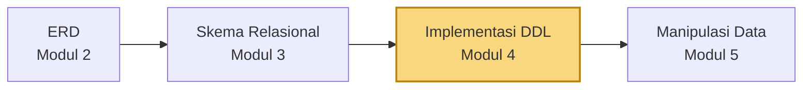
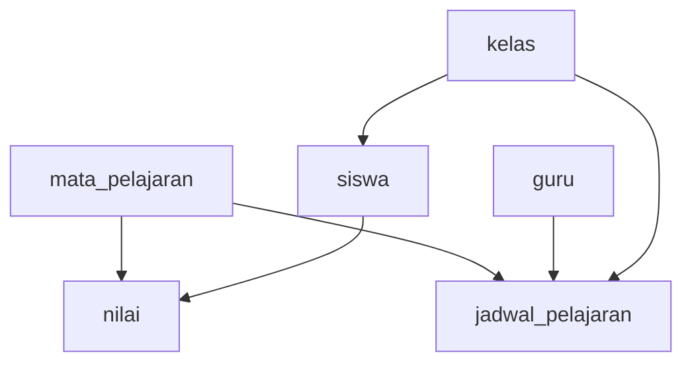

<div align="center">

# 🏗️ Teknologi Basis Data
### Modul Praktikum 4 — Implementasi Struktur Basis Data Menggunakan DDL


**Program Studi Teknologi Informasi · UIN Mataram · 2026**

</div>

---

## 📖 Tentang Modul Ini

Setelah ERD (Modul 2) dan skema relasional (Modul 3), kini rancangan itu **diwujudkan menjadi database sungguhan** dengan **DDL (Data Definition Language)** pada MySQL/MariaDB.

Di modul ini kita membuat database `db_akademiksmahb`, lalu enam tabel SIAKAD SMA Harapan Bangsa lengkap dengan tipe data, **PRIMARY KEY**, **FOREIGN KEY**, dan constraint. Setelah itu struktur tabel diperiksa dan diubah dengan `ALTER TABLE`.



> [!NOTE]
> Modul ini hanya membuat **struktur** (wadah). Mengisi data dengan `INSERT`, `UPDATE`, dan `DELETE` baru dipelajari di Modul 5.

---

## 📑 Daftar Isi

- [Persiapan](#persiapan)
- [1. Cheat Sheet](#1-cheat-sheet)
- [2. Konsep Dasar DDL](#2-konsep-dasar-ddl)
- [3. Urutan Pembuatan Tabel](#3-urutan-pembuatan-tabel)
- [4. Membuat dan Memilih Database](#4-membuat-dan-memilih-database)
- [5. Membuat Tabel](#5-membuat-tabel)
- [6. Memeriksa Tabel](#6-memeriksa-tabel)
- [7. Mengubah Struktur Tabel dengan ALTER](#7-mengubah-struktur-tabel-dengan-alter)
- [8. Menghapus Tabel dengan DROP](#8-menghapus-tabel-dengan-drop)
- [9. Skrip Lengkap](#9-skrip-lengkap)
- [10. Tugas: Implementasi SIAKAD Kampus](#10-tugas-implementasi-siakad-kampus)
- [Catatan dan Koreksi](#catatan-dan-koreksi)
- [Referensi](#referensi)

---

## Persiapan

| Langkah | Yang dilakukan |
|:-:|---|
| 1️⃣ | Buka **XAMPP Control Panel**, klik **Start** pada **Apache** dan **MySQL** |
| 2️⃣ | Pastikan kedua service berstatus aktif |
| 3️⃣ | Buka `http://localhost/phpmyadmin` |
| 4️⃣ | Pilih tab **SQL**, lalu jalankan perintah di bawah ini |

---

## 1. Cheat Sheet

| Kelompok | Perintah | Fungsi |
|---|---|---|
| Database | `CREATE DATABASE nama_db;` | Membuat database |
| | `USE nama_db;` | Memilih database |
| | `SELECT DATABASE();` | Mengecek database aktif |
| Membuat tabel | `CREATE TABLE nama_tabel (...);` | Membuat tabel |
| | `PRIMARY KEY` | Menentukan identitas utama |
| | `FOREIGN KEY` | Membentuk referensi antar-tabel |
| | `REFERENCES` | Menentukan tabel referensi |
| Constraint | `NOT NULL` | Kolom wajib punya nilai |
| | `UNIQUE` | Nilai tidak boleh duplikat |
| | `DEFAULT` | Memberi nilai bawaan |
| | `AUTO_INCREMENT` | Menghasilkan nomor otomatis |
| Memeriksa | `SHOW TABLES;` | Menampilkan semua tabel |
| | `DESCRIBE nama_tabel;` (atau `DESC`) | Menampilkan struktur tabel |
| | `SHOW CREATE TABLE nama_tabel;` | Menampilkan definisi SQL tabel |
| Mengubah | `ALTER TABLE ... ADD` | Menambah kolom |
| | `ALTER TABLE ... MODIFY` | Mengubah definisi kolom |
| | `ALTER TABLE ... CHANGE` | Mengganti nama (dan definisi) kolom |
| | `ALTER TABLE ... DROP COLUMN` | Menghapus kolom |
| Menghapus | `DROP TABLE nama_tabel;` | Menghapus tabel beserta strukturnya |
| | `DROP TABLE IF EXISTS nama_tabel;` | Menghapus tabel hanya jika ada |

---

## 2. Konsep Dasar DDL

### 2.1 Perintah DDL

**DDL (Data Definition Language)** adalah kelompok perintah SQL untuk **mendefinisikan dan mengelola struktur** basis data.

| Perintah | Fungsi |
|---|---|
| `CREATE` | Membuat objek database |
| `ALTER` | Mengubah struktur objek |
| `DROP` | Menghapus objek |
| `TRUNCATE` | Menghapus seluruh **data** dalam tabel tanpa menghapus tabelnya |

### 2.2 Struktur dasar CREATE TABLE

```sql
CREATE TABLE nama_tabel (
    nama_kolom tipe_data constraint,
    nama_kolom tipe_data constraint,
    PRIMARY KEY (nama_kolom)
);
```

Contoh:

```sql
CREATE TABLE siswa (
    nisn       VARCHAR(20)  NOT NULL,
    nama_siswa VARCHAR(100) NOT NULL,
    PRIMARY KEY (nisn)
);
```

### 2.3 Tipe data

Pilih tipe data sesuai karakter nilai yang disimpan.

| Tipe | Fungsi | Contoh |
|---|---|---|
| `VARCHAR(n)` | Teks dengan panjang bervariasi | `nama_siswa VARCHAR(100)` |
| `CHAR(n)` | Teks dengan panjang relatif tetap | `jenis_kelamin CHAR(1)` |
| `INT` | Bilangan bulat | `tingkat INT` |
| `DATE` | Tanggal (`YYYY-MM-DD`) | `tanggal_lahir DATE` |
| `TIME` | Waktu (`HH:MM:SS`) | `jam_mulai TIME` |
| `DECIMAL(p,s)` | Angka desimal yang butuh ketelitian | `nilai_akhir DECIMAL(5,2)` |
| `YEAR` | Nilai tahun untuk kebutuhan tertentu | |

> [!TIP]
> `DECIMAL(5,2)` artinya **total 5 digit, 2 di antaranya di belakang koma**. Jadi nilai terbesar yang bisa disimpan adalah `999.99`.

### 2.4 Primary Key dan Foreign Key

```sql
PRIMARY KEY (nisn)
```

Karakteristik Primary Key: **unik**, **tidak boleh NULL**, dan **dipakai sebagai referensi** tabel lain.

```sql
CONSTRAINT fk_siswa_kelas
    FOREIGN KEY (kode_kelas)
    REFERENCES kelas(kode_kelas)
```

Artinya kolom `kode_kelas` di tabel `siswa` harus berisi nilai yang **sudah ada** di kolom `kode_kelas` tabel `kelas`.

> [!NOTE]
> Foreign Key hanya berfungsi pada engine **InnoDB**, yang merupakan bawaan XAMPP. Pola penamaan constraint di modul ini: `fk_<tabel_anak>_<tabel_induk>`.

### 2.5 Constraint

Constraint adalah aturan pembatas pada kolom atau tabel agar data tetap valid dan konsisten.

| Constraint | Fungsi | Contoh |
|---|---|---|
| `NOT NULL` | Kolom wajib punya nilai | `nama_siswa VARCHAR(100) NOT NULL` |
| `UNIQUE` | Nilai tidak boleh sama dengan record lain | `UNIQUE (nip_nuptk)` |
| `DEFAULT` | Memberi nilai awal otomatis | `status VARCHAR(20) DEFAULT 'Aktif'` |
| `AUTO_INCREMENT` | Menghasilkan nomor otomatis | `id_nilai INT NOT NULL AUTO_INCREMENT` |

---

## 3. Urutan Pembuatan Tabel

> **Foreign Key tidak bisa mengacu ke tabel yang belum ada.** Karena itu **tabel induk dibuat lebih dulu**, baru tabel anak.



*Panah dibaca: "harus dibuat sebelum".*

| Urutan | Tabel | Bergantung pada (tabel induk) |
|:-:|---|---|
| 1 | `kelas` | — |
| 2 | `guru` | — |
| 3 | `mata_pelajaran` | — |
| 4 | `siswa` | `kelas` |
| 5 | `jadwal_pelajaran` | `kelas`, `guru`, `mata_pelajaran` |
| 6 | `nilai` | `siswa`, `mata_pelajaran` |

---

## 4. Membuat dan Memilih Database

```sql
CREATE DATABASE db_akademiksmahb;
USE db_akademiksmahb;
SELECT DATABASE();
```

Hasil `SELECT DATABASE();` harus menampilkan `db_akademiksmahb`. Itu tanda database yang benar sudah aktif sebelum membuat tabel.

> [!TIP]
> Tulis nama database dan nama tabel **dengan huruf kecil semua**. Lihat [Catatan dan Koreksi](#catatan-dan-koreksi) untuk alasannya.

---

## 5. Membuat Tabel

Jalankan satu per satu **sesuai urutan** pada bagian 3.

### 5.1 Tabel `kelas`

```sql
CREATE TABLE kelas (
    kode_kelas   VARCHAR(10) NOT NULL,
    nama_kelas   VARCHAR(50) NOT NULL,
    tahun_ajaran VARCHAR(9)  NOT NULL,

    PRIMARY KEY (kode_kelas)
);
```

### 5.2 Tabel `guru`

```sql
CREATE TABLE guru (
    kode_guru     CHAR(10)     NOT NULL,
    nip_nuptk     CHAR(10),
    nama_guru     VARCHAR(100) NOT NULL,
    jenis_kelamin CHAR(1),
    nomor_telepon CHAR(12),

    PRIMARY KEY (kode_guru),
    UNIQUE (nip_nuptk)
);
```

`UNIQUE (nip_nuptk)` membuat nomor NIP/NUPTK tidak bisa dipakai dua guru. Kolom ini tidak `NOT NULL`, jadi boleh kosong.

### 5.3 Tabel `mata_pelajaran`

```sql
CREATE TABLE mata_pelajaran (
    kode_mapel VARCHAR(10)  NOT NULL,
    nama_mapel VARCHAR(100) NOT NULL,

    PRIMARY KEY (kode_mapel)
);
```

### 5.4 Tabel `siswa`

Memiliki FK ke `kelas`, jadi `kelas` harus sudah ada.

```sql
CREATE TABLE siswa (
    nisn          VARCHAR(20)  NOT NULL,
    nama_siswa    VARCHAR(100) NOT NULL,
    jenis_kelamin CHAR(1)      NOT NULL,
    tanggal_lahir DATE,
    alamat        VARCHAR(200),
    kode_kelas    VARCHAR(10)  NOT NULL,

    PRIMARY KEY (nisn),

    CONSTRAINT fk_siswa_kelas
        FOREIGN KEY (kode_kelas)
        REFERENCES kelas(kode_kelas)
);
```

### 5.5 Tabel `jadwal_pelajaran`

Memiliki **tiga FK**: ke `kelas`, `guru`, dan `mata_pelajaran`.

```sql
CREATE TABLE jadwal_pelajaran (
    kode_jadwal VARCHAR(15) NOT NULL,
    kode_kelas  VARCHAR(10) NOT NULL,
    kode_guru   CHAR(10)    NOT NULL,
    kode_mapel  VARCHAR(10) NOT NULL,
    hari        VARCHAR(10) NOT NULL,
    jam_mulai   TIME        NOT NULL,
    jam_selesai TIME        NOT NULL,
    ruang       VARCHAR(30),

    PRIMARY KEY (kode_jadwal),

    CONSTRAINT fk_jadwal_kelas
        FOREIGN KEY (kode_kelas)
        REFERENCES kelas(kode_kelas),

    CONSTRAINT fk_jadwal_guru
        FOREIGN KEY (kode_guru)
        REFERENCES guru(kode_guru),

    CONSTRAINT fk_jadwal_mapel
        FOREIGN KEY (kode_mapel)
        REFERENCES mata_pelajaran(kode_mapel)
);
```

> [!NOTE]
> Tipe kolom FK **harus sama** dengan kolom PK yang diacu. `kode_guru` di sini `CHAR(10)` karena PK di tabel `guru` juga `CHAR(10)`.

### 5.6 Tabel `nilai`

Tabel penghubung antara `siswa` dan `mata_pelajaran`. Memakai `AUTO_INCREMENT` sebagai Primary Key.

```sql
CREATE TABLE nilai (
    id_nilai    INT          NOT NULL AUTO_INCREMENT,
    nisn        VARCHAR(20)  NOT NULL,
    kode_mapel  VARCHAR(10)  NOT NULL,
    semester    VARCHAR(10)  NOT NULL,
    nilai_tugas DECIMAL(5,2),
    nilai_uts   DECIMAL(5,2),
    nilai_uas   DECIMAL(5,2),
    nilai_akhir DECIMAL(5,2),

    PRIMARY KEY (id_nilai),

    CONSTRAINT fk_nilai_siswa
        FOREIGN KEY (nisn)
        REFERENCES siswa(nisn),

    CONSTRAINT fk_nilai_mapel
        FOREIGN KEY (kode_mapel)
        REFERENCES mata_pelajaran(kode_mapel)
);
```

`id_nilai` akan terisi otomatis (1, 2, 3, ...) setiap ada data nilai baru, jadi tidak perlu diisi manual.

---

## 6. Memeriksa Tabel

### 6.1 Menampilkan seluruh tabel

```sql
SHOW TABLES;
```

Hasil yang diharapkan, enam tabel:

| Tables_in_db_akademiksmahb |
|---|
| guru |
| jadwal_pelajaran |
| kelas |
| mata_pelajaran |
| nilai |
| siswa |

### 6.2 Memeriksa struktur setiap tabel

```sql
DESCRIBE kelas;
DESCRIBE siswa;
DESCRIBE guru;
DESCRIBE mata_pelajaran;
DESCRIBE jadwal_pelajaran;
DESCRIBE nilai;
```

`DESC` adalah singkatan dari `DESCRIBE`, hasilnya sama.

### 6.3 Melihat sintaks pembentuk tabel

```sql
SHOW CREATE TABLE siswa;
```

Menampilkan perintah `CREATE TABLE` lengkap, termasuk nama constraint dan engine yang dipakai. Isinya bisa berbeda tergantung versi DBMS.

### 6.4 Cara membaca hasil DESCRIBE

| Kolom | Arti |
|---|---|
| `Field` | Nama kolom |
| `Type` | Tipe data |
| `Null` | `NO` = wajib diisi (`NOT NULL`), `YES` = boleh kosong |
| `Key` | `PRI` = Primary Key, `UNI` = Unique, `MUL` = kolom berindeks yang nilainya boleh berulang (umumnya Foreign Key) |
| `Default` | Nilai bawaan kolom |
| `Extra` | Keterangan tambahan, misalnya `auto_increment` |

### 6.5 Hasil yang diharapkan

<details>
<summary><b>kelas</b></summary>

| Field | Type | Null | Key | Default | Extra |
|---|---|:-:|:-:|---|---|
| kode_kelas | varchar(10) | NO | PRI | NULL | |
| nama_kelas | varchar(50) | NO | | NULL | |
| tahun_ajaran | varchar(9) | NO | | NULL | |

</details>

<details>
<summary><b>guru</b></summary>

| Field | Type | Null | Key | Default | Extra |
|---|---|:-:|:-:|---|---|
| kode_guru | char(10) | NO | PRI | NULL | |
| nip_nuptk | char(10) | YES | UNI | NULL | |
| nama_guru | varchar(100) | NO | | NULL | |
| jenis_kelamin | char(1) | YES | | NULL | |
| nomor_telepon | char(12) | YES | | NULL | |

</details>

<details>
<summary><b>mata_pelajaran</b></summary>

| Field | Type | Null | Key | Default | Extra |
|---|---|:-:|:-:|---|---|
| kode_mapel | varchar(10) | NO | PRI | NULL | |
| nama_mapel | varchar(100) | NO | | NULL | |

</details>

<details>
<summary><b>siswa</b></summary>

| Field | Type | Null | Key | Default | Extra |
|---|---|:-:|:-:|---|---|
| nisn | varchar(20) | NO | PRI | NULL | |
| nama_siswa | varchar(100) | NO | | NULL | |
| jenis_kelamin | char(1) | NO | | NULL | |
| tanggal_lahir | date | YES | | NULL | |
| alamat | varchar(200) | YES | | NULL | |
| kode_kelas | varchar(10) | NO | MUL | NULL | |

</details>

<details>
<summary><b>jadwal_pelajaran</b></summary>

| Field | Type | Null | Key | Default | Extra |
|---|---|:-:|:-:|---|---|
| kode_jadwal | varchar(15) | NO | PRI | NULL | |
| kode_kelas | varchar(10) | NO | MUL | NULL | |
| kode_guru | char(10) | NO | MUL | NULL | |
| kode_mapel | varchar(10) | NO | MUL | NULL | |
| hari | varchar(10) | NO | | NULL | |
| jam_mulai | time | NO | | NULL | |
| jam_selesai | time | NO | | NULL | |
| ruang | varchar(30) | YES | | NULL | |

</details>

<details>
<summary><b>nilai</b></summary>

| Field | Type | Null | Key | Default | Extra |
|---|---|:-:|:-:|---|---|
| id_nilai | int(11) | NO | PRI | NULL | auto_increment |
| nisn | varchar(20) | NO | MUL | NULL | |
| kode_mapel | varchar(10) | NO | MUL | NULL | |
| semester | varchar(10) | NO | | NULL | |
| nilai_tugas | decimal(5,2) | YES | | NULL | |
| nilai_uts | decimal(5,2) | YES | | NULL | |
| nilai_uas | decimal(5,2) | YES | | NULL | |
| nilai_akhir | decimal(5,2) | YES | | NULL | |

</details>

> [!NOTE]
> Tampilan tipe `INT` bisa berbeda antar versi (`int(11)` atau `int`).

### 6.6 Membandingkan dengan skema Modul 2 dan 3

Modul meminta hasil implementasi dibandingkan dengan skema relasional. Ada beberapa perbedaan:

| Tabel | Pada ERD/skema sebelumnya | Pada implementasi Modul 4 |
|---|---|---|
| `kelas` | Ada kolom `tingkat` | Tidak ada |
| `guru` | Ada kolom `alamat` | Tidak ada |
| `guru` | Kolom telepon `nomor_telephone` | Bernama `nomor_telepon` |
| `siswa` | Ada kolom telepon | Tidak ada |
| `nilai` | PK usulan `kode_nilai` | PK `id_nilai` (`INT AUTO_INCREMENT`) |
| Lainnya | | Sama |

<details>
<summary>Opsional: menambahkan kolom yang belum ada</summary>

Jika dosen menginginkan implementasi yang persis sama dengan skema, kolom yang belum ada bisa ditambahkan dengan `ALTER TABLE`:

```sql
ALTER TABLE kelas ADD tingkat INT;
ALTER TABLE guru  ADD alamat VARCHAR(200);
ALTER TABLE siswa ADD nomor_telepon CHAR(12);
```

</details>

---

## 7. Mengubah Struktur Tabel dengan ALTER

Semua contoh memakai tabel `siswa`. Setelah setiap perubahan, periksa dengan `DESCRIBE siswa;`.

### 7.1 Menambah kolom

Kasus: sekolah ingin menyimpan email siswa.

```sql
ALTER TABLE siswa
ADD email VARCHAR(100);
```

### 7.2 Mengubah definisi kolom

Kasus: kolom `alamat` dianggap terlalu pendek.

```sql
ALTER TABLE siswa
MODIFY alamat VARCHAR(255);
```

### 7.3 Menambah kolom dengan nilai default

Kasus: tambah kolom status siswa.

```sql
ALTER TABLE siswa
ADD status VARCHAR(20) DEFAULT 'Aktif';
```

### 7.4 Mengganti nama kolom

Kasus: `nama_siswa` diganti menjadi `nama_pesertadidik`.

```sql
ALTER TABLE siswa
CHANGE nama_siswa nama_pesertadidik VARCHAR(100);
```

> [!WARNING]
> `CHANGE` dan `MODIFY` **menimpa seluruh definisi kolom**. Karena perintah di atas tidak menyebut `NOT NULL`, kolom `nama_pesertadidik` jadi **boleh kosong** (`Null = YES` pada hasil `DESCRIBE`), padahal sebelumnya wajib diisi. Agar aturan lama tidak hilang, tulis ulang constraint-nya:
>
> ```sql
> ALTER TABLE siswa
> CHANGE nama_siswa nama_pesertadidik VARCHAR(100) NOT NULL;
> ```

### 7.5 Menghapus kolom

Kasus: kolom `email` dihapus.

```sql
ALTER TABLE siswa
DROP COLUMN email;
```

### 7.6 Ringkasan perbedaan perintah ALTER

| Perintah | Fungsi | Mengubah nama kolom? |
|---|---|:-:|
| `ADD` | Menambah kolom baru | — |
| `MODIFY` | Mengubah tipe/constraint kolom | ❌ |
| `CHANGE` | Mengubah nama **dan** definisi kolom | ✅ |
| `DROP COLUMN` | Menghapus kolom | — |

### 7.7 Struktur akhir `siswa` setelah semua perubahan

Sesuai hasil pada modul (dengan perintah `CHANGE` tanpa `NOT NULL`):

| Field | Type | Null | Key | Default |
|---|---|:-:|:-:|---|
| nisn | varchar(20) | NO | PRI | NULL |
| nama_pesertadidik | varchar(100) | YES | | NULL |
| jenis_kelamin | char(1) | NO | | NULL |
| tanggal_lahir | date | YES | | NULL |
| alamat | varchar(255) | YES | | NULL |
| kode_kelas | varchar(10) | NO | MUL | NULL |
| status | varchar(20) | YES | | Aktif |

> [!IMPORTANT]
> Tabel `siswa` akan dipakai lagi di Modul 5. Perhatikan bahwa kolom nama sekarang bernama `nama_pesertadidik`. Kalau ingin kembali ke nama semula:
>
> ```sql
> ALTER TABLE siswa
> CHANGE nama_pesertadidik nama_siswa VARCHAR(100) NOT NULL;
> ```

---

## 8. Menghapus Tabel dengan DROP

`DROP TABLE` menghapus tabel **beserta strukturnya**.

> [!CAUTION]
> **Jangan jalankan `DROP TABLE` pada tabel utama praktikum.** Gunakan tabel percobaan.

```sql
-- 1. Buat tabel percobaan
CREATE TABLE tabel_percobaan (
    id_percobaan INT PRIMARY KEY
);

-- 2. Periksa: tabel_percobaan muncul di daftar tabel
SHOW TABLES;

-- 3. Hapus
DROP TABLE tabel_percobaan;

-- 4. Periksa lagi: tabel_percobaan sudah hilang
SHOW TABLES;
```

Versi aman yang tidak error jika tabel tidak ada:

```sql
DROP TABLE IF EXISTS tabel_percobaan;
```

| Perintah | Tabel ada | Tabel tidak ada |
|---|---|---|
| `DROP TABLE x;` | ✅ Dihapus | ❌ Error |
| `DROP TABLE IF EXISTS x;` | ✅ Dihapus | ✅ Aman, tanpa error |

> [!TIP]
> Urutan menghapus tabel adalah **kebalikan** dari urutan membuatnya: tabel anak dulu, baru tabel induk.

---

## 9. Skrip Lengkap

Seluruh langkah praktikum dalam satu skrip. Jalankan **sekali** pada database baru.

```sql
-- ============================================
-- MODUL 4 : IMPLEMENTASI DDL - SIAKAD SMA
-- ============================================

-- 1. Database
CREATE DATABASE db_akademiksmahb;
USE db_akademiksmahb;
SELECT DATABASE();

-- 2. Tabel induk
CREATE TABLE kelas (
    kode_kelas   VARCHAR(10) NOT NULL,
    nama_kelas   VARCHAR(50) NOT NULL,
    tahun_ajaran VARCHAR(9)  NOT NULL,
    PRIMARY KEY (kode_kelas)
);

CREATE TABLE guru (
    kode_guru     CHAR(10)     NOT NULL,
    nip_nuptk     CHAR(10),
    nama_guru     VARCHAR(100) NOT NULL,
    jenis_kelamin CHAR(1),
    nomor_telepon CHAR(12),
    PRIMARY KEY (kode_guru),
    UNIQUE (nip_nuptk)
);

CREATE TABLE mata_pelajaran (
    kode_mapel VARCHAR(10)  NOT NULL,
    nama_mapel VARCHAR(100) NOT NULL,
    PRIMARY KEY (kode_mapel)
);

-- 3. Tabel anak
CREATE TABLE siswa (
    nisn          VARCHAR(20)  NOT NULL,
    nama_siswa    VARCHAR(100) NOT NULL,
    jenis_kelamin CHAR(1)      NOT NULL,
    tanggal_lahir DATE,
    alamat        VARCHAR(200),
    kode_kelas    VARCHAR(10)  NOT NULL,
    PRIMARY KEY (nisn),
    CONSTRAINT fk_siswa_kelas
        FOREIGN KEY (kode_kelas) REFERENCES kelas(kode_kelas)
);

CREATE TABLE jadwal_pelajaran (
    kode_jadwal VARCHAR(15) NOT NULL,
    kode_kelas  VARCHAR(10) NOT NULL,
    kode_guru   CHAR(10)    NOT NULL,
    kode_mapel  VARCHAR(10) NOT NULL,
    hari        VARCHAR(10) NOT NULL,
    jam_mulai   TIME        NOT NULL,
    jam_selesai TIME        NOT NULL,
    ruang       VARCHAR(30),
    PRIMARY KEY (kode_jadwal),
    CONSTRAINT fk_jadwal_kelas
        FOREIGN KEY (kode_kelas) REFERENCES kelas(kode_kelas),
    CONSTRAINT fk_jadwal_guru
        FOREIGN KEY (kode_guru) REFERENCES guru(kode_guru),
    CONSTRAINT fk_jadwal_mapel
        FOREIGN KEY (kode_mapel) REFERENCES mata_pelajaran(kode_mapel)
);

CREATE TABLE nilai (
    id_nilai    INT          NOT NULL AUTO_INCREMENT,
    nisn        VARCHAR(20)  NOT NULL,
    kode_mapel  VARCHAR(10)  NOT NULL,
    semester    VARCHAR(10)  NOT NULL,
    nilai_tugas DECIMAL(5,2),
    nilai_uts   DECIMAL(5,2),
    nilai_uas   DECIMAL(5,2),
    nilai_akhir DECIMAL(5,2),
    PRIMARY KEY (id_nilai),
    CONSTRAINT fk_nilai_siswa
        FOREIGN KEY (nisn) REFERENCES siswa(nisn),
    CONSTRAINT fk_nilai_mapel
        FOREIGN KEY (kode_mapel) REFERENCES mata_pelajaran(kode_mapel)
);

-- 4. Periksa
SHOW TABLES;
DESCRIBE kelas;
DESCRIBE siswa;
DESCRIBE guru;
DESCRIBE mata_pelajaran;
DESCRIBE jadwal_pelajaran;
DESCRIBE nilai;
SHOW CREATE TABLE siswa;

-- 5. ALTER TABLE pada siswa
ALTER TABLE siswa ADD email VARCHAR(100);
ALTER TABLE siswa MODIFY alamat VARCHAR(255);
ALTER TABLE siswa ADD status VARCHAR(20) DEFAULT 'Aktif';
ALTER TABLE siswa CHANGE nama_siswa nama_pesertadidik VARCHAR(100) NOT NULL;
ALTER TABLE siswa DROP COLUMN email;
DESCRIBE siswa;

-- 6. DROP TABLE pada tabel percobaan
CREATE TABLE tabel_percobaan (
    id_percobaan INT PRIMARY KEY
);
DROP TABLE tabel_percobaan;
SHOW TABLES;
```

---

## 10. Tugas: Implementasi SIAKAD Kampus

Implementasikan **skema relasional SIAKAD Kampus** (hasil Modul 3) ke MySQL/MariaDB. Sintaks SQL final **tidak diberikan**. Kamu menyusunnya sendiri dari ERD dan skema relasionalmu.

### 10.1 Yang harus dikerjakan

- [ ] Membuat database untuk Sistem Informasi Akademik Kampus
- [ ] Menentukan **urutan pembuatan tabel**
- [ ] Menentukan **tipe data** setiap field
- [ ] Menentukan **Primary Key**
- [ ] Menentukan **Foreign Key**
- [ ] Menggunakan `NOT NULL` sesuai kebutuhan
- [ ] Menggunakan `UNIQUE` jika diperlukan
- [ ] Menggunakan `DEFAULT` jika sesuai
- [ ] Membuat seluruh tabel dengan `CREATE TABLE`
- [ ] Memeriksa dengan `SHOW TABLES`
- [ ] Memeriksa setiap struktur dengan `DESCRIBE`
- [ ] Menampilkan **minimal tiga tabel** dengan `SHOW CREATE TABLE`

### 10.2 Hasil pengerjaan

<!--
Setelah selesai, simpan skrip SQL (misalnya tugas/siakad_kampus.sql) dan tangkapan layar hasil
SHOW TABLES / DESCRIBE ke folder images/, lalu tautkan di sini, misalnya:


-->

*Tambahkan skrip SQL dan tangkapan layar hasil pengerjaan di sini.*

---

## Catatan dan Koreksi

Beberapa hal pada modul asli yang perlu diperhatikan. Sebagian sudah disesuaikan di README ini, sebagian lagi hanya perlu kamu ketahui:

| Bagian modul | Catatan |
|---|---|
| Penulisan nama | Modul menulis `db_AkademikSMAHB` lalu memakai `db_akademiksmahb`, dan membuat tabel `Guru` (huruf besar) tetapi merujuknya sebagai `guru`. Di Windows ini tidak jadi masalah, tetapi di Linux/macOS nama database dan tabel **peka huruf besar/kecil**, sehingga `REFERENCES guru(...)` akan gagal. README memakai huruf kecil semua. |
| Sintaks umum `CREATE TABLE` | Pada bagian teori, baris kolom terakhir tidak diakhiri koma dan tertulis `PRIMARY KEY (PK)`. README menuliskan bentuk yang benar. |
| Penulisan `UINQUE` | Salah ketik pada tabel constraint. Yang benar `UNIQUE`. |
| `CHANGE` menghapus `NOT NULL` | Pada langkah mengganti nama kolom, `nama_pesertadidik` menjadi `Null = YES`. Lihat peringatan di bagian 7.4. README memakai versi dengan `NOT NULL` pada skrip lengkap. |
| Kolom berbeda dari Modul 3 | Kolom `tingkat`, `guru.alamat`, dan kolom telepon `siswa` tidak ada di implementasi, serta `nomor_telephone` menjadi `nomor_telepon`. Lihat bagian 6.6. |
| PK tabel `nilai` | Modul memakai `id_nilai`, sedangkan README Modul 2 dan 3 mengusulkan `kode_nilai`. Untuk implementasi, ikuti `id_nilai`. |
| `nip_nuptk CHAR(10)` | Terlalu pendek untuk nomor sungguhan (NIP berisi 18 digit, NUPTK 16 digit). Untuk data riil, pertimbangkan misalnya `VARCHAR(20)`. Begitu pula `nomor_telepon CHAR(12)` yang bisa kurang bila memakai awalan `+62`. |
| Tabel `nilai` bisa berisi duplikat | Tidak ada aturan yang mencegah satu siswa punya dua baris nilai untuk mapel dan semester yang sama. Kalau diinginkan, bisa ditambah `ALTER TABLE nilai ADD CONSTRAINT uq_nilai UNIQUE (nisn, kode_mapel, semester);` |

---

## Referensi

- Modul Praktikum 4 *Teknologi Basis Data* — Muti'ah, M.Pd, Program Studi Teknologi Informasi, UIN Mataram, 2026.
- Elmasri, R., & Navathe, S. B. *Fundamentals of Database Systems*. Pearson.
- Connolly, T., & Begg, C. *Database Systems: A Practical Approach to Design, Implementation, and Management*. Pearson.
- [MySQL Reference Manual](https://dev.mysql.com/doc/)
- [MariaDB Server Documentation](https://mariadb.com/kb/en/documentation/)

---

<div align="center">

[⬅️ Modul 3: Transformasi ERD menjadi Skema Relasional](../Modul-3/README.md)

Dibuat untuk keperluan belajar oleh [@akramjunaidi](https://github.com/akramjunaidi)

⭐ Kalau bermanfaat, jangan lupa beri bintang!

</div>
