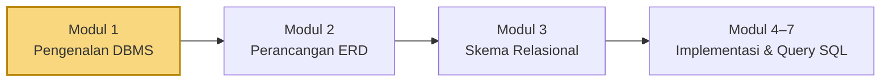
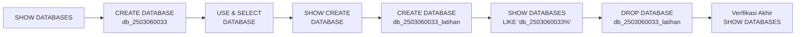

<div align="center">

# 🗄️ Teknologi Basis Data
### Modul Praktikum 1 — Pengenalan Sistem Basis Data dan DBMS


**Akram Junaidi (`2503060033`) · Program Studi Teknologi Informasi · UIN Mataram · 2026**

</div>

---

## 📖 Tentang Modul Ini

Repository ini merupakan dokumentasi praktikum pribadi pada mata kuliah **Teknologi Basis Data** (Dosen Pengampu: **Muti'ah, M.Pd.**). Pada **Modul 1**, fokus pengerjaan adalah memahami arsitektur dasar sistem basis data, mengenali lingkungan server **MySQL/MariaDB** melalui **XAMPP** dan **phpMyAdmin**, serta melakukan operasi pengelolaan *database* (membuat, memeriksa metadata, memilih *database* aktif, mencari pola nama, dan menghapus *database* sementara).

Tahap ini menjadi fondasi administrasi sebelum masuk ke tahap perancangan konseptual ERD (Modul 2), skema relasional (Modul 3), hingga pembangunan struktur dan isi basis data utama **`db_akademikkampus`** (Modul 4–7).



> [!NOTE]
> Pada modul ini belum dibuat tabel maupun rekaman data. Fokus utama adalah memastikan server database berjalan stabil dan perintah dasar DDL pengelolaan *database* (`db_2503060033`) dieksekusi dengan benar.

---

## 📑 Daftar Isi

- [Persiapan Lingkungan Kerja](#persiapan-lingkungan-kerja)
- [Cheat Sheet Perintah Modul 1](#cheat-sheet-perintah-modul-1)
- [1. Informasi Database Server](#1-informasi-database-server)
- [2. Membuat Database](#2-membuat-database)
- [3. Melihat dan Mencari Database](#3-melihat-dan-mencari-database)
- [4. Memilih Database Aktif](#4-memilih-database-aktif)
- [5. Menghapus Database](#5-menghapus-database)
- [6. Eksekusi Tugas Praktikum Mandiri (`db_2503060033`)](#6-eksekusi-tugas-praktikum-mandiri-db_2503060033)
- [7. Kategori Perintah SQL](#7-kategori-perintah-sql)
- [8. Refleksi dan Catatan Koreksi](#8-refleksi-dan-catatan-koreksi)
- [Referensi](#referensi)

---

## Persiapan Lingkungan Kerja

Sebelum menjalankan perintah SQL apa pun, pastikan layanan *web server* dan *database server* pada perangkat lokal sudah aktif:

| Langkah | Aktivitas yang Dilakukan | Keterangan / Hasil |
|:-:|---|---|
| 1️⃣ | Buka **XAMPP Control Panel** | Jalankan pada lingkungan lokal (`127.0.0.1`) |
| 2️⃣ | Klik **Start** pada modul **Apache** dan **MySQL** | Apache berjalan di port `80, 443` dan MySQL di port `3306` |
| 3️⃣ | Buka peramban dan akses `http://localhost/phpmyadmin` | Antarmuka **phpMyAdmin v5.2.1** siap digunakan |
| 4️⃣ | Pilih tab **SQL** | Siap mengeksekusi perintah administrasi database |

> [!WARNING]
> Pada panel kiri phpMyAdmin terdapat database sistem bawaan seperti `information_schema`, `mysql`, `performance_schema`, `phpmyadmin`, dan `test`. **Jangan menghapus atau mengubah struktur database bawaan tersebut** karena dibutuhkan oleh sistem DBMS.

---

## Cheat Sheet Perintah Modul 1

Rangkuman seluruh perintah SQL yang digunakan pada Modul 1:

| # | Perintah SQL | Fungsi |
|:-:|---|---|
| 1 | `SELECT VERSION();` | Menampilkan versi server MySQL/MariaDB |
| 2 | `SELECT USER();` | Menampilkan akun pengguna yang sedang login |
| 3 | `SELECT NOW();` | Menampilkan tanggal dan waktu aktif pada server |
| 4 | `CREATE DATABASE nama_db;` | Membuat database baru |
| 5 | `CREATE DATABASE IF NOT EXISTS nama_db;` | Membuat database hanya jika belum tersedia (aman) |
| 6 | `SHOW DATABASES;` | Menampilkan seluruh daftar database pada server |
| 7 | `SHOW DATABASES LIKE 'db%';` | Menyaring daftar database berdasarkan pola awalan nama |
| 8 | `SHOW CREATE DATABASE nama_db;` | Menampilkan sintaks DDL beserta *character set* & *collation* |
| 9 | `USE nama_db;` | Mengaktifkan database tertentu sebagai ruang kerja aktif |
| 10 | `SELECT DATABASE();` | Memverifikasi nama database yang sedang aktif |
| 11 | `DROP DATABASE nama_db;` | Menghapus database secara permanen |
| 12 | `DROP DATABASE IF EXISTS nama_db;` | Menghapus database secara aman hanya jika tersedia |

---

## 1. Informasi Database Server

Tiga fungsi informasi dasar dijalankan untuk mengenali identitas server yang digunakan selama praktikum:

```sql
SELECT VERSION();   -- memeriksa versi DBMS
SELECT USER();      -- memeriksa user aktif
SELECT NOW();       -- memeriksa waktu server saat eksekusi
```

| Perintah | Hasil pada Lingkungan Praktikum |
|---|---|
| `SELECT VERSION();` | `10.4.32-MariaDB` |
| `SELECT USER();` | `root@localhost` |
| `SELECT NOW();` | `2026-11-16 12:30:00` *(sesuai waktu eksekusi)* |

> [!TIP]
> Fungsi `USER()` wajib ditulis dengan tanda kurung `()`. Menulis `SELECT USER;` tanpa tanda kurung akan menghasilkan *syntax error* pada MariaDB/MySQL.

---

## 2. Membuat Database

### Cara 1 — Sintaks Standar `CREATE DATABASE`

```sql
CREATE DATABASE db_akademik;
```

Apabila perintah tersebut dijalankan kembali ketika database sudah ada, server akan menolak dengan pesan galat:

```text
#1007 - Can't create database 'db_akademik'; database exists
```

### Cara 2 — Menggunakan `IF NOT EXISTS` (Direkomendasikan)

```sql
CREATE DATABASE IF NOT EXISTS db_akademik;
```

### Cara 3 — Antarmuka Grafis (GUI) phpMyAdmin

Masuk ke tab **Databases** pada halaman utama phpMyAdmin, ketik nama database pada kolom *Create database*, pilih *collation* `utf8mb4_general_ci`, lalu klik **Create**.

| Perintah | Kondisi Database Sudah Ada | Kondisi Database Belum Ada |
|---|---|---|
| `CREATE DATABASE x;` | ❌ Error (`#1007`) | ✅ Berhasil dibuat |
| `CREATE DATABASE IF NOT EXISTS x;` | ✅ Aman (tidak menimpa data lama) | ✅ Berhasil dibuat |

---

## 3. Melihat dan Mencari Database

### Menampilkan Seluruh Daftar Database

```sql
SHOW DATABASES;
```

### Mencari Database Berdasarkan Pola Nama (`LIKE`)

```sql
SHOW DATABASES LIKE 'db%';
```

| Wildcard | Makna | Contoh Pola |
|:-:|---|---|
| `%` | Mewakili nol, satu, atau banyak karakter bebas | `'db%'` mencocokkan `db_2503060033`, `db_akademikkampus` |
| `_` | Mewakili tepat satu karakter bebas | `'db_250306003_'` mencocokkan `db_2503060033` |

### Melihat Detail Konfigurasi Pembuatan Database

```sql
SHOW CREATE DATABASE db_2503060033;
```

Keluaran perintah ini memperlihatkan konfigurasi *character set* bawaan server (`utf8mb4`) dan *collation* (`utf8mb4_general_ci`), yang nantinya juga menjadi standar pengodean karakter seluruh tabel pada `db_akademikkampus`.

---

## 4. Memilih Database Aktif

```sql
USE db_2503060033;     -- mengalihkan konteks kerja ke db_2503060033
SELECT DATABASE();     -- memastikan database yang sedang aktif
```

| Perintah | Keluaran yang Dihasilkan |
|---|---|
| `USE db_2503060033;` | `MySQL returned an empty result set` (konteks aktif berpindah) |
| `SELECT DATABASE();` | `db_2503060033` (atau `NULL` jika belum ada database yang dipilih) |

---

## 5. Menghapus Database

```sql
DROP DATABASE db_2503060033_latihan;
```

Atau menggunakan klausa pengaman `IF EXISTS`:

```sql
DROP DATABASE IF EXISTS db_2503060033_latihan;
```

| Perintah | Database Tersedia | Database Tidak Tersedia |
|---|---|---|
| `DROP DATABASE x;` | ✅ Dihapus permanen | ❌ Error (`#1008 Can't drop database`) |
| `DROP DATABASE IF EXISTS x;` | ✅ Dihapus permanen | ✅ Aman tanpa pesan error |

> [!CAUTION]
> Perintah `DROP DATABASE` menghapus seluruh struktur tabel dan isi data di dalamnya secara permanen (*irreversible*). Selalu verifikasi nama database menggunakan `SHOW DATABASES;` sebelum menjalankan perintah penghapusan.

---

## 6. Eksekusi Tugas Praktikum Mandiri (`db_2503060033`)

Sesuai ketentuan tugas mandiri pada Modul 1 dengan format penamaan `db_NIM`, seluruh tahapan dieksekusi menggunakan NIM **`2503060033`**:

```sql
-- ==========================================================
-- TUGAS PRAKTIKUM MODUL 1 — AKRAM JUNAIDI (NIM: 2503060033)
-- ==========================================================

-- 1. Menampilkan seluruh database awal pada server
SHOW DATABASES;

-- 2. Membuat database utama sesuai NIM
CREATE DATABASE IF NOT EXISTS db_2503060033;

-- 3. Memverifikasi database db_2503060033 telah terdaftar
SHOW DATABASES;

-- 4. Memilih database utama sebagai database aktif
USE db_2503060033;

-- 5. Mengonfirmasi nama database yang sedang aktif
SELECT DATABASE();

-- 6. Melihat detail DDL dan character set pembuatan database
SHOW CREATE DATABASE db_2503060033;

-- 7. Membuat satu database sementara untuk pengujian
CREATE DATABASE IF NOT EXISTS db_2503060033_latihan;

-- 8. Mencari database berdasarkan pola awalan NIM
SHOW DATABASES LIKE 'db_2503060033%';

-- 9. Menghapus database sementara setelah pengujian selesai
DROP DATABASE IF EXISTS db_2503060033_latihan;

-- 10. Memastikan database sementara terhapus dan db_2503060033 tetap utuh
SHOW DATABASES;
```

### Alur Eksekusi Tugas



### Hasil Verifikasi Praktikum

| Tahapan Tugas | Target Objek | Status & Hasil Verifikasi |
|---|---|---|
| Pembuatan Database Utama | `db_2503060033` | ✅ Berhasil dibuat (`utf8mb4_general_ci`) |
| Aktivasi & Cek Database | `SELECT DATABASE()` | ✅ Menampilkan `db_2503060033` |
| Pembuatan Database Latihan | `db_2503060033_latihan` | ✅ Berhasil dibuat sementara |
| Pencarian Pola Nama | `LIKE 'db_2503060033%'` | ✅ Menampilkan `db_2503060033` dan `db_2503060033_latihan` |
| Penghapusan Database Latihan | `DROP DATABASE db_2503060033_latihan` | ✅ Terhapus bersih; `db_2503060033` tetap tersedia |

<!--
Simpan tangkapan layar eksekusi SQL di folder images/ lalu aktifkan baris di bawah ini:

-->

---

## 7. Kategori Perintah SQL

| Kategori | Kepanjangan | Fungsi Utama | Contoh Perintah |
|:-:|---|---|---|
| **DDL** | *Data Definition Language* | Mendefinisikan struktur database & tabel | `CREATE`, `ALTER`, `DROP`, `RENAME` |
| **DML** | *Data Manipulation Language* | Mengelola isi rekaman data | `INSERT`, `UPDATE`, `DELETE` |
| **DQL** | *Data Query Language* | Mengambil dan menampilkan data | `SELECT` |
| **DCL** | *Data Control Language* | Mengatur hak akses pengguna | `GRANT`, `REVOKE` |
| **TCL** | *Transaction Control Language* | Mengendalikan transaksi database | `COMMIT`, `ROLLBACK` |

---

## 8. Refleksi dan Catatan Koreksi

| Aspek | Uraian / Penyelesaian |
|---|---|
| **Koreksi Sintaks Penamaan** | Pada contoh teks modul tertulis `Create database db akademik;` dan `DROP DATABASE db coba;` menggunakan spasi. Pada implementasi nyata, nama database tidak boleh memakai spasi sehingga diganti dengan garis bawah (*underscore*) menjadi `db_2503060033` dan `db_2503060033_latihan`. |
| **Penerapan Klausa Pengaman** | Penambahan `IF NOT EXISTS` saat pembuatan dan `IF EXISTS` saat penghapusan mencegah kegagalan eksekusi skrip apabila dijalankan ulang pada server. |
| **Keterkaitan dengan Modul Lanjutan** | Pola isolasi antara database utama (`db_2503060033`) dan database pengujian sementara (`db_2503060033_latihan`) menjadi dasar praktik aman saat membangun `db_akademikkampus` dan menguji pemulihan data pada `db_akademikkampus_test` di Modul 7. |

---

## Referensi

- Modul Praktikum 1 *Teknologi Basis Data* — **Muti'ah, M.Pd.**, Program Studi Teknologi Informasi, UIN Mataram, 2026.
- [MySQL 8.0 Reference Manual](https://dev.mysql.com/doc/)
- [MariaDB Server Documentation](https://mariadb.com/kb/en/documentation/)

---

<div align="center">

[Modul 2: Perancangan Basis Data Menggunakan ERD ➡️](../Modul-2/README.md)

Dokumentasi Praktikum oleh **Akram Junaidi** ([@akramjunaidi](https://github.com/akramjunaidi))

</div>
