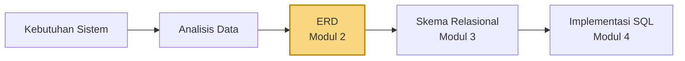
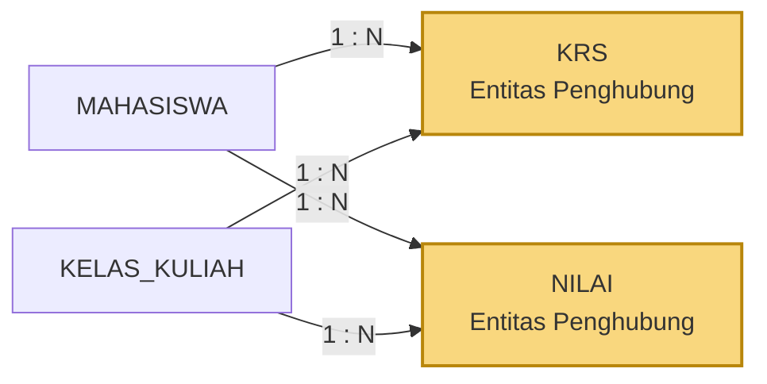
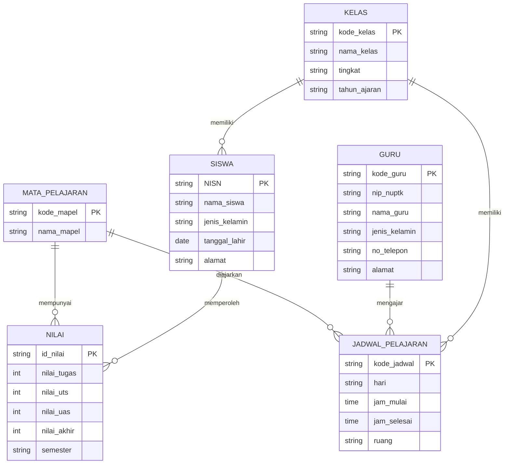
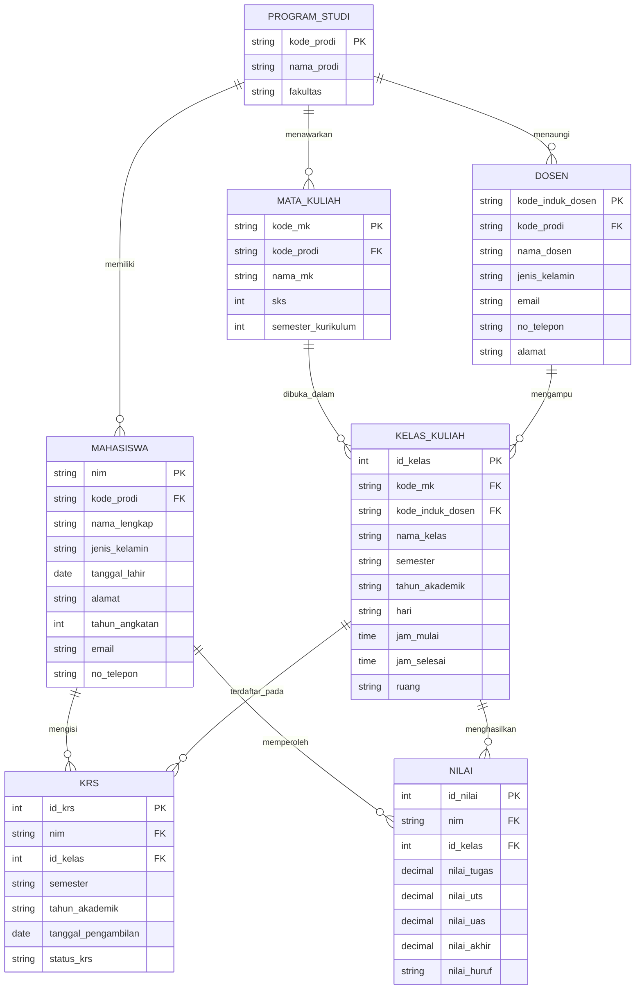

# 🧩 Teknologi Basis Data
### Modul Praktikum 2 — Perancangan Basis Data Menggunakan Entity Relationship Diagram (ERD)

**Akram Junaidi (`2503060033`) · Program Studi Teknologi Informasi · UIN Mataram · 2026**

---

## 📖 Tentang Modul Ini

Sebelum mengimplementasikan tabel ke dalam SQL, struktur basis data harus dirancang terlebih dahulu secara konseptual agar terbebas dari redundansi dan inkonsistensi relasi. Pada **Modul 2**, perancangan dimodelkan menggunakan **Entity Relationship Diagram (ERD)** di aplikasi **draw.io** (*diagrams.net*).

Modul ini **belum menggunakan perintah SQL (`CREATE TABLE`)**, melainkan berfokus pada pemodelan visual yang terbagi menjadi dua bagian:

| Bagian Praktikum | Studi Kasus | Notasi Diagram | Berkas Kerja |
|---|---|---|---|
| **Praktikum Terbimbing** | Sistem Informasi Akademik **SMA Harapan Bangsa** (6 Entitas) | Notasi Chen Dasar | `ERD_Siakad_SMA_2503060033.drawio` |
| **Tugas Praktikum Mandiri** | Sistem Informasi Akademik **Kampus** (7 Entitas) | **Crow's Foot Notation** | `ERD_Siakad_Kampus_2503060033.drawio` |

> [!NOTE]
> Rancangan **7 entitas** pada Tugas Mandiri Sistem Informasi Akademik Kampus di modul ini menjadi cetak biru langsung bagi struktur tabel database **`db_akademikkampus`** yang diimplementasikan pada Modul 3 hingga Modul 7.

---

## 📑 Daftar Isi

- [1. Komponen Dasar ERD](#1-komponen-dasar-erd)
- [2. Jenis Atribut & Penentuan Identifier](#2-jenis-atribut--penentuan-identifier)
- [3. Relationship & Kardinalitas (Crow's Foot)](#3-relationship--kardinalitas-crows-foot)
- [4. Penyelesaian Hubungan Many-to-Many (M:N)](#4-penyelesaian-hubungan-many-to-many-mn)
- [5. Praktikum Terbimbing: ERD SIAKAD SMA (6 Entitas)](#5-praktikum-terbimbing-erd-siakad-sma-6-entitas)
- [6. Panduan Pembuatan Diagram di draw.io](#6-panduan-pembuatan-diagram-di-drawio)
- [7. Tugas Mandiri: ERD SIAKAD Kampus (7 Entitas)](#7-tugas-mandiri-erd-siakad-kampus-7-entitas)
- [8. Refleksi dan Catatan Koreksi](#8-refleksi-dan-catatan-koreksi)
- [Referensi](#referensi)

---

## 1. Komponen Dasar ERD

| Komponen | Pengertian | Simbol Konseptual (Chen) | Contoh |
|---|---|:-:|---|
| **Entity** | Objek nyata maupun konseptual yang datanya perlu disimpan | Persegi panjang ▭ | `MAHASISWA`, `MATA_KULIAH` |
| **Attribute** | Karakteristik atau properti yang mendeskripsikan entitas | Oval ⬭ | `nama_lengkap`, `sks` |
| **Identifier (Key)** | Atribut unik pembeda satu rekaman data dari data lainnya | Oval **bergaris bawah** | <ins>nim</ins>, <ins>kode_prodi</ins> |
| **Relationship** | Hubungan fungsional antar-entitas (umumnya kata kerja) | Belah ketupat ◇ | `memiliki`, `mengampu` |
| **Cardinality** | Batasan jumlah keterlibatan data antar-entitas dalam relasi | Angka `1`, `N`, `M` / *Crow's Foot* | `1 : N`, `M : N` |

### Kriteria Kelayakan Suatu Objek Menjadi Entitas

Tidak semua kata benda pada deskripsi studi kasus otomatis dijadikan entitas. Suatu objek ditetapkan sebagai entitas apabila memenuhi empat syarat:
- ✅ Informasinya **perlu disimpan** secara persisten dalam sistem;
- ✅ Memiliki **sekumpulan atribut** deskriptif tersendiri;
- ✅ Dapat **dibedakan secara unik** dari objek lain melalui *identifier*;
- ✅ Memiliki **peran aktif** dalam proses bisnis sistem.

---

## 2. Jenis Atribut & Penentuan Identifier

| Jenis Atribut | Karakteristik | Contoh pada SIAKAD |
|---|---|---|
| **Simple Attribute** | Atribut atomik yang tidak dapat dipecah lagi | `jenis_kelamin`, `sks` |
| **Composite Attribute** | Atribut yang dapat dipecah menjadi sub-atribut lebih kecil | `alamat` (jalan, kelurahan, kota) |
| **Single-valued Attribute** | Hanya menyimpan satu nilai tunggal per baris entitas | `nama_lengkap`, `tanggal_lahir` |
| **Multi-valued Attribute** | Dapat menyimpan lebih dari satu nilai untuk satu entitas | `no_telepon` |
| **Derived Attribute** | Nilainya diperoleh dari kalkulasi atribut lain | `nilai_akhir` (dihitung dari tugas, UTS, UAS) |
| **Identifier (`PK`)** | Atribut kunci yang menjamin keunikan setiap instans entitas | `nim`, `kode_induk_dosen`, `kode_prodi` |

> [!TIP]
> Pada tahap ERD, penentuan tipe data teknis SQL (`VARCHAR`, `INT`, `DECIMAL`, `DATE`) belum diwajibkan karena baru ditetapkan saat tahap implementasi DDL di Modul 4.

---

## 3. Relationship & Kardinalitas (Crow's Foot)

### Jenis Kardinalitas

| Kardinalitas | Notasi | Makna Hubungan | Contoh pada Sistem Kampus |
|---|:-:|---|---|
| **One-to-One** | `1 : 1` | Satu data entitas A terhubung dengan tepat satu data entitas B | Satu dosen mengepalai satu program studi |
| **One-to-Many** | `1 : N` | Satu data entitas A dapat terhubung dengan banyak data entitas B | Satu `PROGRAM_STUDI` memiliki banyak `MAHASISWA` |
| **Many-to-Many** | `M : N` | Banyak data entitas A dapat terhubung dengan banyak data entitas B | Banyak `MAHASISWA` mengambil banyak `KELAS_KULIAH` |

### Panduan Simbol Ujung Garis Crow's Foot

Untuk Tugas Mandiri Sistem Informasi Akademik Kampus, modul mewajibkan penggunaan **Crow's Foot Notation**:

| Simbol Mermaid | Notasi Visual | Makna Kardinalitas & Partisipasi |
|:-:|:-:|---|
| `\|\|` | `──┼┼` | **One and only one** (Tepat satu — wajib) |
| `o\|` | `──○┼` | **Zero or one** (Nol atau satu — opsional) |
| `}\|` | `──┼<` | **One or many** (Satu atau banyak) |
| `}o` | `──○<` | **Zero or many** (Nol atau banyak) |

---

## 4. Penyelesaian Hubungan Many-to-Many (M:N)

Hubungan **Many-to-Many (`M:N`)** tidak boleh dibiarkan langsung pada model relasional akhir karena menimbulkan duplikasi data. Solusinya adalah memecah relasi `M:N` menjadi dua hubungan `1:N` menggunakan **entitas penghubung (*associative entity*)**.

---

## 5. Praktikum Terbimbing: ERD SIAKAD SMA (6 Entitas)

Pada latihan terbimbing **SMA Harapan Bangsa**, diidentifikasi **6 entitas** (`KELAS`, `GURU`, `MATA_PELAJARAN`, `JADWAL_PELAJARAN`, `SISWA`, dan `NILAI`) yang dimodelkan sebagai berikut:

---

## 6. Panduan Pembuatan Diagram di draw.io

1. Buka peramban dan akses **[https://app.diagrams.net](https://app.diagrams.net)**, pilih penyimpanan **Device** agar file `.drawio` tersimpan di komputer lokal.
2. Pilih **Create New Diagram** → pilih template **Entity Relationship Diagram** → klik **Create**.
3. Aktifkan pustaka simbol ERD melalui panel kiri bawah: **+ More Shapes... → kategori Software → centang Entity Relation → Apply**.
4. Gunakan simbol **Table / Entity** (kotak bertingkat dengan kolom `PK` dan `FK`) untuk Tugas Mandiri Kampus, lalu atur ujung garis penghubung pada panel kanan (**Style → Line Start / Line End**) menggunakan simbol **Crow's Foot** (`ERone` dan `ERmany`).
5. Susun tata letak entitas master di bagian atas dan entitas penghubung di bagian bawah agar jalur konektor bersih tanpa persilangan.

---

## 7. Tugas Mandiri: ERD SIAKAD Kampus (7 Entitas)

Berdasarkan analisis kebutuhan studi kasus perguruan tinggi, rancangan **ERD Sistem Informasi Akademik Kampus** dikembangkan menjadi **7 entitas relasional** yang selaras sepenuhnya dengan implementasi basis data **`db_akademikkampus`**.

### 7.1 Daftar Entitas, Identifier, dan Atribut

| No. | Nama Entitas | Peran dalam Sistem | Identifier (`PK`) | Atribut Kunci Asing (`FK`) & Atribut Deskriptif |
|:-:|---|---|:-:|---|
| 1 | **`PROGRAM_STUDI`** | Entitas Master | `kode_prodi` | `nama_prodi`, `fakultas` |
| 2 | **`DOSEN`** | Entitas Master | `kode_induk_dosen` | `kode_prodi` *(FK)*, `nama_dosen`, `jenis_kelamin`, `email`, `no_telepon`, `alamat` |
| 3 | **`MAHASISWA`** | Entitas Master | `nim` | `kode_prodi` *(FK)*, `nama_lengkap`, `jenis_kelamin`, `tanggal_lahir`, `alamat`, `tahun_angkatan`, `email`, `no_telepon` |
| 4 | **`MATA_KULIAH`** | Entitas Kurikulum | `kode_mk` | `kode_prodi` *(FK)*, `nama_mk`, `sks`, `semester_kurikulum` |
| 5 | **`KELAS_KULIAH`** | Entitas Penjadwalan | `id_kelas` | `kode_mk` *(FK)*, `kode_induk_dosen` *(FK)*, `nama_kelas`, `semester`, `tahun_akademik`, `hari`, `jam_mulai`, `jam_selesai`, `ruang` |
| 6 | **`KRS`** | Entitas Penghubung (`M:N`) | `id_krs` | `nim` *(FK)*, `id_kelas` *(FK)*, `semester`, `tahun_akademik`, `tanggal_pengambilan`, `status_krs` |
| 7 | **`NILAI`** | Entitas Penghubung (`M:N`) | `id_nilai` | `nim` *(FK)*, `id_kelas` *(FK)*, `nilai_tugas`, `nilai_uts`, `nilai_uas`, `nilai_akhir`, `nilai_huruf` |

> [!IMPORTANT]
> **Alasan Penambahan Entitas `KELAS_KULIAH` dan `KRS`:** Berbeda dengan sistem SMA di mana satu kelas mengikuti seluruh paket mata pelajaran secara tetap, pada sistem kampus satu mata kuliah dapat dibuka dalam beberapa kelas paralel (`KELAS_KULIAH`) yang diampu dosen berbeda, dan setiap mahasiswa memilih kelasnya masing-masing tiap semester melalui entitas penghubung **`KRS`**.

### 7.2 Analisis Relationship dan Kardinalitas (8 Relasi Biner)

| No. | Entitas Induk (`1`) | Relationship | Entitas Anak (`N`) | Kardinalitas | Keterangan Relasi |
|:-:|---|:-:|---|:-:|---|
| 1 | `PROGRAM_STUDI` | *memiliki* | `MAHASISWA` | `1 : N` | Satu program studi memiliki banyak mahasiswa; satu mahasiswa terdaftar pada satu prodi |
| 2 | `PROGRAM_STUDI` | *menaungi* | `DOSEN` | `1 : N` | Satu program studi memiliki banyak dosen; satu dosen bernaung di satu prodi |
| 3 | `PROGRAM_STUDI` | *menawarkan* | `MATA_KULIAH` | `1 : N` | Satu program studi menawarkan sejumlah mata kuliah sesuai kurikulum |
| 4 | `MATA_KULIAH` | *dibuka_dalam* | `KELAS_KULIAH` | `1 : N` | Satu mata kuliah dapat dibuka menjadi satu atau beberapa kelas kuliah per semester |
| 5 | `DOSEN` | *mengampu* | `KELAS_KULIAH` | `1 : N` | Seorang dosen dapat mengampu beberapa kelas kuliah; satu kelas diampu satu dosen |
| 6 | `MAHASISWA` | *mengisi* | `KRS` | `1 : N` | Pemecahan relasi `M:N` pengambilan kelas kuliah oleh mahasiswa |
| 7 | `KELAS_KULIAH` | *terdaftar_pada* | `KRS` | `1 : N` | Satu kelas kuliah dapat diambil oleh banyak mahasiswa melalui KRS |
| 8 | `MAHASISWA` & `KELAS_KULIAH` | *memperoleh / menghasilkan* | `NILAI` | `1 : N` | Pemecahan relasi `M:N` pencatatan nilai angka (`nilai_akhir`) dan `nilai_huruf` per kelas |

### 7.3 Diagram ERD SIAKAD Kampus (Crow's Foot Notation)

### 7.4 Checklist Ketentuan Pengerjaan (`draw.io`)

- [x] Dibuat menggunakan **draw.io** (`ERD_Siakad_Kampus_2503060033.drawio`)
- [x] Nama ketujuh entitas ditulis konsisten dalam huruf kapital/standar relasional
- [x] Setiap entitas dilengkapi atribut relevan sesuai studi kasus akademik kampus
- [x] Setiap entitas memiliki *identifier* (`PK`) unik yang jelas
- [x] Seluruh 8 *relationship* dilengkapi simbol kardinalitas **Crow's Foot Notation**
- [x] Dua hubungan *many-to-many* (`MAHASISWA` ↔ `KELAS_KULIAH`) telah dianalisis dan dipecah menggunakan entitas penghubung **`KRS`** dan **`NILAI`**
- [x] Tata letak diagram tersusun rapi dari atas (master) ke bawah (transaksi) tanpa persilangan konektor berlebihan

<!--
Setelah mengekspor file draw.io ke PNG (File -> Export as -> PNG), simpan di folder images/ lalu aktifkan baris di bawah ini:

-->

---

## 8. Refleksi dan Catatan Koreksi

| Bagian / Isu | Analisis dan Penyelesaian pada Rancangan Mandiri |
|---|---|
| **Pengaitan Relasi `NILAI`** | Pada contoh kasus SMA, `NILAI` dihubungkan langsung ke `MATA_PELAJARAN`. Pada rancangan kampus, `NILAI` diarahkan ke **`KELAS_KULIAH`** agar nilai setiap mahasiswa tercatat spesifik berdasarkan kelas paralel, semester, dan dosen pengampunya. |
| **Identifier Tabel Penghubung** | Penambahan *surrogate identifier* **`id_krs`** pada entitas `KRS` dan **`id_nilai`** pada entitas `NILAI` mempermudah identifikasi baris secara tunggal dan menjaga konsistensi saat ditransformasikan menjadi *Primary Key* pada Modul 3 dan Modul 4. |
| **Atribut `JADWAL_PELAJARAN` (SMA)** | Salah ketik `jam_selesai_ruang` pada tabel atribut modul dipisahkan secara tegas menjadi dua atribut terpisah: `jam_selesai` dan `ruang`. |

---

## Referensi

- Modul Praktikum 2 *Teknologi Basis Data* — **Muti'ah, M.Pd.**, Program Studi Teknologi Informasi, UIN Mataram, 2026.
- [diagrams.net / draw.io Documentation](https://app.diagrams.net)
- [Mermaid Entity Relationship Diagram Syntax](https://mermaid.js.org/syntax/entityRelationshipDiagram.html)

---

[⬅️ Modul 1: Pengenalan Sistem Basis Data dan DBMS](../Modul-1/README.md) · [Modul 3: Transformasi ERD ke Skema Relasional ➡️](../Modul-3/README.md)

Dokumentasi Praktikum oleh **Akram Junaidi** ([@akramjunaidi](https://github.com/akramjunaidi))

