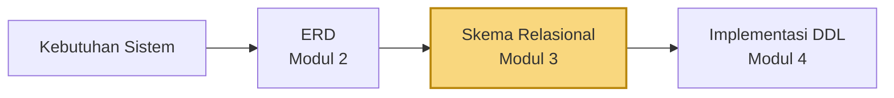
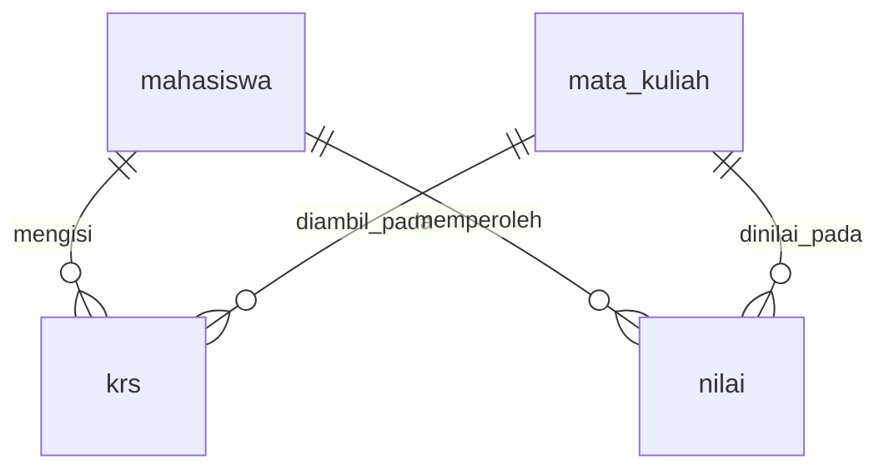
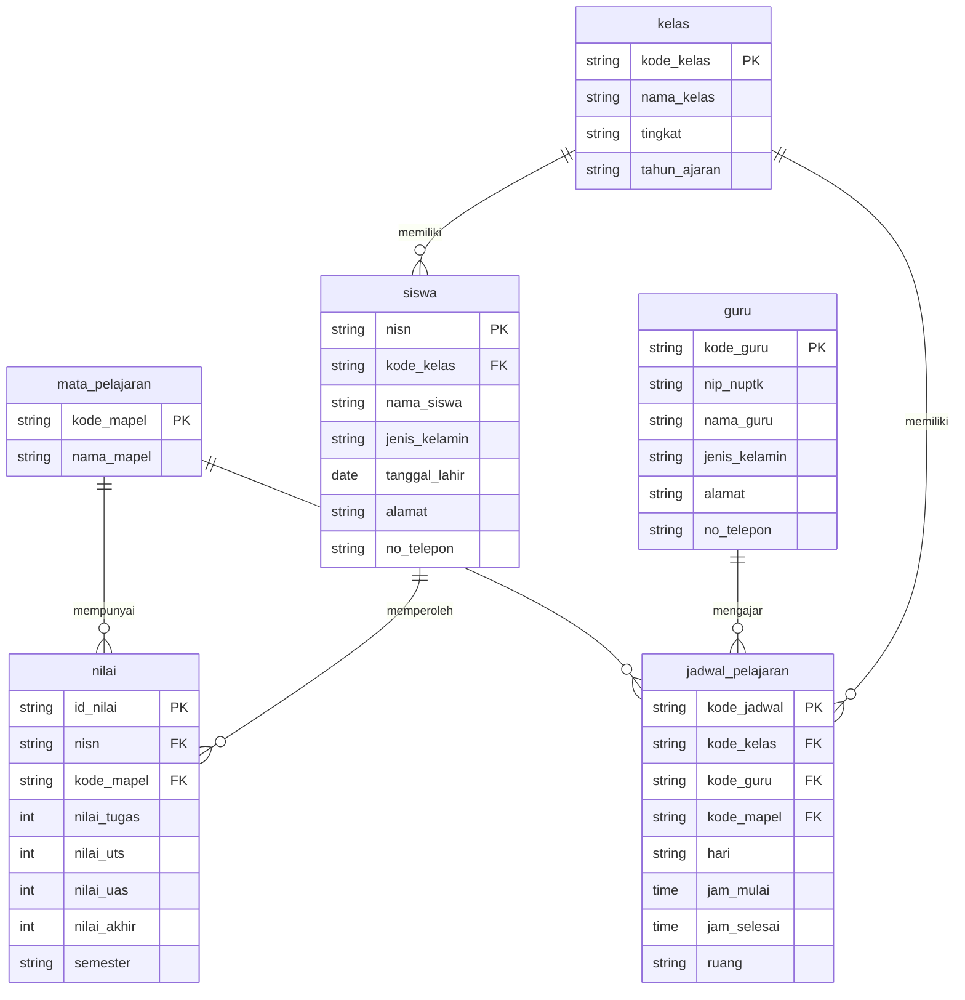
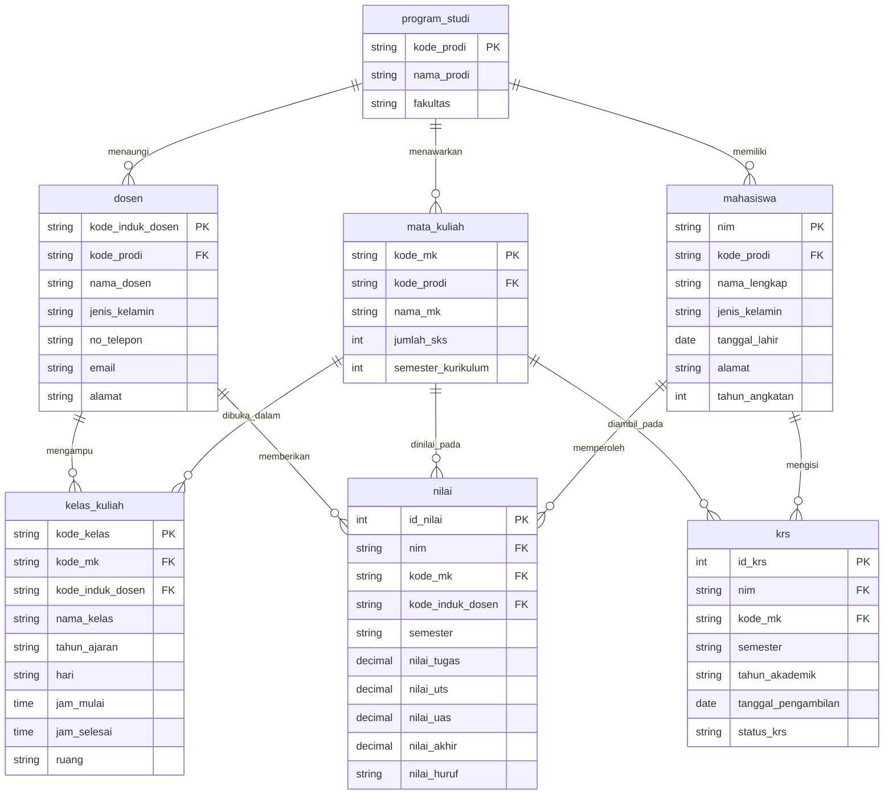

# 🔗 Teknologi Basis Data
### Modul Praktikum 3 — Transformasi ERD menjadi Skema Relasional

**Akram Junaidi (`2503060033`) · Program Studi Teknologi Informasi · UIN Mataram · 2026**

---

## 📖 Tentang Modul Ini

Setelah merancang model konseptual menggunakan Entity Relationship Diagram (ERD) pada Modul 2, tahap berikutnya dalam siklus pengembangan basis data adalah **mentransformasikan ERD menjadi Skema Relasional**. Pada **Modul 3**, setiap entitas diterjemahkan menjadi **tabel**, setiap *identifier* menjadi **Primary Key (`PK`)**, dan setiap *relationship* direpresentasikan melalui pasangan **Foreign Key (`FK`)** berdasarkan aturan kardinalitasnya.

Hasil akhir praktikum berupa diagram skema relasional yang digambar menggunakan **draw.io** (*diagrams.net*) tanpa menuliskan perintah SQL (`CREATE TABLE` baru dimulai pada Modul 4).

> [!NOTE]
> Studi kasus pada modul ini melanjutkan rancangan Modul 2: **Praktikum Terbimbing** mentransformasikan ERD SIAKAD SMA Harapan Bangsa (6 tabel), sedangkan **Tugas Mandiri** mentransformasikan ERD SIAKAD Kampus (7 tabel) sebagai cetak biru database **`db_akademikkampus`**.

---

## 📑 Daftar Isi

- [1. Pemetaan Konsep ERD ke Skema Relasional](#1-pemetaan-konsep-erd-ke-skema-relasional)
- [2. Primary Key, Foreign Key, dan Pencegahan Redundansi](#2-primary-key-foreign-key-dan-pencegahan-redundansi)
- [3. Aturan Transformasi Kardinalitas](#3-aturan-transformasi-kardinalitas)
- [4. Notasi Crow's Foot pada Skema Relasional](#4-notasi-crows-foot-pada-skema-relasional)
- [5. Praktikum Terbimbing: Skema Relasional SIAKAD SMA (6 Tabel)](#5-praktikum-terbimbing-skema-relasional-siakad-sma-6-tabel)
- [6. Panduan Menyusun Diagram di draw.io](#6-panduan-menyusun-diagram-di-drawio)
- [7. Tugas Mandiri: Transformasi ERD SIAKAD Kampus (7 Tabel)](#7-tugas-mandiri-transformasi-erd-siakad-kampus-7-tabel)
- [8. Refleksi dan Catatan Koreksi](#8-refleksi-dan-catatan-koreksi)
- [Referensi](#referensi)

---

## 1. Pemetaan Konsep ERD ke Skema Relasional

Skema relasional adalah model logis basis data yang mempresentasikan struktur penyimpanan ke dalam kumpulan **tabel dua dimensi** yang saling terhubung melalui kunci referensi.

| Konsep pada ERD (Modul 2) | Transformasi | Representasi Skema Relasional (Modul 3) |
|---|:-:|---|
| **Entity** (Entitas) | → | **Tabel** (ditulis huruf kecil, contoh: `mahasiswa`) |
| **Attribute** (Atribut) | → | **Field / Kolom** di dalam tabel |
| **Identifier** (Atribut kunci) | → | **Primary Key (`PK`)** |
| **Relationship** (Hubungan) | → | **Konektor Relasi `PK` – `FK`** antar-tabel |
| **Cardinality** (`1:N`, `M:N`) | → | **Penentu arah penempatan `FK`** dan simbol ujung garis |

---

## 2. Primary Key, Foreign Key, dan Pencegahan Redundansi

### Perbedaan Utama `PK` dan `FK`

| Karakteristik | Primary Key (`PK`) | Foreign Key (`FK`) |
|---|---|---|
| **Asal Transformasi** | *Identifier* unik entitas | *Relationship* antar-entitas |
| **Fungsi Utama** | Menjamin keunikan setiap baris rekaman data | Menghubungkan tabel anak ke tabel induk |
| **Keunikan Nilai** | **Wajib unik** dan tidak boleh kosong (`NOT NULL`) | **Boleh berulang** sesuai jumlah data anak |
| **Posisi dalam Relasi** | Sumber referensi pada tabel induk (sisi `1`) | Kolom perujuk pada tabel anak (sisi `N`) |

### Mengapa Menggunakan `FK` Dibanding Menyalin Data?

| ❌ Pendekatan Redundan (Tanpa `FK`) | ✅ Pendekatan Relasional (Dengan `FK`) |
|---|---|
| Menyimpan `nama_prodi` dan `fakultas` berulang kali di setiap baris tabel `mahasiswa`. Jika nama prodi berubah, puluhan hingga ratusan baris harus diperbarui satu per satu. | Tabel `mahasiswa` cukup menyimpan `kode_prodi` (`FK`) yang merujuk ke `program_studi.kode_prodi` (`PK`). Perubahan nama prodi cukup dilakukan pada satu baris di tabel induk. |

---

## 3. Aturan Transformasi Kardinalitas

### 3.1 Hubungan One-to-Many (`1 : N`)

> **Aturan Baku:** *Primary Key* (`PK`) dari tabel yang berada di sisi **satu (`1`)** ditempatkan sebagai *Foreign Key* (`FK`) pada tabel yang berada di sisi **banyak (`N`)**.

Contoh pada sistem kampus (`program_studi` `1 : N` `mahasiswa`):
1. Tentukan sisi `1` = `program_studi` dan sisi `N` = `mahasiswa`.
2. Identifikasi `PK` pada sisi `1` = `kode_prodi`.
3. Tambahkan kolom `kode_prodi` sebagai `FK` di dalam tabel `mahasiswa`.

> [!TIP]
> Cara cepat memeriksa lokasi *Foreign Key*: **kolom `FK` selalu ditempatkan pada tabel yang berada di sisi kaki gagak (*many* / `N`)**.

### 3.2 Hubungan Many-to-Many (`M : N`)

Relasi `M : N` tidak dapat direpresentasikan secara langsung dengan satu kolom `FK`. Relasi tersebut dipecah menjadi dua hubungan `1 : N` melalui **tabel penghubung (*junction/associative table*)** yang menampung `FK` dari kedua tabel induk yang dihubungkan.

---

## 4. Notasi Crow's Foot pada Skema Relasional

Pada diagram skema relasional di `draw.io`, setiap garis penghubung antar-tabel menggunakan **Crow's Foot Notation** untuk menyatakan batasan jumlah rekaman serta sifat wajib/opsional relasi:

| Simbol Mermaid | Tampilan Ujung Garis | Nama Notasi | Makna Relasional |
|:-:|:-:|---|---|
| `\|\|` | `──┼┼` | **One and only one** | Tepat satu baris induk (wajib ada) |
| `o\|` | `──○┼` | **Zero or one** | Nol atau satu baris (opsional) |
| `}\|` | `──┼<` | **One or many** | Satu atau banyak baris anak |
| `}o` | `──○<` | **Zero or many** | Nol atau banyak baris anak |

---

## 5. Praktikum Terbimbing: Skema Relasional SIAKAD SMA (6 Tabel)

Pada studi kasus **SMA Harapan Bangsa**, keenam entitas dari Modul 2 ditransformasikan menjadi 6 tabel (`kelas`, `siswa`, `guru`, `mata_pelajaran`, `jadwal_pelajaran`, dan `nilai`) dengan berkas kerja **`SKEMA_RELASIONAL_SMA_2503060033.drawio`**.

### 5.1 Matriks Penempatan Foreign Key (SIAKAD SMA)

| No. | Relationship | Tabel Induk (Sisi `1`) | Tabel Anak (Sisi `N`) | Kolom `FK` yang Ditambahkan |
|:-:|---|---|---|---|
| 1 | **memiliki** | `kelas` (`kode_kelas`) | `siswa` | `kode_kelas` *(FK)* |
| 2 | **memiliki** | `kelas` (`kode_kelas`) | `jadwal_pelajaran` | `kode_kelas` *(FK)* |
| 3 | **mengajar** | `guru` (`kode_guru`) | `jadwal_pelajaran` | `kode_guru` *(FK)* |
| 4 | **diajarkan** | `mata_pelajaran` (`kode_mapel`) | `jadwal_pelajaran` | `kode_mapel` *(FK)* |
| 5 | **memperoleh** | `siswa` (`nisn`) | `nilai` | `nisn` *(FK)* |
| 6 | **mempunyai** | `mata_pelajaran` (`kode_mapel`) | `nilai` | `kode_mapel` *(FK)* |

### 5.2 Diagram Skema Relasional SIAKAD SMA (Crow's Foot)

---

## 6. Panduan Menyusun Diagram di draw.io

1. Buka **[https://app.diagrams.net](https://app.diagrams.net)**, pilih **Blank Diagram**, dan simpan dokumen terpisah dengan nama **`SKEMA_RELASIONAL_KAMPUS_2503060033.drawio`** agar dokumen ERD Modul 2 tidak tertimpa.
2. Pada panel kiri bagian **Entity Relation**, gunakan simbol **Table** (kotak bertingkat dengan kolom penanda kunci di sisi kiri dan nama *field* di sisi kanan).
3. Susun tabel dari **tabel induk (tanpa `FK`)** terlebih dahulu (`program_studi`), diikuti **tabel tingkat kedua** (`dosen`, `mahasiswa`, `mata_kuliah`), dan terakhir **tabel anak/penghubung** (`kelas_kuliah`, `krs`, `nilai`).
4. Tarik garis konektor langsung dari baris **`PK`** tabel induk ke baris **`FK`** tabel anak, lalu atur ujung konektor melalui **Format Panel → Style** menggunakan gaya **ER One** (`|`) pada sisi `PK` dan **ER Many** (`|<`) pada sisi `FK`.

---

## 7. Tugas Mandiri: Transformasi ERD SIAKAD Kampus (7 Tabel)

Seluruh **7 entitas** dari ERD SIAKAD Kampus pada Modul 2 ditransformasikan menjadi **7 tabel relasional** siap implementasi pada basis data **`db_akademikkampus`**.

### 7.1 Matriks Transformasi Relasi & Penempatan Foreign Key

| No. | Hubungan pada ERD | Kardinalitas | Tabel Sisi `1` (`PK` Sumber) | Tabel Sisi `N` (Penerima `FK`) | Kolom `FK` yang Ditambahkan |
|:-:|---|:-:|---|---|---|
| 1 | `program_studi` — `dosen` | `1 : N` | `program_studi` (`kode_prodi`) | `dosen` | `kode_prodi` *(FK)* |
| 2 | `program_studi` — `mahasiswa` | `1 : N` | `program_studi` (`kode_prodi`) | `mahasiswa` | `kode_prodi` *(FK)* |
| 3 | `program_studi` — `mata_kuliah` | `1 : N` | `program_studi` (`kode_prodi`) | `mata_kuliah` | `kode_prodi` *(FK)* |
| 4 | `mata_kuliah` — `kelas_kuliah` | `1 : N` | `mata_kuliah` (`kode_mk`) | `kelas_kuliah` | `kode_mk` *(FK)* |
| 5 | `dosen` — `kelas_kuliah` | `1 : N` | `dosen` (`kode_induk_dosen`) | `kelas_kuliah` | `kode_induk_dosen` *(FK)* |
| 6 | `mahasiswa` — `krs` *(pecahan M:N)* | `1 : N` | `mahasiswa` (`nim`) | `krs` | `nim` *(FK)* |
| 7 | `mata_kuliah` — `krs` *(pecahan M:N)* | `1 : N` | `mata_kuliah` (`kode_mk`) | `krs` | `kode_mk` *(FK)* |
| 8 | `mahasiswa` — `nilai` *(pecahan M:N)* | `1 : N` | `mahasiswa` (`nim`) | `nilai` | `nim` *(FK)* |
| 9 | `mata_kuliah` & `dosen` — `nilai` | `1 : N` | `mata_kuliah` (`kode_mk`) & `dosen` (`kode_induk_dosen`) | `nilai` | `kode_mk` *(FK)*, `kode_induk_dosen` *(FK)* |

### 7.2 Struktur Skema Relasional 7 Tabel (`db_akademikkampus`)

Sesuai standar Modul 3, penamaan tabel dan kolom ditulis dalam huruf kecil (*lowercase*) dan **belum mencantumkan tipe data SQL**:

| No. | Nama Tabel | Primary Key (`PK`) | Foreign Key (`FK`) | Kolom / Field Biasa |
|:-:|---|:-:|---|---|
| 1 | **`program_studi`** | `kode_prodi` | — | `nama_prodi`, `fakultas` |
| 2 | **`dosen`** | `kode_induk_dosen` | `kode_prodi` → `program_studi` | `nama_dosen`, `jenis_kelamin`, `no_telepon`, `email`, `alamat` |
| 3 | **`mahasiswa`** | `nim` | `kode_prodi` → `program_studi` | `nama_lengkap`, `jenis_kelamin`, `tanggal_lahir`, `alamat`, `tahun_angkatan` |
| 4 | **`mata_kuliah`** | `kode_mk` | `kode_prodi` → `program_studi` | `nama_mk`, `jumlah_sks`, `semester_kurikulum` |
| 5 | **`kelas_kuliah`** | `kode_kelas` | `kode_mk` → `mata_kuliah` `kode_induk_dosen` → `dosen` | `nama_kelas`, `tahun_ajaran`, `hari`, `jam_mulai`, `jam_selesai`, `ruang` |
| 6 | **`krs`** | `id_krs` | `nim` → `mahasiswa` `kode_mk` → `mata_kuliah` | `semester`, `tahun_akademik`, `tanggal_pengambilan`, `status_krs` |
| 7 | **`nilai`** | `id_nilai` | `nim` → `mahasiswa` `kode_mk` → `mata_kuliah` `kode_induk_dosen` → `dosen` | `semester`, `nilai_tugas`, `nilai_uts`, `nilai_uas`, `nilai_akhir`, `nilai_huruf` |

### 7.3 Diagram Skema Relasional SIAKAD Kampus (Crow's Foot)

> [!NOTE]
> Label tipe pada blok Mermaid (`string`, `int`, `date`, `time`, `decimal`) hanya berfungsi untuk kebutuhan rendering diagram di GitHub. Spesifikasi tipe data SQL eksak ditetapkan pada Modul 4.

### 7.4 Checklist Indikator Keberhasilan

- [x] Menggunakan kembali seluruh 7 entitas ERD SIAKAD Kampus dari Modul 2
- [x] Seluruh entitas ditransformasikan menjadi tabel relasional dengan penamaan *lowercase* konsisten
- [x] Setiap tabel memiliki **Primary Key (`PK`)** unik (`kode_prodi`, `kode_induk_dosen`, `nim`, `kode_mk`, `kode_kelas`, `id_krs`, `id_nilai`)
- [x] Seluruh **Foreign Key (`FK`)** ditempatkan pada sisi banyak (`N`) sesuai kardinalitas hubungan
- [x] Hubungan *many-to-many* (`mahasiswa` ↔ `mata_kuliah`) diselesaikan melalui tabel penghubung **`krs`** dan **`nilai`**
- [x] Diagram digambar di **draw.io** (`SKEMA_RELASIONAL_KAMPUS_2503060033.drawio`) dengan notasi **Crow's Foot** tanpa redundansi atribut

<!--
Setelah mengekspor file draw.io ke PNG (File -> Export as -> PNG), simpan di folder images/ lalu aktifkan baris di bawah ini:

-->

---

## 8. Refleksi dan Catatan Koreksi

| Bagian / Permasalahan | Analisis dan Penyelesaian pada Rancangan Mandiri |
|---|---|
| **Konsistensi Penamaan Kolom untuk Modul 4–7** | Penamaan kolom pada skema relasional diselaraskan langsung dengan implementasi SQL pada `db_akademikkampus`, seperti penggunaan `jumlah_sks` pada `mata_kuliah`, `kode_kelas` dan `tahun_ajaran` pada `kelas_kuliah`, serta `kode_mk` pada `krs` dan `nilai` sehingga tidak terjadi perbedaan nama kolom saat menyusun perintah `CREATE TABLE` maupun kueri `JOIN` di Modul 6. |
| **Penyertaan `kode_induk_dosen` pada Tabel `nilai`** | Selain merujuk ke `mahasiswa` (`nim`) dan `mata_kuliah` (`kode_mk`), tabel `nilai` juga menyertakan `kode_induk_dosen` (`FK`) agar riwayat penilaian setiap mata kuliah dapat ditelusuri langsung ke dosen pemberi nilai. |
| **Koreksi Modul Asli (SIAKAD SMA)** | Pada modul asli tertulis arah terbalik untuk relasi `mata_pelajaran` – `jadwal_pelajaran` (seharusnya sisi `1` = `mata_pelajaran`, sisi `N` = `jadwal_pelajaran`) dan belum mencantumkan kolom `PK` eksplisit pada tabel `nilai` (diselesaikan menggunakan `id_nilai`). |

---

## Referensi

- Modul Praktikum 3 *Teknologi Basis Data* — **Muti'ah, M.Pd.**, Program Studi Teknologi Informasi, UIN Mataram, 2026.
- Elmasri, R., & Navathe, S. B. *Fundamentals of Database Systems*. Pearson.
- Connolly, T., & Begg, C. *Database Systems: A Practical Approach to Design, Implementation, and Management*. Pearson.
- [diagrams.net / draw.io Documentation](https://app.diagrams.net)

---

[⬅️ Modul 2: Perancangan Basis Data Menggunakan ERD](../Modul-2/README.md) · [Modul 4: Implementasi Struktur Basis Data Menggunakan DDL ➡️](../Modul-4/README.md)

Dokumentasi Praktikum oleh **Akram Junaidi** ([@akramjunaidi](https://github.com/akramjunaidi))

