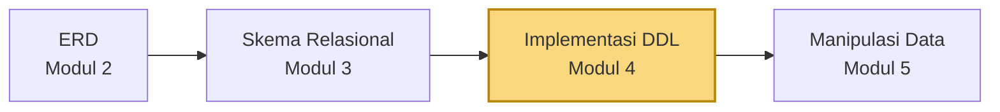
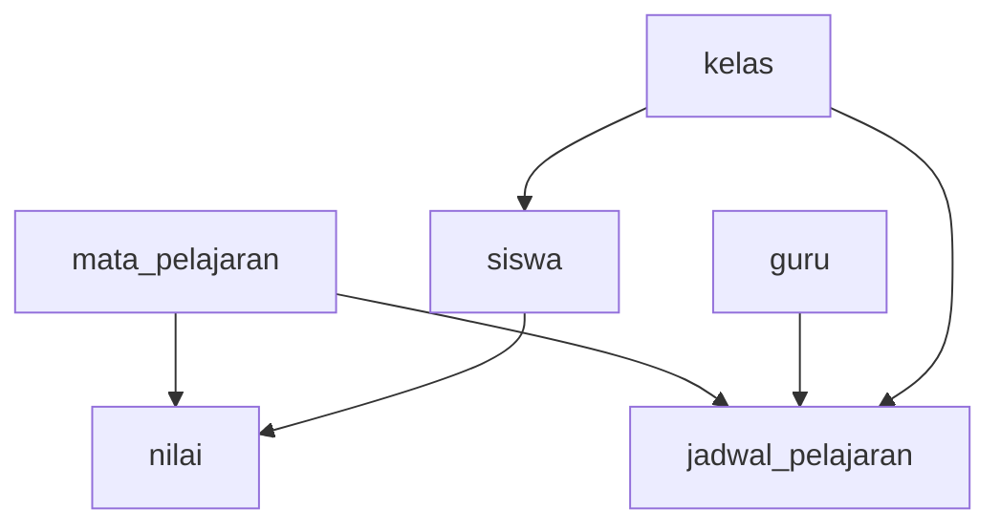
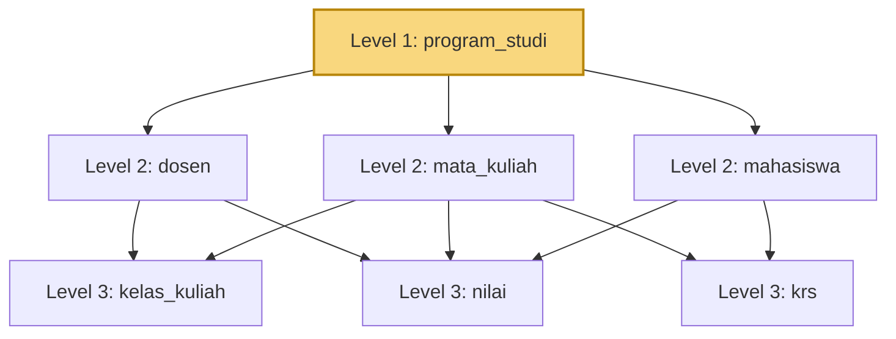

<div align="center">

# 🏗️ Teknologi Basis Data
### Modul Praktikum 4 — Implementasi Struktur Basis Data Menggunakan DDL


**Akram Junaidi (`2503060033`) · Program Studi Teknologi Informasi · UIN Mataram · 2026**

</div>

---

## 📖 Tentang Modul Ini

Setelah merancang ERD (Modul 2) dan menyusun Skema Relasional (Modul 3), tahap selanjutnya adalah mewujudkan rancangan tersebut menjadi objek basis data fisik di **MySQL/MariaDB** menggunakan perintah **DDL (*Data Definition Language*)**.

Pada **Modul 4**, praktik dibagi menjadi dua bagian: membangun basis data terbimbing **`db_akademiksmahb`** (6 tabel beserta latihan `ALTER TABLE` dan `DROP TABLE`), kemudian mengimplementasikan tugas mandiri utama **`db_akademikkampus`** (7 tabel relasional lengkap dengan tipe data presisi, *Primary Key*, *Foreign Key*, dan *constraint*).



> [!NOTE]
> Modul ini berfokus pada pembangunan **struktur tabel** (wadah penyimpanan). Pengisian data menggunakan `INSERT`, pembaruan dengan `UPDATE`, dan penghapusan dengan `DELETE` dikerjakan pada Modul 5.

---

## 📑 Daftar Isi

- [Persiapan Lingkungan Kerja](#persiapan-lingkungan-kerja)
- [1. Cheat Sheet Perintah DDL](#1-cheat-sheet-perintah-ddl)
- [2. Konsep Dasar DDL, Tipe Data, dan Constraint](#2-konsep-dasar-ddl-tipe-data-dan-constraint)
- [3. Praktikum Terbimbing: SIAKAD SMA (`db_akademiksmahb`)](#3-praktikum-terbimbing-siakad-sma-db_akademiksmahb)
- [4. Tugas Mandiri: Implementasi DDL SIAKAD Kampus (`db_akademikkampus`)](#4-tugas-mandiri-implementasi-ddl-siakad-kampus-db_akademikkampus)
- [5. Refleksi dan Catatan Koreksi](#5-refleksi-dan-catatan-koreksi)
- [Referensi](#referensi)

---

## Persiapan Lingkungan Kerja

| Langkah | Aktivitas yang Dilakukan | Keterangan |
|:-:|---|---|
| 1️⃣ | Jalankan **XAMPP Control Panel** | Aktifkan layanan **Apache** dan **MySQL** (`10.4.32-MariaDB`) |
| 2️⃣ | Buka peramban dan akses `http://localhost/phpmyadmin` | Pastikan *storage engine* default adalah **InnoDB** |
| 3️⃣ | Buka tab **SQL** | Siap mengeksekusi skrip DDL secara berurutan |

---

## 1. Cheat Sheet Perintah DDL

| Kelompok | Perintah SQL | Fungsi Utama |
|---|---|---|
| **Database** | `CREATE DATABASE IF NOT EXISTS nama_db;` | Membuat database baru secara aman |
| | `USE nama_db;` | Mengaktifkan database target |
| **Tabel** | `CREATE TABLE nama_tabel (...);` | Mendefinisikan tabel, kolom, tipe data, dan kunci |
| | `PRIMARY KEY (kolom)` | Menetapkan identitas unik baris |
| | `CONSTRAINT fk_... FOREIGN KEY (...) REFERENCES ...` | Membentuk integritas referensial antar-tabel |
| **Constraint** | `NOT NULL` / `UNIQUE` / `DEFAULT` / `AUTO_INCREMENT` | Menjaga validitas, keunikan, nilai bawaan, dan nomor urut otomatis |
| **Inspeksi** | `SHOW TABLES;` | Menampilkan daftar seluruh tabel dalam database aktif |
| | `DESCRIBE nama_tabel;` (`DESC`) | Menampilkan struktur kolom, tipe data, status `NULL`, dan `Key` |
| | `SHOW CREATE TABLE nama_tabel;` | Menampilkan sintaks DDL lengkap beserta nama *constraint* |
| **Modifikasi** | `ALTER TABLE ... ADD / MODIFY / CHANGE / DROP COLUMN` | Mengubah struktur kolom pada tabel yang sudah ada |
| **Penghapusan** | `DROP TABLE IF EXISTS nama_tabel;` | Menghapus tabel beserta strukturnya secara permanen |

---

## 2. Konsep Dasar DDL, Tipe Data, dan Constraint

### 2.1 Tipe Data Utama MySQL/MariaDB

| Tipe Data | Karakteristik | Contoh Penerapan |
|---|---|---|
| `VARCHAR(n)` | String dengan panjang karakter dinamis (hemat ruang) | `nama_lengkap VARCHAR(100)`, `alamat VARCHAR(255)` |
| `CHAR(n)` | String dengan panjang karakter tetap | `jenis_kelamin CHAR(1)`, `nilai_huruf CHAR(2)` |
| `INT` | Bilangan bulat (*integer*) | `jumlah_sks INT`, `tahun_angkatan INT` |
| `DATE` | Tanggal format standar `YYYY-MM-DD` | `tanggal_lahir DATE`, `tanggal_pengambilan DATE` |
| `TIME` | Waktu format standar `HH:MM:SS` | `jam_mulai TIME`, `jam_selesai TIME` |
| `DECIMAL(p,s)` | Bilangan desimal presisi tetap (`p` total digit, `s` di belakang koma) | `nilai_akhir DECIMAL(5,2)` (maksimal `999.99`) |

### 2.2 Aturan Integritas Referensial (`FOREIGN KEY`)

1. **Urutan Pembuatan:** Tabel induk (*referenced table*) **wajib dibuat lebih dahulu** sebelum tabel anak (*referencing table*).
2. **Kesamaan Tipe Data:** Kolom `FK` pada tabel anak harus memiliki tipe data dan panjang yang identik dengan kolom `PK` pada tabel induk.
3. **Storage Engine:** Mendukung relasi `FOREIGN KEY` secara penuh menggunakan **InnoDB**.

---

## 3. Praktikum Terbimbing: SIAKAD SMA (`db_akademiksmahb`)

Pada latihan terbimbing, dibuat database `db_akademiksmahb` berisi 6 tabel dengan urutan pembuatan dari tabel induk ke tabel anak, dilanjutkan pengujian perintah `ALTER TABLE` pada tabel `siswa` serta `DROP TABLE` pada tabel percobaan:



```sql
-- ==========================================================
-- PRAKTIKUM TERBIMBING MODUL 4 — SIAKAD SMA (db_akademiksmahb)
-- ==========================================================

CREATE DATABASE IF NOT EXISTS db_akademiksmahb;
USE db_akademiksmahb;

-- 1. Tabel Induk
CREATE TABLE kelas (
    kode_kelas   VARCHAR(10) NOT NULL,
    nama_kelas   VARCHAR(50) NOT NULL,
    tahun_ajaran VARCHAR(9)  NOT NULL,
    PRIMARY KEY (kode_kelas)
);

CREATE TABLE guru (
    kode_guru     CHAR(10)     NOT NULL,
    nip_nuptk     VARCHAR(20),
    nama_guru     VARCHAR(100) NOT NULL,
    jenis_kelamin CHAR(1),
    nomor_telepon VARCHAR(15),
    PRIMARY KEY (kode_guru),
    UNIQUE (nip_nuptk)
);

CREATE TABLE mata_pelajaran (
    kode_mapel VARCHAR(10)  NOT NULL,
    nama_mapel VARCHAR(100) NOT NULL,
    PRIMARY KEY (kode_mapel)
);

-- 2. Tabel Anak
CREATE TABLE siswa (
    nisn          VARCHAR(20)  NOT NULL,
    nama_siswa    VARCHAR(100) NOT NULL,
    jenis_kelamin CHAR(1)      NOT NULL,
    tanggal_lahir DATE,
    alamat        VARCHAR(200),
    kode_kelas    VARCHAR(10)  NOT NULL,
    PRIMARY KEY (nisn),
    CONSTRAINT fk_siswa_kelas
        FOREIGN KEY (kode_kelas) REFERENCES kelas(kode_kelas)
);

CREATE TABLE jadwal_pelajaran (
    kode_jadwal VARCHAR(15) NOT NULL,
    kode_kelas  VARCHAR(10) NOT NULL,
    kode_guru   CHAR(10)    NOT NULL,
    kode_mapel  VARCHAR(10) NOT NULL,
    hari        VARCHAR(10) NOT NULL,
    jam_mulai   TIME        NOT NULL,
    jam_selesai TIME        NOT NULL,
    ruang       VARCHAR(30),
    PRIMARY KEY (kode_jadwal),
    CONSTRAINT fk_jadwal_kelas FOREIGN KEY (kode_kelas) REFERENCES kelas(kode_kelas),
    CONSTRAINT fk_jadwal_guru  FOREIGN KEY (kode_guru)  REFERENCES guru(kode_guru),
    CONSTRAINT fk_jadwal_mapel FOREIGN KEY (kode_mapel) REFERENCES mata_pelajaran(kode_mapel)
);

CREATE TABLE nilai (
    id_nilai    INT          NOT NULL AUTO_INCREMENT,
    nisn        VARCHAR(20)  NOT NULL,
    kode_mapel  VARCHAR(10)  NOT NULL,
    semester    VARCHAR(10)  NOT NULL,
    nilai_tugas DECIMAL(5,2),
    nilai_uts   DECIMAL(5,2),
    nilai_uas   DECIMAL(5,2),
    nilai_akhir DECIMAL(5,2),
    PRIMARY KEY (id_nilai),
    CONSTRAINT fk_nilai_siswa FOREIGN KEY (nisn)       REFERENCES siswa(nisn),
    CONSTRAINT fk_nilai_mapel FOREIGN KEY (kode_mapel) REFERENCES mata_pelajaran(kode_mapel)
);

-- 3. Latihan Modifikasi Struktur (ALTER TABLE) pada siswa
ALTER TABLE siswa ADD email VARCHAR(100);
ALTER TABLE siswa MODIFY alamat VARCHAR(255);
ALTER TABLE siswa ADD status VARCHAR(20) DEFAULT 'Aktif';
ALTER TABLE siswa CHANGE nama_siswa nama_pesertadidik VARCHAR(100) NOT NULL;
ALTER TABLE siswa DROP COLUMN email;

-- 4. Latihan Penghapusan Tabel Uji Coba (DROP TABLE)
CREATE TABLE tabel_percobaan (
    id_percobaan INT PRIMARY KEY
);
DROP TABLE IF EXISTS tabel_percobaan;
```

---

## 4. Tugas Mandiri: Implementasi DDL SIAKAD Kampus (`db_akademikkampus`)

Sesuai skema relasional Modul 3, basis data **`db_akademikkampus`** diimplementasikan ke dalam **7 tabel relasional** dengan urutan pembuatan berjenjang agar seluruh *Foreign Key* tervalidasi tanpa galat.

### 4.1 Hierarki & Urutan Pembuatan 7 Tabel



| Urutan | Nama Tabel | Tingkat Ketergantungan | Primary Key (`PK`) | Foreign Key (`FK`) |
|:-:|---|---|:-:|---|
| 1 | `program_studi` | Level 1 (Induk Utama) | `kode_prodi` | — |
| 2 | `dosen` | Level 2 (Anak `program_studi`) | `kode_induk_dosen` | `kode_prodi` |
| 3 | `mahasiswa` | Level 2 (Anak `program_studi`) | `nim` | `kode_prodi` |
| 4 | `mata_kuliah` | Level 2 (Anak `program_studi`) | `kode_mk` | `kode_prodi` |
| 5 | `kelas_kuliah` | Level 3 (Anak `mata_kuliah` & `dosen`) | `kode_kelas` | `kode_mk`, `kode_induk_dosen` |
| 6 | `krs` | Level 3 (Penghubung `mahasiswa` & `mata_kuliah`) | `id_krs` (`AUTO_INCREMENT`) | `nim`, `kode_mk` |
| 7 | `nilai` | Level 3 (Penghubung `mahasiswa`, `mata_kuliah`, `dosen`) | `id_nilai` (`AUTO_INCREMENT`) | `nim`, `kode_mk`, `kode_induk_dosen` |

### 4.2 Skrip Lengkap SQL DDL (`db_akademikkampus`)

```sql
-- =====================================================================
-- TUGAS MANDIRI MODUL 4 — IMPLEMENTASI DDL SIAKAD KAMPUS
-- Nama Mahasiswa : Akram Junaidi (NIM: 2503060033)
-- Program Studi  : Teknologi Informasi · UIN Mataram
-- =====================================================================

-- 1. Membuat dan mengaktifkan database utama
CREATE DATABASE IF NOT EXISTS db_akademikkampus
    CHARACTER SET utf8mb4
    COLLATE utf8mb4_general_ci;

USE db_akademikkampus;
SELECT DATABASE();

-- 2. Level 1 — Tabel Induk Utama: program_studi
CREATE TABLE program_studi (
    kode_prodi VARCHAR(10)  NOT NULL,
    nama_prodi VARCHAR(100) NOT NULL,
    fakultas   VARCHAR(100) NOT NULL,
    PRIMARY KEY (kode_prodi),
    UNIQUE (nama_prodi)
) ENGINE=InnoDB;

-- 3. Level 2 — Tabel dosen
CREATE TABLE dosen (
    kode_induk_dosen VARCHAR(15)  NOT NULL,
    nama_dosen       VARCHAR(100) NOT NULL,
    jenis_kelamin    CHAR(1)      NOT NULL,
    no_telepon       VARCHAR(15)  DEFAULT NULL,
    email            VARCHAR(100) DEFAULT NULL,
    alamat           VARCHAR(255) DEFAULT NULL,
    kode_prodi       VARCHAR(10)  NOT NULL,
    PRIMARY KEY (kode_induk_dosen),
    UNIQUE (email),
    CONSTRAINT fk_dosen_prodi
        FOREIGN KEY (kode_prodi)
        REFERENCES program_studi(kode_prodi)
        ON UPDATE CASCADE
        ON DELETE RESTRICT
) ENGINE=InnoDB;

-- 4. Level 2 — Tabel mahasiswa
CREATE TABLE mahasiswa (
    nim            VARCHAR(15)  NOT NULL,
    nama_lengkap   VARCHAR(100) NOT NULL,
    jenis_kelamin  CHAR(1)      NOT NULL,
    tanggal_lahir  DATE         DEFAULT NULL,
    alamat         VARCHAR(255) DEFAULT NULL,
    tahun_angkatan INT          NOT NULL,
    kode_prodi     VARCHAR(10)  NOT NULL,
    PRIMARY KEY (nim),
    CONSTRAINT fk_mahasiswa_prodi
        FOREIGN KEY (kode_prodi)
        REFERENCES program_studi(kode_prodi)
        ON UPDATE CASCADE
        ON DELETE RESTRICT
) ENGINE=InnoDB;

-- 5. Level 2 — Tabel mata_kuliah
CREATE TABLE mata_kuliah (
    kode_mk            VARCHAR(10)  NOT NULL,
    nama_mk            VARCHAR(100) NOT NULL,
    jumlah_sks         INT          NOT NULL,
    semester_kurikulum INT          DEFAULT NULL,
    kode_prodi         VARCHAR(10)  NOT NULL,
    PRIMARY KEY (kode_mk),
    CONSTRAINT fk_matakuliah_prodi
        FOREIGN KEY (kode_prodi)
        REFERENCES program_studi(kode_prodi)
        ON UPDATE CASCADE
        ON DELETE RESTRICT
) ENGINE=InnoDB;

-- 6. Level 3 — Tabel kelas_kuliah
CREATE TABLE kelas_kuliah (
    kode_kelas       VARCHAR(10) NOT NULL,
    nama_kelas       VARCHAR(50) NOT NULL,
    tahun_ajaran     VARCHAR(9)  NOT NULL,
    hari             VARCHAR(15) DEFAULT NULL,
    jam_mulai        TIME        DEFAULT NULL,
    jam_selesai      TIME        DEFAULT NULL,
    ruang            VARCHAR(30) DEFAULT NULL,
    kode_mk          VARCHAR(10) NOT NULL,
    kode_induk_dosen VARCHAR(15) NOT NULL,
    PRIMARY KEY (kode_kelas),
    CONSTRAINT fk_kelas_matakuliah
        FOREIGN KEY (kode_mk)
        REFERENCES mata_kuliah(kode_mk)
        ON UPDATE CASCADE
        ON DELETE RESTRICT,
    CONSTRAINT fk_kelas_dosen
        FOREIGN KEY (kode_induk_dosen)
        REFERENCES dosen(kode_induk_dosen)
        ON UPDATE CASCADE
        ON DELETE RESTRICT
) ENGINE=InnoDB;

-- 7. Level 3 — Tabel Penghubung krs
CREATE TABLE krs (
    id_krs              INT         NOT NULL AUTO_INCREMENT,
    nim                 VARCHAR(15) NOT NULL,
    kode_mk             VARCHAR(10) NOT NULL,
    semester            VARCHAR(15) NOT NULL,
    tahun_akademik      VARCHAR(9)  NOT NULL,
    tanggal_pengambilan DATE        DEFAULT NULL,
    status_krs          VARCHAR(20) NOT NULL DEFAULT 'Disetujui',
    PRIMARY KEY (id_krs),
    CONSTRAINT fk_krs_mahasiswa
        FOREIGN KEY (nim)
        REFERENCES mahasiswa(nim)
        ON UPDATE CASCADE
        ON DELETE RESTRICT,
    CONSTRAINT fk_krs_matakuliah
        FOREIGN KEY (kode_mk)
        REFERENCES mata_kuliah(kode_mk)
        ON UPDATE CASCADE
        ON DELETE RESTRICT
) ENGINE=InnoDB;

-- 8. Level 3 — Tabel Penghubung nilai
CREATE TABLE nilai (
    id_nilai         INT          NOT NULL AUTO_INCREMENT,
    nim              VARCHAR(15)  NOT NULL,
    kode_mk          VARCHAR(10)  NOT NULL,
    kode_induk_dosen VARCHAR(15)  NOT NULL,
    semester         VARCHAR(15)  NOT NULL,
    nilai_tugas      DECIMAL(5,2) DEFAULT NULL,
    nilai_uts        DECIMAL(5,2) DEFAULT NULL,
    nilai_uas        DECIMAL(5,2) DEFAULT NULL,
    nilai_akhir      DECIMAL(5,2) DEFAULT NULL,
    nilai_huruf      CHAR(2)      DEFAULT NULL,
    PRIMARY KEY (id_nilai),
    CONSTRAINT fk_nilai_mahasiswa
        FOREIGN KEY (nim)
        REFERENCES mahasiswa(nim)
        ON UPDATE CASCADE
        ON DELETE RESTRICT,
    CONSTRAINT fk_nilai_matakuliah
        FOREIGN KEY (kode_mk)
        REFERENCES mata_kuliah(kode_mk)
        ON UPDATE CASCADE
        ON DELETE RESTRICT,
    CONSTRAINT fk_nilai_dosen
        FOREIGN KEY (kode_induk_dosen)
        REFERENCES dosen(kode_induk_dosen)
        ON UPDATE CASCADE
        ON DELETE RESTRICT
) ENGINE=InnoDB;

-- 9. Inspeksi dan Verifikasi Struktur
SHOW TABLES;

DESCRIBE program_studi;
DESCRIBE dosen;
DESCRIBE mahasiswa;
DESCRIBE mata_kuliah;
DESCRIBE kelas_kuliah;
DESCRIBE krs;
DESCRIBE nilai;

SHOW CREATE TABLE mahasiswa;
SHOW CREATE TABLE kelas_kuliah;
SHOW CREATE TABLE krs;
SHOW CREATE TABLE nilai;
```

### 4.3 Hasil Verifikasi `SHOW TABLES` pada `db_akademikkampus`

| Tables_in_db_akademikkampus | Storage Engine | Keterangan Peran Tabel |
|---|---|---|
| `dosen` | `InnoDB` | Data master dosen pengampu |
| `kelas_kuliah` | `InnoDB` | Data jadwal dan kelas paralel per mata kuliah |
| `krs` | `InnoDB` | Data transaksi pengambilan mata kuliah mahasiswa |
| `mahasiswa` | `InnoDB` | Data master mahasiswa aktif |
| `mata_kuliah` | `InnoDB` | Data master kurikulum mata kuliah |
| `nilai` | `InnoDB` | Data hasil evaluasi nilai angka & huruf mahasiswa |
| `program_studi` | `InnoDB` | Data master program studi dan fakultas |

### 4.4 Checklist Ketentuan Tugas Mandiri

- [x] Membuat database **`db_akademikkampus`** dengan pengodean `utf8mb4`
- [x] Menyusun urutan pembuatan tabel secara berjenjang (induk → anak)
- [x] Menetapkan tipe data presisi (`VARCHAR`, `CHAR`, `INT`, `DATE`, `TIME`, `DECIMAL(5,2)`)
- [x] Mendefinisikan seluruh **Primary Key** (`PRIMARY KEY`) termasuk `AUTO_INCREMENT` pada `krs` dan `nilai`
- [x] Mendefinisikan seluruh **Foreign Key** (`CONSTRAINT fk_... FOREIGN KEY ... REFERENCES`) dengan `ON UPDATE CASCADE ON DELETE RESTRICT`
- [x] Menerapkan *constraint* `NOT NULL`, `UNIQUE`, dan `DEFAULT` sesuai aturan bisnis kampus
- [x] Memverifikasi seluruh 7 tabel menggunakan `SHOW TABLES`, `DESCRIBE`, dan `SHOW CREATE TABLE`

<!--
Simpan tangkapan layar hasil SHOW TABLES dan DESCRIBE di folder images/ lalu aktifkan baris di bawah ini:

-->

---

## 5. Refleksi dan Catatan Koreksi

| Aspek / Masalah | Analisis dan Penyelesaian pada Implementasi Mandiri |
|---|---|
| **Konsistensi Huruf Kecil (*Case Sensitivity*)** | Pada modul asli terdapat campuran huruf kapital pada penamaan tabel (`Guru` vs `guru`) yang berisiko gagal saat dijalankan pada server berbasis Linux. Seluruh nama database, tabel, dan kolom pada `db_akademikkampus` ditulis seragam dalam huruf kecil (*lowercase*). |
| **Menjaga `NOT NULL` saat `ALTER TABLE ... CHANGE`** | Perintah `CHANGE` dan `MODIFY` menimpa seluruh definisi kolom lama; oleh karena itu setiap perubahan nama kolom selalu menyertakan ulang klausa `NOT NULL` agar integritas kolom tetap terjaga. |
| **Kesiapan Kolom `alamat` untuk Analisis `COUNT()`** | Kolom `alamat` pada tabel `mahasiswa` didefinisikan sebagai `VARCHAR(255) DEFAULT NULL` agar dapat digunakan pada pengujian perbandingan `COUNT(*)` dengan `COUNT(alamat)` pada Modul 6. |

---

## Referensi

- Modul Praktikum 4 *Teknologi Basis Data* — **Muti'ah, M.Pd.**, Program Studi Teknologi Informasi, UIN Mataram, 2026.
- [MySQL 8.0 Data Definition Statements](https://dev.mysql.com/doc/refman/8.0/en/sql-data-definition-statements.html)
- [MariaDB FOREIGN KEY Constraints](https://mariadb.com/kb/en/foreign-keys/)

---

<div align="center">

[⬅️ Modul 3: Transformasi ERD menjadi Skema Relasional](../Modul-3/README.md) · [Modul 5: Manipulasi Data Menggunakan DML ➡️](../Modul-5/README.md)

Dokumentasi Praktikum oleh **Akram Junaidi** ([@akramjunaidi](https://github.com/akramjunaidi))

</div>
