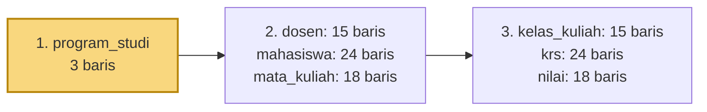

<div align="center">

# ⚙️ Teknologi Basis Data
### Modul Praktikum 5 — Manipulasi Data Menggunakan Data Manipulation Language (DML)


**Akram Junaidi (`2503060033`) · Program Studi Teknologi Informasi · UIN Mataram · 2026**

</div>

---

## 📖 Tentang Modul Ini

Setelah struktur fisik tabel selesai dibangun melalui DDL pada Modul 4, tahap berikutnya adalah mengisi dan mengelola rekaman data di dalamnya menggunakan **DML (*Data Manipulation Language*)**. Pada **Modul 5**, fokus praktikum mencakup tiga operasi inti pengelolaan data: menambahkan baris baru (`INSERT INTO`), memperbarui nilai data yang sudah ada (`UPDATE`), serta menghapus rekaman data tertentu secara terkontrol (`DELETE`).

Pada tugas mandiri, basis data **`db_akademikkampus`** diisi secara bertahap dari tabel induk hingga tabel transaksi hingga terkumpul **117 baris rekaman data** yang saling terhubung dan menjadi sumber dataset utama untuk analisis kueri pada Modul 6 dan pencadangan pada Modul 7.


> [!NOTE]
> Seluruh populasi data pada tabel anak (`dosen`, `mahasiswa`, `mata_kuliah`, `kelas_kuliah`, `krs`, dan `nilai`) mematuhi aturan **Integritas Referensial (`FOREIGN KEY`)** sehingga setiap nilai kunci tamu merujuk pada kunci utama yang valid di tabel induk.

---

## 📑 Daftar Isi

- [1. Cheat Sheet Perintah DML](#1-cheat-sheet-perintah-dml)
- [2. Konsep Dasar DML (`INSERT`, `UPDATE`, `DELETE`)](#2-konsep-dasar-dml-insert-update-delete)
- [3. Praktikum Terbimbing: Manipulasi Data SIAKAD SMA (`db_akademiksmahb`)](#3-praktikum-terbimbing-manipulasi-data-siakad-sma-db_akademiksmahb)
- [4. Tugas Mandiri: Populasi & Pengelolaan Data `db_akademikkampus`](#4-tugas-mandiri-populasi--pengelolaan-data-db_akademikkampus)
- [5. Refleksi dan Catatan Koreksi](#5-refleksi-dan-catatan-koreksi)
- [Referensi](#referensi)

---

## 1. Cheat Sheet Perintah DML

| Operasi | Sintaks SQL | Fungsi Utama |
|---|---|---|
| **Insert Tunggal** | `INSERT INTO tabel (kolom1, kolom2) VALUES (val1, val2);` | Menambahkan satu baris rekaman baru |
| **Insert Banyak** | `INSERT INTO tabel VALUES (...), (...), (...);` | Menambahkan banyak baris rekaman dalam satu eksekusi |
| **Update Data** | `UPDATE tabel SET kolom = nilai_baru WHERE kondisi;` | Mengubah nilai kolom pada baris yang memenuhi syarat |
| **Delete Data** | `DELETE FROM tabel WHERE kondisi;` | Menghapus baris rekaman spesifik berdasarkan syarat |
| **Verifikasi** | `SELECT * FROM tabel;` / `SELECT COUNT(*) FROM tabel;` | Memeriksa hasil perubahan dan jumlah baris data |

---

## 2. Konsep Dasar DML (`INSERT`, `UPDATE`, `DELETE`)

### 2.1 Aturan Pengisian Data (`INSERT INTO`)

1. **Urutan Populasi:** Data pada **tabel induk** (`program_studi`) harus dimasukkan lebih dahulu sebelum mengisi data pada **tabel anak** (`mahasiswa`, `dosen`, `mata_kuliah`), dan terakhir tabel penghubung (`kelas_kuliah`, `krs`, `nilai`).
2. **Kolom `AUTO_INCREMENT`:** Untuk tabel dengan kunci utama otomatis (`id_krs` pada `krs` dan `id_nilai` pada `nilai`), kolom `PK` dapat dilewati dalam daftar kolom `INSERT` agar MySQL/MariaDB mengisi nomor urut secara otomatis.
3. **Format Nilai:** Tipe string dan tanggal (`DATE`/`TIME`) wajib diapit tanda petik tunggal (`'...'`), sedangkan tipe numerik (`INT`, `DECIMAL`) ditulis langsung tanpa tanda petik.

### 2.2 Pengamanan pada `UPDATE` dan `DELETE`

> [!CAUTION]
> **Selalu sertakan klausa `WHERE` yang spesifik** (sebaiknya merujuk pada kolom `PRIMARY KEY`) saat menjalankan perintah `UPDATE` atau `DELETE`. Menjalankan `UPDATE` atau `DELETE` tanpa klausa `WHERE` akan mengubah atau menghapus **seluruh baris** di dalam tabel sekaligus!

### 2.3 Perilaku `ON DELETE RESTRICT` pada Relasi Tabel

Karena seluruh relasi pada `db_akademikkampus` dikonfigurasi dengan `ON DELETE RESTRICT`, server DBMS akan otomatis menolak penghapusan baris pada tabel induk (misalnya `program_studi` `'PR001'`) apabila masih terdapat baris mahasiswa, dosen, atau mata kuliah yang merujuk kepadanya.

---

## 3. Praktikum Terbimbing: Manipulasi Data SIAKAD SMA (`db_akademiksmahb`)

Pada latihan terbimbing, data uji dimasukkan ke dalam `db_akademiksmahb` secara berurutan, lalu dilakukan simulasi pembaruan alamat siswa dan penghapusan rekaman uji coba:

```sql
-- ==========================================================
-- PRAKTIKUM TERBIMBING MODUL 5 — DML SIAKAD SMA
-- ==========================================================

USE db_akademiksmahb;

-- 1. Mengisi tabel induk terlebih dahulu
INSERT INTO kelas (kode_kelas, nama_kelas, tahun_ajaran) VALUES
('KLS-X1', 'X IPA 1', '2025/2026'),
('KLS-X2', 'X IPA 2', '2025/2026');

INSERT INTO guru (kode_guru, nip_nuptk, nama_guru, jenis_kelamin, nomor_telepon) VALUES
('GR001', '198504122010011001', 'Ahmad Fauzi, S.Pd.', 'L', '081234567890'),
('GR002', '199007182015022002', 'Rina Marlina, M.Pd.', 'P', '081298765432');

INSERT INTO mata_pelajaran (kode_mapel, nama_mapel) VALUES
('MP001', 'Basis Data Dasar'),
('MP002', 'Pemrograman Web');

-- 2. Mengisi tabel anak (siswa, jadwal_pelajaran, nilai)
INSERT INTO siswa (nisn, nama_pesertadidik, jenis_kelamin, tanggal_lahir, alamat, kode_kelas) VALUES
('0081234501', 'Budi Santoso', 'L', '2009-05-14', 'Jl. Pendidikan No. 10, Mataram', 'KLS-X1'),
('0081234502', 'Nadia Putri', 'P', '2009-08-21', 'Jl. Majapahit No. 22, Mataram', 'KLS-X1'),
('0081234503', 'Rizki Ramadhan', 'L', '2009-02-11', 'Jl. Pejanggik No. 5, Mataram', 'KLS-X2');

INSERT INTO nilai (nisn, kode_mapel, semester, nilai_tugas, nilai_uts, nilai_uas, nilai_akhir) VALUES
('0081234501', 'MP001', 'Ganjil', 88.00, 85.00, 90.00, 87.80),
('0081234502', 'MP001', 'Ganjil', 92.00, 90.00, 94.00, 92.10);

-- 3. Mengubah data menggunakan UPDATE dengan klausa WHERE
UPDATE siswa
SET alamat = 'Jl. Sriwijaya No. 45, Mataram'
WHERE nisn = '0081234501';

-- 4. Menghapus satu baris uji coba menggunakan DELETE dengan klausa WHERE
DELETE FROM siswa
WHERE nisn = '0081234503';
```

---

## 4. Tugas Mandiri: Populasi & Pengelolaan Data `db_akademikkampus`

Pada tugas mandiri, ketujuh tabel pada **`db_akademikkampus`** diisi secara lengkap dan terstruktur sehingga menghasilkan total **117 baris data valid** yang siap dianalisis menggunakan kueri kompleks pada Modul 6.

### 4.1 Alur Populasi & Rekapitulasi 117 Baris Data



| Urutan Pengisian | Nama Tabel | Rentang Kode / Kunci Utama | Jumlah Rekaman | Keterangan Distribusi Data |
|:-:|---|:-:|:-:|---|
| 1 | `program_studi` | `PR001` – `PR003` | **3 baris** | Teknologi Informasi, Sistem Informasi, Ilmu Komputer |
| 2 | `dosen` | `DSN001` – `DSN015` | **15 baris** | Masing-masing 5 dosen per program studi |
| 3 | `mahasiswa` | `250306001` – `250306024` | **24 baris** | Masing-masing 8 mahasiswa per program studi (`PR001`–`PR003`) |
| 4 | `mata_kuliah` | `MK001` – `MK018` | **18 baris** | Masing-masing 6 mata kuliah (bobot 3 SKS) per program studi |
| 5 | `kelas_kuliah` | `KLS001` – `KLS015` | **15 baris** | Kelas paralel tahun ajaran `2025/2026` (tiap dosen mengampu 1 kelas) |
| 6 | `krs` | `id_krs` `1` – `24` | **24 baris** | Pengambilan mata kuliah oleh ke-24 mahasiswa pada semester `Ganjil` |
| 7 | `nilai` | `id_nilai` `1` – `18` | **18 baris** | Rekaman komponen tugas, UTS, UAS, `nilai_akhir`, dan `nilai_huruf` |
| **Total** | **7 Tabel Relasional** | — | **117 baris** | **100% tervalidasi tanpa pelanggaran Foreign Key** |

### 4.2 Contoh Skrip SQL Pengisian & Manipulasi Data (`db_akademikkampus`)

```sql
-- =====================================================================
-- TUGAS MANDIRI MODUL 5 — POPULASI & MANIPULASI DATA (db_akademikkampus)
-- Nama Mahasiswa : Akram Junaidi (NIM: 2503060033)
-- =====================================================================

USE db_akademikkampus;

-- 1. Mengisi Tabel Induk: program_studi (3 baris)
INSERT INTO program_studi (kode_prodi, nama_prodi, fakultas) VALUES
('PR001', 'Teknologi Informasi', 'Fakultas Dakwah dan Ilmu Komunikasi'),
('PR002', 'Sistem Informasi', 'Fakultas Sains dan Teknologi'),
('PR003', 'Ilmu Komputer', 'Fakultas Sains dan Teknologi');

-- 2. Mengisi Tabel dosen (contoh sampel dari 15 dosen: DSN001 - DSN015)
INSERT INTO dosen (kode_induk_dosen, nama_dosen, jenis_kelamin, no_telepon, email, alamat, kode_prodi) VALUES
('DSN001', 'Dr. Arief Budiman, M.Kom.', 'L', '081803711001', 'arief.budiman@uinmataram.ac.id', 'Mataram', 'PR001'),
('DSN002', 'Muti''ah, M.Pd.', 'P', '081803711002', 'mutiah@uinmataram.ac.id', 'Mataram', 'PR001'),
('DSN003', 'Hendra Saputra, M.T.', 'L', '081803711003', 'hendra.saputra@uinmataram.ac.id', 'Lombok Barat', 'PR001'),
('DSN004', 'Nurfadilah, M.Kom.', 'P', '081803711004', 'nurfadilah@uinmataram.ac.id', 'Mataram', 'PR001'),
('DSN005', 'Zulkifli Rahman, M.Cs.', 'L', '081803711005', 'zulkifli.rahman@uinmataram.ac.id', 'Lombok Tengah', 'PR001');
-- (Dilanjutkan hingga DSN015 untuk PR002 dan PR003)

-- 3. Mengisi Tabel mahasiswa (contoh sampel dari 24 mahasiswa: 250306001 - 250306024)
INSERT INTO mahasiswa (nim, nama_lengkap, jenis_kelamin, tanggal_lahir, alamat, tahun_angkatan, kode_prodi) VALUES
('250306001', 'Akram Junaidi', 'L', '2005-04-04', 'Jempong Baru, Sekarbela, Mataram', 2025, 'PR001'),
('250306004', 'Siti Aisyah', 'P', '2005-09-12', 'Ampenan, Mataram', 2025, 'PR001'),
('250306007', 'Andi Pratama', 'L', '2005-01-20', 'Cakranegara, Mataram', 2025, 'PR001'),
('250306017', 'Nadia Khairunnisa', 'P', '2005-06-18', 'Selaparang, Mataram', 2025, 'PR003'),
('250306021', 'M. Rizky Pratama', 'L', '2005-11-03', 'Sandubaya, Mataram', 2025, 'PR003');
-- (Dilanjutkan hingga 24 mahasiswa: masing-masing 8 mahasiswa per program studi)

-- 4. Mengisi Tabel mata_kuliah (contoh sampel dari 18 mata kuliah: MK001 - MK018)
INSERT INTO mata_kuliah (kode_mk, nama_mk, jumlah_sks, semester_kurikulum, kode_prodi) VALUES
('MK001', 'Teknologi Basis Data', 3, 3, 'PR001'),
('MK002', 'Pemrograman Web', 3, 3, 'PR001'),
('MK003', 'Jaringan Komputer', 3, 3, 'PR001'),
('MK004', 'Tata Kelola Teknologi Informasi', 3, 3, 'PR001'),
('MK005', 'Struktur Data dan Algoritma', 3, 3, 'PR001');
-- (Dilanjutkan hingga MK018 untuk seluruh program studi)

-- 5. Mengisi Tabel kelas_kuliah (contoh sampel dari 15 kelas: KLS001 - KLS015)
INSERT INTO kelas_kuliah (kode_kelas, nama_kelas, tahun_ajaran, hari, jam_mulai, jam_selesai, ruang, kode_mk, kode_induk_dosen) VALUES
('KLS001', 'TI-3A', '2025/2026', 'Senin', '08:00:00', '10:30:00', 'Lab Komputer TIPD 1', 'MK001', 'DSN002'),
('KLS002', 'TI-3B', '2025/2026', 'Selasa', '08:00:00', '10:30:00', 'Lab Komputer TIPD 2', 'MK002', 'DSN001'),
('KLS003', 'TI-3C', '2025/2026', 'Rabu', '10:30:00', '13:00:00', 'Ruang Kuliah 301', 'MK003', 'DSN003'),
('KLS004', 'TI-3D', '2025/2026', 'Kamis', '13:00:00', '15:30:00', 'Ruang Kuliah 302', 'MK004', 'DSN004'),
('KLS005', 'TI-3E', '2025/2026', 'Jumat', '08:00:00', '10:30:00', 'Lab Jaringan', 'MK005', 'DSN005');
-- (Dilanjutkan hingga KLS015)

-- 6. Mengisi Tabel Penghubung krs (24 baris) & nilai (18 baris)
INSERT INTO krs (nim, kode_mk, semester, tahun_akademik, tanggal_pengambilan, status_krs) VALUES
('250306001', 'MK001', 'Ganjil', '2025/2026', '2025-09-01', 'Disetujui'),
('250306004', 'MK001', 'Ganjil', '2025/2026', '2025-09-01', 'Disetujui'),
('250306007', 'MK002', 'Ganjil', '2025/2026', '2025-09-02', 'Disetujui');

INSERT INTO nilai (nim, kode_mk, kode_induk_dosen, semester, nilai_tugas, nilai_uts, nilai_uas, nilai_akhir, nilai_huruf) VALUES
('250306017', 'MK013', 'DSN011', 'Ganjil', 95.00, 94.00, 94.50, 94.50, 'A'),
('250306001', 'MK001', 'DSN002', 'Ganjil', 90.00, 88.00, 92.00, 90.20, 'A'),
('250306004', 'MK001', 'DSN002', 'Ganjil', 86.00, 85.00, 88.00, 86.50, 'A');

-- 7. Simulasi Pembaruan Data (UPDATE) dan Penghapusan Data Uji (DELETE)
UPDATE nilai
SET nilai_uas = 93.00, nilai_akhir = 90.60
WHERE nim = '250306001' AND kode_mk = 'MK001';

-- Menambahkan satu rekaman uji sementara lalu menghapusnya kembali agar tetap 117 baris
INSERT INTO krs (nim, kode_mk, semester, tahun_akademik, tanggal_pengambilan, status_krs)
VALUES ('250306001', 'MK005', 'Ganjil', '2025/2026', '2025-09-05', 'Batal');

DELETE FROM krs
WHERE nim = '250306001' AND kode_mk = 'MK005' AND status_krs = 'Batal';
```

### 4.3 Verifikasi Jumlah Rekaman Lintas 7 Tabel

```sql
SELECT 'program_studi' AS nama_tabel, COUNT(*) AS jumlah_baris FROM program_studi
UNION ALL SELECT 'dosen', COUNT(*) FROM dosen
UNION ALL SELECT 'mahasiswa', COUNT(*) FROM mahasiswa
UNION ALL SELECT 'mata_kuliah', COUNT(*) FROM mata_kuliah
UNION ALL SELECT 'kelas_kuliah', COUNT(*) FROM kelas_kuliah
UNION ALL SELECT 'krs', COUNT(*) FROM krs
UNION ALL SELECT 'nilai', COUNT(*) FROM nilai;
```

### 4.4 Checklist Ketentuan Tugas Mandiri

- [x] Mengisi data seluruh **7 tabel** sesuai urutan ketergantungan *Foreign Key*
- [x] Memastikan keunikan seluruh nilai *Primary Key* (`PR001`–`PR003`, `DSN001`–`DSN015`, `250306001`–`250306024`, `MK001`–`MK018`, `KLS001`–`KLS015`)
- [x] Menguji perintah `UPDATE` dan `DELETE` dengan klausa `WHERE` yang presisi tanpa memengaruhi rekaman lain
- [x] Memverifikasi total **117 baris data** valid sebagai dataset siap pakai untuk analisis Modul 6 dan *backup/restore* Modul 7

<!--
Simpan tangkapan layar hasil INSERT / SELECT COUNT(*) di folder images/ lalu aktifkan baris di bawah ini:

-->

---

## 5. Refleksi dan Catatan Koreksi

| Aspek / Masalah | Analisis dan Penyelesaian pada Implementasi Mandiri |
|---|---|
| **Urutan Pengisian untuk Mencegah Error `#1452`** | Galat `#1452 - Cannot add or update a child row: a foreign key constraint fails` terjadi apabila baris tabel anak dimasukkan sebelum baris induknya tersedia. Dengan mengisi `program_studi` terlebih dahulu, seluruh 117 baris berhasil dimasukkan tanpa kendala referensial. |
| **Dampak Perubahan DML terhadap Laporan Modul 6** | Setiap operasi `INSERT`, `UPDATE`, maupun `DELETE` pada tabel `nilai` dan `mahasiswa` secara langsung memengaruhi peringkat 5 besar nilai akhir tertinggi (`WHERE nilai_akhir >= 85.00`) maupun rekapitulasi jumlah mahasiswa per program studi (`GROUP BY kode_prodi`) pada kueri analitik Modul 6. |
| **Penanganan Tanda Petik Tunggal pada String** | Nama gelar yang mengandung tanda petik tunggal seperti `Muti'ah, M.Pd.` ditulis dengan *escape* dua tanda petik tunggal (`'Muti''ah, M.Pd.'`) agar tidak memutus string SQL. |

---

## Referensi

- Modul Praktikum 5 *Teknologi Basis Data* — **Muti'ah, M.Pd.**, Program Studi Teknologi Informasi, UIN Mataram, 2026.
- [MySQL 8.0 Data Manipulation Statements](https://dev.mysql.com/doc/refman/8.0/en/sql-data-manipulation-statements.html)
- [MariaDB INSERT, UPDATE, and DELETE Documentation](https://mariadb.com/kb/en/data-manipulation/)

---

<div align="center">

[⬅️ Modul 4: Implementasi Struktur Basis Data Menggunakan DDL](../Modul-4/README.md) · [Modul 6: Analisis Data Menggunakan DQL & JOIN ➡️](../Modul-6/README.md)

Dokumentasi Praktikum oleh **Akram Junaidi** ([@akramjunaidi](https://github.com/akramjunaidi))

</div>
