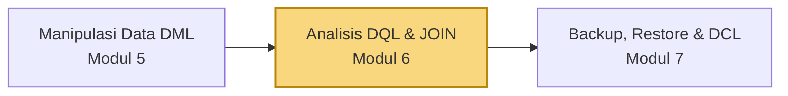
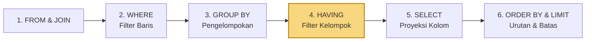

<div align="center">

# 📊 Teknologi Basis Data
### Modul Praktikum 6 — Analisis Data Akademik Menggunakan DQL, Agregasi, dan JOIN


**Akram Junaidi (`2503060033`) · Program Studi Teknologi Informasi · UIN Mataram · 2026**

</div>

---

## 📖 Tentang Modul Ini

Setelah basis data **`db_akademikkampus`** terisi lengkap sebanyak **117 baris rekaman data** melalui operasi DML pada Modul 5, tahap berikutnya adalah mengekstraksi informasi strategis dari data tersebut menggunakan **DQL (*Data Query Language*)**.

Pada **Modul 6**, fokus praktikum mencakup penyaringan baris (`WHERE`, `LIKE`, `IN`, `BETWEEN`), pengurutan dan pembatasan keluaran (`ORDER BY`, `LIMIT`), pengelompokan dan fungsi agregasi (`COUNT`, `GROUP BY`, `HAVING`), hingga penggabungan data lintas tabel menggunakan **`INNER JOIN`** (dua dan tiga tabel) serta **`LEFT JOIN`** melalui **16 skenario kueri analisis akademik**.



> [!NOTE]
> Perintah `SELECT` bersifat *read-only* (hanya membaca dan menampilkan proyeksi data), sehingga tidak mengubah struktur tabel maupun isi rekaman permanen pada `db_akademikkampus`.

---

## 📑 Daftar Isi

- [1. Cheat Sheet Perintah DQL, Agregasi & JOIN](#1-cheat-sheet-perintah-dql-agregasi--join)
- [2. Konsep Dasar Seleksi, Pengelompokan, dan Relasi Tabel](#2-konsep-dasar-seleksi-pengelompokan-dan-relasi-tabel)
- [3. Tugas Lanjutan: 16 Kueri Analisis Data (`db_akademikkampus`)](#3-tugas-lanjutan-16-kueri-analisis-data-db_akademikkampus)
  - [3.1 Proyeksi, Pengurutan, dan Penyaringan Data (Butir 1–7)](#31-proyeksi-pengurutan-dan-penyaringan-data-butir-17)
  - [3.2 Fungsi Agregasi, Pengelompokan, dan Laporan (Butir 8–12)](#32-fungsi-agregasi-pengelompokan-dan-laporan-butir-812)
  - [3.3 Penggabungan Multi-Tabel dengan JOIN (Butir 13–16)](#33-penggabungan-multi-tabel-dengan-join-butir-1316)
- [4. Refleksi dan Catatan Teknis](#4-refleksi-dan-catatan-teknis)
- [Referensi](#referensi)

---

## 1. Cheat Sheet Perintah DQL, Agregasi & JOIN

| Kategori | Sintaks / Klausa SQL | Fungsi Utama |
|---|---|---|
| **Proyeksi** | `SELECT kolom1, kolom2 FROM tabel;` | Memilih kolom spesifik yang akan ditampilkan |
| **Penyaringan** | `WHERE kondisi` (`AND`, `OR`, `NOT`) | Menyaring baris berdasarkan kriteria logika |
| **Pencocokan Pola** | `WHERE kolom LIKE '%pola%'` | Mencari substring menggunakan *wildcard* (`%` dan `_`) |
| **Daftar & Rentang** | `IN ('A', 'B')` / `BETWEEN x AND y` | Memilih nilai dalam himpunan atau rentang inklusif |
| **Urutan & Batas** | `ORDER BY kolom ASC\|DESC LIMIT n` | Mengurutkan hasil dan membatasi jumlah baris keluaran |
| **Agregasi** | `COUNT(*)`, `COUNT(kolom)`, `AVG()`, `MAX()`, `MIN()` | Menghitung ringkasan statistik data |
| **Pengelompokan** | `GROUP BY kolom HAVING kondisi_agregat` | Mengelompokkan baris dan menyaring hasil agregasi |
| **Relasi Tabel** | `INNER JOIN ... ON a.pk = b.fk` | Menggabungkan baris yang saling berpasangan di kedua tabel |
| **Deteksi Kosong** | `LEFT JOIN ... ON ... WHERE b.fk IS NULL` | Menampilkan seluruh data tabel kiri termasuk yang belum berpasangan |

---

## 2. Konsep Dasar Seleksi, Pengelompokan, dan Relasi Tabel

### Urutan Evaluasi Logis Kueri `SELECT`

Memahami urutan eksekusi internal SQL membantu mencegah kesalahan penempatan kondisi antara `WHERE` dan `HAVING`:



| Perbedaan | Klausa `WHERE` | Klausa `HAVING` |
|---|---|---|
| **Objek yang Disaring** | Baris data mentah sebelum dikelompokkan | Kelompok hasil agregasi setelah `GROUP BY` |
| **Penggunaan Fungsi Agregat** | ❌ Tidak dapat memakai `COUNT()`, `AVG()`, dll. | ✅ Wajib/dapat memakai fungsi agregat (`COUNT(*) > 1`) |

---

## 3. Tugas Lanjutan: 16 Kueri Analisis Data (`db_akademikkampus`)

Seluruh 16 butir analisis dieksekusi langsung pada basis data **`db_akademikkampus`** (7 tabel, 117 baris data).

### 3.1 Proyeksi, Pengurutan, dan Penyaringan Data (Butir 1–7)

#### 1. Menampilkan Seluruh Data dan Proyeksi Kolom Program Studi
```sql
-- 1a. Menampilkan seluruh kolom pada tabel program_studi (3 baris)
SELECT * FROM program_studi;

-- 1b. Menampilkan hanya kolom kode_prodi dan nama_prodi (3 baris)
SELECT kode_prodi, nama_prodi
FROM program_studi;
```
> **Interpretasi:** Kueri `1a` menampilkan lengkap tiga atribut (`kode_prodi`, `nama_prodi`, `fakultas`) untuk 3 program studi (`PR001`, `PR002`, `PR003`), sedangkan kueri `1b` memproyeksikan dua kolom utama agar tampilan lebih ringkas.

#### 2. Menampilkan Identitas Mahasiswa Terurut Alfabetis (`ORDER BY`)
```sql
SELECT nim, nama_lengkap, tahun_angkatan
FROM mahasiswa
ORDER BY nama_lengkap ASC;
```
> **Interpretasi:** Menampilkan seluruh 24 mahasiswa terurut secara menaik (`ASC`) dari abjad A hingga Z, dimulai dari **Akram Junaidi (`250306001`)** hingga **Siti Aisyah (`250306004`)**.

#### 3. Pencarian Pola Nama Mahasiswa (`LIKE` dan Wildcard)
```sql
SELECT nim, nama_lengkap, kode_prodi
FROM mahasiswa
WHERE nama_lengkap LIKE '%Pratama%';
```
> **Interpretasi:** Pola `'%Pratama%'` mencocokkan substring di posisi mana pun dan menemukan **2 mahasiswa**, yakni **Andi Pratama (`250306007`)** dan **M. Rizky Pratama (`250306021`)**.

#### 4. Filter Mahasiswa dari Beberapa Program Studi (`IN`)
```sql
SELECT nim, nama_lengkap, kode_prodi, tahun_angkatan
FROM mahasiswa
WHERE kode_prodi IN ('PR001', 'PR002');
```
> **Interpretasi:** Menyaring mahasiswa yang terdaftar pada Program Studi Teknologi Informasi (`PR001`) atau Sistem Informasi (`PR002`), menghasilkan **16 mahasiswa** (masing-masing 8 mahasiswa per prodi) dan mengecualikan `PR003`.

#### 5. Filter Dosen yang Memenuhi Dua Kriteria Sekaligus (`AND`)
```sql
SELECT kode_induk_dosen, nama_dosen, jenis_kelamin, kode_prodi
FROM dosen
WHERE kode_prodi = 'PR001'
  AND jenis_kelamin = 'L';
```
> **Interpretasi:** Operator logika `AND` menyaring dosen laki-laki (`'L'`) yang bertugas pada `PR001`, menghasilkan **3 dosen** (`DSN001`, `DSN003`, dan `DSN005`).

#### 6. Filter Rentang SKS Mata Kuliah (`BETWEEN`) dan Pengurutan (`DESC`)
```sql
SELECT kode_mk, nama_mk, jumlah_sks
FROM mata_kuliah
WHERE jumlah_sks BETWEEN 2 AND 4
ORDER BY jumlah_sks DESC;
```
> **Interpretasi:** Menampilkan seluruh **18 mata kuliah** karena masing-masing memiliki bobot **3 SKS** (berada pada rentang inklusif 2 hingga 4 SKS).

#### 7. Menampilkan Lima Data Kelas Kuliah Pertama (`ORDER BY` dan `LIMIT`)
```sql
SELECT kode_kelas, nama_kelas, tahun_ajaran, kode_mk
FROM kelas_kuliah
ORDER BY kode_kelas ASC
LIMIT 5;
```
> **Interpretasi:** Mengurutkan daftar kelas kuliah berdasarkan `kode_kelas` secara menaik dan membatasi keluaran sebanyak 5 baris pertama (`KLS001` / `TI-3A` hingga `KLS005` / `TI-3E`).

---

### 3.2 Fungsi Agregasi, Pengelompokan, dan Laporan (Butir 8–12)

#### 8. Menghitung Jumlah Mahasiswa per Program Studi (`GROUP BY`)
```sql
SELECT kode_prodi, COUNT(*) AS jumlah_mahasiswa
FROM mahasiswa
GROUP BY kode_prodi;
```
> **Interpretasi:** Memperlihatkan distribusi mahasiswa yang merata pada ketiga program studi: `PR001` (8 mahasiswa), `PR002` (8 mahasiswa), dan `PR003` (8 mahasiswa).

#### 9. Menghitung Jumlah Kelas Kuliah per Dosen (`GROUP BY`)
```sql
SELECT kode_induk_dosen, COUNT(*) AS jumlah_kelas
FROM kelas_kuliah
GROUP BY kode_induk_dosen;
```
> **Interpretasi:** Ke-15 dosen (`DSN001` hingga `DSN015`) masing-masing mengampu tepat **1 kelas kuliah** pada tahun ajaran `2025/2026`.

#### 10. Menyaring Kelompok dengan Lebih dari Satu Data Terkait (`HAVING`)
```sql
SELECT kode_prodi, COUNT(*) AS total_mahasiswa
FROM mahasiswa
GROUP BY kode_prodi
HAVING COUNT(*) > 1;
```
> **Interpretasi:** Menyaring kelompok program studi dengan jumlah anggota lebih dari satu, menampilkan ketiga program studi (`PR001`, `PR002`, dan `PR003`) yang masing-masing memiliki 8 mahasiswa.

#### 11. Perbandingan `COUNT(*)` dengan `COUNT(kolom_yang_boleh_NULL)`
```sql
SELECT COUNT(*) AS total_baris_mahasiswa,
       COUNT(alamat) AS total_alamat_terisi
FROM mahasiswa;
```
> **Interpretasi:** Kedua fungsi menghasilkan nilai identik yaitu **24**, karena meskipun kolom `alamat` didefinisikan mengizinkan nilai kosong (`DEFAULT NULL`), seluruh 24 baris mahasiswa telah terisi alamatnya.

#### 12. Laporan 5 Besar Nilai Akhir Tertinggi (`WHERE`, `ORDER BY`, `LIMIT`)
```sql
SELECT id_nilai, nim, kode_induk_dosen, nilai_akhir
FROM nilai
WHERE nilai_akhir >= 85.00
ORDER BY nilai_akhir DESC
LIMIT 5;
```
> **Interpretasi:** Menampilkan 5 mahasiswa dengan `nilai_akhir` tertinggi ($\ge 85.00$), dipimpin oleh NIM **`250306017`** dengan nilai **`94.50`**. Setiap operasi `INSERT` atau `UPDATE` pada tabel `nilai` di Modul 5 secara langsung memengaruhi peringkat laporan ini.

---

### 3.3 Penggabungan Multi-Tabel dengan JOIN (Butir 13–16)

#### 13. Identitas Mahasiswa Beserta Program Studi (`INNER JOIN` 2 Tabel)
```sql
SELECT m.nim, m.nama_lengkap, p.nama_prodi, p.fakultas
FROM mahasiswa AS m
INNER JOIN program_studi AS p
    ON m.kode_prodi = p.kode_prodi;
```
> **Interpretasi:** Menghubungkan `mahasiswa` dan `program_studi` melalui kunci tamu `kode_prodi`, menghasilkan **24 baris** profil lengkap mahasiswa beserta nama program studi dan fakultasnya.

#### 14. Informasi Mata Kuliah Beserta Kelas Kuliah (`INNER JOIN` 2 Tabel)
```sql
SELECT mk.kode_mk, mk.nama_mk, mk.jumlah_sks,
       k.kode_kelas, k.nama_kelas, k.tahun_ajaran
FROM mata_kuliah AS mk
INNER JOIN kelas_kuliah AS k
    ON mk.kode_mk = k.kode_mk;
```
> **Interpretasi:** Menampilkan **15 mata kuliah** yang telah dijadwalkan ke dalam kelas kuliah aktif (`KLS001`–`KLS015`) pada tahun ajaran `2025/2026`.

#### 15. Daftar KRS Beserta Nama Mahasiswa dan Mata Kuliah (`INNER JOIN` 3 Tabel)
```sql
SELECT k.id_krs, m.nim, m.nama_lengkap, mk.nama_mk,
       k.semester, k.tahun_akademik
FROM krs AS k
INNER JOIN mahasiswa AS m
    ON k.nim = m.nim
INNER JOIN mata_kuliah AS mk
    ON k.kode_mk = mk.kode_mk;
```
> **Interpretasi:** Menggabungkan tiga tabel (`krs`, `mahasiswa`, dan `mata_kuliah`) untuk menerjemahkan kode referensi menjadi **24 baris informasi KRS** lengkap dengan nama mahasiswa dan nama mata kuliah.

#### 16. Menemukan Program Studi Tanpa Data Terkait (`LEFT JOIN`)
```sql
SELECT p.kode_prodi, p.nama_prodi, m.nim
FROM program_studi AS p
LEFT JOIN mahasiswa AS m
    ON p.kode_prodi = m.kode_prodi
WHERE m.nim IS NULL;
```
> **Interpretasi:** Mengembalikan hasil kosong (**0 baris**), yang membuktikan bahwa seluruh program studi (`PR001`, `PR002`, dan `PR003`) sudah memiliki mahasiswa terdaftar tanpa ada program studi yang kosong.

### Ringkasan Keluaran 16 Kueri Analisis

| No. | Fokus Kueri | Klausa Utama | Jumlah Baris Hasil |
|:-:|---|---|:-:|
| 1 | Proyeksi tabel `program_studi` | `SELECT *` & kolom spesifik | 3 baris |
| 2 | Urutan alfabetis mahasiswa | `ORDER BY nama_lengkap ASC` | 24 baris |
| 3 | Pencarian substring `'Pratama'` | `WHERE ... LIKE '%Pratama%'` | 2 baris |
| 4 | Filter prodi `PR001` dan `PR002` | `WHERE kode_prodi IN (...)` | 16 baris |
| 5 | Filter dosen laki-laki pada `PR001` | `WHERE ... AND ...` | 3 baris |
| 6 | Rentang bobot 2–4 SKS | `WHERE jumlah_sks BETWEEN 2 AND 4` | 18 baris |
| 7 | Lima kelas kuliah pertama | `ORDER BY ... ASC LIMIT 5` | 5 baris |
| 8 | Rekap mahasiswa per prodi | `GROUP BY kode_prodi` | 3 baris (8 mhs/prodi) |
| 9 | Rekap kelas per dosen | `GROUP BY kode_induk_dosen` | 15 baris (1 kelas/dosen) |
| 10 | Kelompok prodi > 1 mahasiswa | `GROUP BY ... HAVING COUNT(*) > 1` | 3 baris |
| 11 | Perbandingan baris vs kolom `NULL` | `COUNT(*)` vs `COUNT(alamat)` | 1 baris (nilai 24 vs 24) |
| 12 | Top 5 nilai akhir $\ge 85.00$ | `WHERE ... ORDER BY ... DESC LIMIT 5` | 5 baris (tertinggi `94.50`) |
| 13 | Mahasiswa + Prodi & Fakultas | `INNER JOIN` (2 tabel) | 24 baris |
| 14 | Mata Kuliah + Kelas Kuliah | `INNER JOIN` (2 tabel) | 15 baris |
| 15 | KRS + Mahasiswa + Mata Kuliah | `INNER JOIN` (3 tabel) | 24 baris |
| 16 | Deteksi prodi tanpa mahasiswa | `LEFT JOIN ... WHERE m.nim IS NULL` | 0 baris (semua terisi) |

---

## 4. Refleksi dan Catatan Teknis

| Butir / Topik | Analisis Teknis pada Dataset `db_akademikkampus` |
|---|---|
| **Pemilihan Tabel pada Klausa `HAVING` (Butir 10)** | Karena setiap dosen (`DSN001`–`DSN015`) pada tabel `kelas_kuliah` hanya mengampu 1 kelas (`jumlah_kelas = 1`), pengujian `HAVING COUNT(*) > 1` diterapkan pada tabel `mahasiswa` berdasarkan `kode_prodi` (masing-masing 8 mahasiswa) sehingga menghasilkan kelompok agregat yang valid. |
| **Konsistensi `COUNT(*)` dan `COUNT(alamat)` (Butir 11)** | Fungsi `COUNT(kolom)` hanya menghitung baris yang tidak bernilai `NULL`. Karena seluruh 24 data mahasiswa telah terisi alamatnya, `COUNT(alamat)` bernilai sama dengan `COUNT(*)` (`24`). |
| **Makna 0 Baris pada `LEFT JOIN` (Butir 16)** | Pola `LEFT JOIN ... WHERE child.pk IS NULL` merupakan teknik standar audit integritas untuk menemukan data induk yatim (*orphan parent*). Hasil 0 baris menandakan distribusi data mahasiswa telah mencakup seluruh program studi. |

---

## Referensi

- Modul Praktikum 6 *Teknologi Basis Data* — **Muti'ah, M.Pd.**, Program Studi Teknologi Informasi, UIN Mataram, 2026.
- [MySQL 8.0 SELECT Statement Documentation](https://dev.mysql.com/doc/refman/8.0/en/select.html)
- [MariaDB JOIN Syntax](https://mariadb.com/kb/en/join-syntax/)

---

<div align="center">

[⬅️ Modul 5: Manipulasi Data Menggunakan DML](../Modul-5/README.md) · [Modul 7: Backup, Restore, dan Pengelolaan Hak Akses ➡️](../Modul-7/README.md)

Dokumentasi Praktikum oleh **Akram Junaidi** ([@akramjunaidi](https://github.com/akramjunaidi))

</div>
