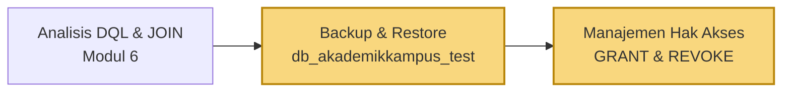

<div align="center">

# 🔐 Teknologi Basis Data
### Modul Praktikum 7 — Backup, Restore, dan Pengelolaan Hak Akses Basis Data (DCL)


**Akram Junaidi (`2503060033`) · Program Studi Teknologi Informasi · UIN Mataram · 2026**

</div>

---

## 📖 Tentang Modul Ini

Modul penutup pada rangkaian praktikum **Teknologi Basis Data** berfokus pada dua pilar utama administrasi basis data profesional: **ketersediaan dan pemulihan data (*Backup & Restore*)** serta **keamanan otorisasi pengguna (*Data Control Language* / DCL)**.

Pada **Modul 7**, seluruh struktur dan rekaman data basis data utama **`db_akademikkampus`** (7 tabel, 117 baris) dicadangkan ke dalam berkas **`backup_kampus_2503060033.sql`**, dipulihkan secara terisolasi ke dalam basis data pengujian **`db_akademikkampus_test`** tanpa menimpa basis data sumber, serta diuji penerapan prinsip keamanan ***least privilege*** menggunakan akun pembaca terbatas **`'petugas_baca'@'localhost'`**.



> [!NOTE]
> Pemulihan berkas cadangan dilakukan pada basis data pengujian terpisah (**`db_akademikkampus_test`**) agar basis data produksi/utama (**`db_akademikkampus`**) tetap aman dari risiko penimpaan atau duplikasi data.

---

## 📑 Daftar Isi

- [1. Cheat Sheet Perintah Administrasi & Hak Akses (DCL)](#1-cheat-sheet-perintah-administrasi--hak-akses-dcl)
- [2. Konsep Backup, Restore, dan Prinsip Least Privilege](#2-konsep-backup-restore-dan-prinsip-least-privilege)
- [3. Tahap 1 — Backup & Restore Basis Data Kampus (`db_akademikkampus_test`)](#3-tahap-1--backup--restore-basis-data-kampus-db_akademikkampus_test)
- [4. Tahap 2 — Pengelolaan Hak Akses Pengguna (`'petugas_baca'@'localhost'`)](#4-tahap-2--pengelolaan-hak-akses-pengguna-petugas_bacalocalhost)
- [5. Refleksi Praktikum dan Catatan Koreksi](#5-refleksi-praktikum-dan-catatan-koreksi)
- [Referensi](#referensi)

---

## 1. Cheat Sheet Perintah Administrasi & Hak Akses (DCL)

| Kelompok | Perintah SQL | Fungsi Utama |
|---|---|---|
| **Inspeksi Baris** | `SELECT COUNT(*) FROM tabel;` | Menghitung jumlah rekaman data sebelum & sesudah *restore* |
| **Database Uji** | `CREATE DATABASE db_akademikkampus_test;` | Membuat wadah database terpisah untuk pengujian pemulihan |
| **Manajemen User** | `CREATE USER 'user'@'localhost' IDENTIFIED BY 'pass';` | Membuat akun pengguna baru pada server lokal |
| | `DROP USER IF EXISTS 'user'@'localhost';` | Menghapus akun pengguna secara permanen dari server |
| **Pemberian Izin** | `GRANT SELECT ON db.* TO 'user'@'localhost';` | Memberikan hak akses baca saja (*read-only*) pada database target |
| **Pencabutan Izin** | `REVOKE SELECT ON db.* FROM 'user'@'localhost';` | Mencabut hak akses tertentu tanpa menghapus akun pengguna |
| **Audit & Reload** | `SHOW GRANTS FOR 'user'@'localhost';` | Menampilkan daftar hak akses aktif yang dimiliki pengguna |
| | `FLUSH PRIVILEGES;` | Memuat ulang tabel hak akses (*grant tables*) pada server |

---

## 2. Konsep Backup, Restore, dan Prinsip Least Privilege

| Konsep | Penjelasan Teknis | Implementasi pada Tugas Mandiri |
|---|---|---|
| **Backup (Pencadangan)** | Proses mengekspor definisi struktur (`CREATE TABLE`) dan rekaman data (`INSERT INTO`) ke berkas eksternal `.sql` untuk mitigasi kehilangan data. | Ekspor **Custom SQL** (`Structure` + `Data`) dari `db_akademikkampus` ke **`backup_kampus_2503060033.sql`**. |
| **Restore (Pemulihan)** | Proses mengimpor kembali berkas cadangan `.sql` ke server DBMS untuk membangun ulang struktur dan isi basis data. | Impor 40 kueri dari `backup_kampus_2503060033.sql` ke **`db_akademikkampus_test`**. |
| **Least Privilege** | Prinsip keamanan yang membatasi hak akses akun pengguna hanya sebatas wewenang minimum yang diperlukan untuk tugasnya. | Akun **`'petugas_baca'@'localhost'`** hanya diberi izin **`SELECT`** pada `db_akademikkampus_test.*` tanpa hak `INSERT`, `UPDATE`, `DELETE`, maupun `DROP`. |

---

## 3. Tahap 1 — Backup & Restore Basis Data Kampus (`db_akademikkampus_test`)

### 3.1 Pemeriksaan Basis Data Utama & Tiga Tabel Pilihan

Sebelum melakukan ekspor, dilakukan verifikasi daftar tabel dan perhitungan jumlah baris awal pada tiga tabel acuan (`mahasiswa`, `dosen`, dan `nilai`):

```sql
USE db_akademikkampus;
SHOW TABLES;

SELECT 'mahasiswa' AS nama_tabel, COUNT(*) AS jumlah_baris FROM mahasiswa
UNION ALL
SELECT 'dosen', COUNT(*) FROM dosen
UNION ALL
SELECT 'nilai', COUNT(*) FROM nilai;
```

| Tabel Pilihan | Jumlah Baris Awal (`db_akademikkampus`) | Peran dalam Basis Data |
|---|:-:|---|
| `mahasiswa` | **24 baris** | Tabel master mahasiswa aktif (`PR001`–`PR003`) |
| `dosen` | **15 baris** | Tabel master dosen pengampu (`DSN001`–`DSN015`) |
| `nilai` | **18 baris** | Tabel transaksi evaluasi hasil belajar mahasiswa |

### 3.2 Ekspor SQL (`backup_kampus_2503060033.sql`) & Pembuatan Database Uji

1. Pada **phpMyAdmin**, pilih basis data **`db_akademikkampus`** → buka tab **Export**.
2. Pilih metode **Custom**, format **SQL**, pastikan seluruh **7 tabel** tercentang pada opsi **Structure** dan **Data**, serta pilih penyimpanan ke berkas bernama **`backup_kampus_2503060033.sql`** dengan pengodean **`utf-8`**.
3. Periksa berkas hasil unduhan di **Visual Studio Code** untuk memastikan sintaks `CREATE TABLE` dan `INSERT INTO` lengkap serta tidak memuat perintah `USE db_akademikkampus;` yang dapat menimpa database sumber.
4. Buat basis data pengujian baru dan impor berkas cadangan ke dalamnya:

```sql
CREATE DATABASE db_akademikkampus_test;
```

*(Dilanjutkan memilih `db_akademikkampus_test` → tab **Import** → unggah `backup_kampus_2503060033.sql` → eksekusi sukses: **`40 queries executed`**).*

### 3.3 Komparasi Jumlah Baris Lintas 7 Tabel (Utama vs Pengujian)

```sql
SELECT 'program_studi' AS nama_tabel,
       (SELECT COUNT(*) FROM db_akademikkampus.program_studi) AS db_utama,
       (SELECT COUNT(*) FROM db_akademikkampus_test.program_studi) AS db_pengujian
UNION ALL
SELECT 'dosen',
       (SELECT COUNT(*) FROM db_akademikkampus.dosen),
       (SELECT COUNT(*) FROM db_akademikkampus_test.dosen)
UNION ALL
SELECT 'mahasiswa',
       (SELECT COUNT(*) FROM db_akademikkampus.mahasiswa),
       (SELECT COUNT(*) FROM db_akademikkampus_test.mahasiswa)
UNION ALL
SELECT 'mata_kuliah',
       (SELECT COUNT(*) FROM db_akademikkampus.mata_kuliah),
       (SELECT COUNT(*) FROM db_akademikkampus_test.mata_kuliah)
UNION ALL
SELECT 'kelas_kuliah',
       (SELECT COUNT(*) FROM db_akademikkampus.kelas_kuliah),
       (SELECT COUNT(*) FROM db_akademikkampus_test.kelas_kuliah)
UNION ALL
SELECT 'krs',
       (SELECT COUNT(*) FROM db_akademikkampus.krs),
       (SELECT COUNT(*) FROM db_akademikkampus_test.krs)
UNION ALL
SELECT 'nilai',
       (SELECT COUNT(*) FROM db_akademikkampus.nilai),
       (SELECT COUNT(*) FROM db_akademikkampus_test.nilai);
```

| No. | Nama Tabel | Jumlah Baris (`db_akademikkampus`) | Jumlah Baris (`db_akademikkampus_test`) | Status Verifikasi |
|:-:|---|:-:|:-:|:---:|
| 1 | `program_studi` | 3 baris | 3 baris | ✅ Identik |
| 2 | `dosen` | 15 baris | 15 baris | ✅ Identik |
| 3 | `mahasiswa` | 24 baris | 24 baris | ✅ Identik |
| 4 | `mata_kuliah` | 18 baris | 18 baris | ✅ Identik |
| 5 | `kelas_kuliah` | 15 baris | 15 baris | ✅ Identik |
| 6 | `krs` | 24 baris | 24 baris | ✅ Identik |
| 7 | `nilai` | 18 baris | 18 baris | ✅ Identik |
| **Total** | **7 Tabel Relasional** | **117 baris** | **117 baris** | **✅ 100% Sesuai** |

---

## 4. Tahap 2 — Pengelolaan Hak Akses Pengguna (`'petugas_baca'@'localhost'`)

### 4.1 Pembuatan Akun & Pemberian Hak Akses Baca (`GRANT SELECT`)

```sql
DROP USER IF EXISTS 'petugas_baca'@'localhost';

CREATE USER 'petugas_baca'@'localhost'
IDENTIFIED BY 'BacaKampus_2026!';

GRANT SELECT
ON db_akademikkampus_test.*
TO 'petugas_baca'@'localhost';

FLUSH PRIVILEGES;
```

### 4.2 Verifikasi Daftar Hak Akses (`SHOW GRANTS`)

```sql
SHOW GRANTS FOR 'petugas_baca'@'localhost';
```

**Keluaran `SHOW GRANTS` sebelum pencabutan:**
```text
GRANT USAGE ON *.* TO `petugas_baca`@`localhost` IDENTIFIED BY PASSWORD '...'
GRANT SELECT ON `db_akademikkampus_test`.* TO `petugas_baca`@`localhost`
```

### 4.3 Pencabutan Hak Akses (`REVOKE SELECT`) dan Audit Akhir

```sql
-- Mencabut hak akses SELECT pada db_akademikkampus_test.*
REVOKE SELECT ON `db_akademikkampus_test`.* FROM 'petugas_baca'@'localhost';
FLUSH PRIVILEGES;

-- Memverifikasi bahwa hak SELECT telah tercabut
SHOW GRANTS FOR 'petugas_baca'@'localhost';
```

**Keluaran `SHOW GRANTS` setelah pencabutan:**
```text
GRANT USAGE ON *.* TO `petugas_baca`@`localhost` IDENTIFIED BY PASSWORD '...'
```
*(Baris `GRANT SELECT ON db_akademikkampus_test.*` telah hilang; akun tetap terdaftar pada server dengan izin koneksi dasar `USAGE` tanpa kewenangan mengakses objek tabel mana pun).*

> [!TIP]
> Apabila akun pengujian `'petugas_baca'@'localhost'` tidak lagi diperlukan setelah dokumentasi selesai, akun dapat dihapus permanen dari server dengan perintah `DROP USER IF EXISTS 'petugas_baca'@'localhost';`.

---

## 5. Refleksi Praktikum dan Catatan Koreksi

| Pertanyaan / Aspek Refleksi | Jawaban dan Analisis Teknis |
|---|---|
| **1. Perbedaan `backup` dengan `restore`** | **Backup** mengekspor struktur skema dan rekaman data dari basis data aktif ke berkas cadangan eksternal (`.sql`). Sebaliknya, **restore** mengimpor kembali berkas cadangan tersebut ke server DBMS untuk membangun ulang struktur dan data saat pemulihan atau pengujian. |
| **2. Mengapa berkas hasil `export` perlu diuji melalui `import`?** | Untuk memverifikasi bahwa berkas cadangan tidak korup, tidak terpotong, memiliki *encoding* yang valid, serta urutan pembuatan tabel berelasi (`FOREIGN KEY`) dapat dieksekusi tanpa galat sebelum benar-benar dibutuhkan pada kondisi darurat. |
| **3. Risiko melakukan `import` ke basis data yang salah** | Mengimpor ke basis data produksi yang sedang aktif dapat menimpa tabel existing (jika memuat `DROP TABLE IF EXISTS`), menggandakan baris data, memicu galat *Duplicate entry*, hingga merusak integritas referensial antar-tabel. |
| **4. Mengapa akun pembaca cukup diberikan izin `SELECT`?** | Sesuai prinsip *least privilege*, akun pelaporan tidak membutuhkan hak modifikasi data. Pembatasan hanya pada izin `SELECT` mencegah kesalahan manusia (*human error*) seperti penghapusan tidak disengaja dan membatasi dampak penyalahgunaan kredensial. |
| **5. Perbedaan `GRANT`, `REVOKE`, dan `DROP USER`** | `GRANT` memberikan hak akses tertentu atas objek basis data; `REVOKE` mencabut hak akses tertentu tanpa menghapus akun dari server; sedangkan `DROP USER` menghapus akun pengguna secara permanen beserta seluruh hak akses yang melekat padanya. |

---

## Referensi

- Modul Praktikum 7 *Teknologi Basis Data* — **Muti'ah, M.Pd.**, Program Studi Teknologi Informasi, UIN Mataram, 2026.
- [MySQL 8.0 Account Management Statements (`CREATE USER`, `GRANT`, `REVOKE`, `DROP USER`)](https://dev.mysql.com/doc/refman/8.0/en/account-management-statements.html)
- [MariaDB Backup and Restore Overview](https://mariadb.com/kb/en/backup-and-restore-overview/)

---

<div align="center">

[⬅️ Modul 6: Analisis Data Menggunakan DQL & JOIN](../Modul-6/README.md) · [🏠 Halaman Utama Repository](../README.md)

Dokumentasi Praktikum oleh **Akram Junaidi** ([@akramjunaidi](https://github.com/akramjunaidi))

</div>
