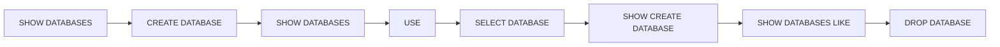

<div align="center">

# 🗄️ Teknologi Basis Data
### Modul Praktikum 1 — Pengenalan Sistem Basis Data dan DBMS


**Program Studi Teknologi Informasi · UIN Mataram · 2026**

</div>

---

## 📖 Tentang Repository Ini

Repository ini berisi **rangkuman seluruh perintah SQL** yang dipakai pada Modul Praktikum 1 mata kuliah *Teknologi Basis Data*.

Pada modul ini fokus kita adalah **mengelola database-nya saja** (wadah data): membuat, melihat, memilih, dan menghapus database. Belum ada tabel dan isi data. Tabel baru dipelajari di modul berikutnya.

> [!NOTE]
> Modul asli disusun oleh **Muti'ah, M.Pd**. README ini adalah ringkasan belajar pribadi berdasarkan modul tersebut.

---

## 📑 Daftar Isi

- [Persiapan](#persiapan)
- [Cheat Sheet](#cheat-sheet)
- [1. Informasi Server](#1-informasi-server)
- [2. Membuat Database](#2-membuat-database)
- [3. Melihat dan Mencari Database](#3-melihat-dan-mencari-database)
- [4. Memilih Database](#4-memilih-database)
- [5. Menghapus Database](#5-menghapus-database)
- [Alur Praktikum Lengkap](#alur-praktikum-lengkap)
- [Template Tugas Praktikum](#template-tugas-praktikum)
- [Kategori Perintah SQL](#kategori-perintah-sql)
- [Catatan Penting](#catatan-penting)
- [Referensi](#referensi)

---

## Persiapan

Sebelum menjalankan perintah apa pun, pastikan server database sudah hidup.

| Langkah | Yang dilakukan |
|:-:|---|
| 1️⃣ | Buka **XAMPP Control Panel** |
| 2️⃣ | Klik **Start** pada modul **Apache** dan **MySQL** |
| 3️⃣ | Buka browser, lalu akses `http://localhost/phpmyadmin` |
| 4️⃣ | Pilih tab **SQL**, lalu tulis dan jalankan perintah di bawah ini |

> [!WARNING]
> Di phpMyAdmin akan terlihat database bawaan seperti `information_schema`, `mysql`, `performance_schema`, `phpmyadmin`, dan `test`. **Jangan dihapus atau diubah**, karena dibutuhkan oleh sistem DBMS dan phpMyAdmin.

---

## Cheat Sheet

Semua perintah modul dalam satu tabel:

| # | Perintah | Fungsi |
|:-:|---|---|
| 1 | `SELECT VERSION();` | Melihat versi DBMS |
| 2 | `SELECT USER();` | Melihat user database yang aktif |
| 3 | `SELECT NOW();` | Melihat tanggal dan jam server |
| 4 | `CREATE DATABASE nama_db;` | Membuat database |
| 5 | `CREATE DATABASE IF NOT EXISTS nama_db;` | Membuat database jika belum ada |
| 6 | `SHOW DATABASES;` | Menampilkan semua database |
| 7 | `SHOW DATABASES LIKE 'db%';` | Mencari database berdasarkan pola nama |
| 8 | `SHOW CREATE DATABASE nama_db;` | Melihat definisi pembuatan database |
| 9 | `USE nama_db;` | Memilih database aktif |
| 10 | `SELECT DATABASE();` | Mengecek database yang sedang aktif |
| 11 | `DROP DATABASE nama_db;` | Menghapus database |
| 12 | `DROP DATABASE IF EXISTS nama_db;` | Menghapus database jika ada |

---

## 1. Informasi Server

Tiga perintah untuk mengenali server tempat kamu bekerja.

```sql
SELECT VERSION();   -- versi MySQL/MariaDB
SELECT USER();      -- user yang sedang login
SELECT NOW();       -- tanggal & jam server
```

| Perintah | Contoh hasil |
|---|---|
| `SELECT VERSION();` | `10.4.32-MariaDB` *(tergantung instalasi)* |
| `SELECT USER();` | `root@localhost` |
| `SELECT NOW();` | `2026-10-23 09:30:15` |

> [!TIP]
> Perhatikan tanda kurung `()` pada `USER()`. Menulis `SELECT USER;` tanpa kurung akan menghasilkan error.

---

## 2. Membuat Database

### Cara 1 — Perintah SQL

```sql
CREATE DATABASE db_akademik;
```

Jika dijalankan **dua kali**, percobaan kedua akan error karena nama sudah dipakai:

```
#1007 - Can't create database 'db_akademik'; database exists
```

### Cara 2 — Dengan `IF NOT EXISTS` (lebih aman)

```sql
CREATE DATABASE IF NOT EXISTS db_akademik;
```

Database hanya dibuat **jika belum ada**. Kalau sudah ada, tidak terjadi error dan database lama tidak ditimpa.

### Cara 3 — Lewat antarmuka phpMyAdmin (GUI)

Buka menu **Databases**, tulis nama database pada kolom yang tersedia, lalu klik **Create**.

| Perintah | Kalau database sudah ada | Kalau belum ada |
|---|---|---|
| `CREATE DATABASE x;` | ❌ Error | ✅ Dibuat |
| `CREATE DATABASE IF NOT EXISTS x;` | ✅ Aman, tidak dibuat ulang | ✅ Dibuat |

---

## 3. Melihat dan Mencari Database

### Menampilkan semua database

```sql
SHOW DATABASES;
```

### Mencari database berdasarkan pola nama

```sql
SHOW DATABASES LIKE 'db%';
```

Perintah ini menampilkan database yang namanya **diawali `db`**.

| Simbol | Arti | Contoh |
|:-:|---|---|
| `%` | Karakter apa saja, berapa pun jumlahnya | `'db%'` cocok dengan `db_akademik`, `db_coba` |
| `_` | Tepat satu karakter apa saja | `'db_coba'` cocok dengan `db_coba` dan `dbXcoba` |

### Melihat cara database dibuat

```sql
SHOW CREATE DATABASE db_akademik;
```

Hasilnya berupa perintah pembuatan database lengkap dengan **character set** dan **collation** yang dipakai. Isinya bisa berbeda tergantung versi DBMS.

---

## 4. Memilih Database

```sql
USE db_akademik;         -- pilih database
SELECT DATABASE();       -- konfirmasi database yang aktif
```

Setelah `USE`, semua perintah berikutnya (misalnya membuat tabel di modul selanjutnya) otomatis berlaku pada database tersebut.

| Perintah | Hasil |
|---|---|
| `USE db_akademik;` | Database `db_akademik` menjadi database aktif |
| `SELECT DATABASE();` | Menampilkan `db_akademik` (atau `NULL` jika belum ada yang dipilih) |

---

## 5. Menghapus Database

```sql
DROP DATABASE db_coba;
```

Atau versi aman:

```sql
DROP DATABASE IF EXISTS db_coba;
```

Setelah menghapus, cek hasilnya:

```sql
SHOW DATABASES;
```

| Perintah | Kalau database ada | Kalau database tidak ada |
|---|---|---|
| `DROP DATABASE x;` | ✅ Dihapus | ❌ Error `#1008 - Can't drop database 'x'; database doesn't exist` |
| `DROP DATABASE IF EXISTS x;` | ✅ Dihapus | ✅ Aman, tidak ada error |

> [!CAUTION]
> `DROP DATABASE` menghapus database **beserta seluruh isinya** dan **tidak bisa di-undo**. Periksa kembali nama database sebelum menjalankannya.

---

## Alur Praktikum Lengkap

Urutan perintah dari awal sampai akhir, siap dijalankan pada tab **SQL**:

```sql
-- ============================================
-- MODUL 1 : PENGENALAN DATABASE & DBMS
-- ============================================

-- 1. Kenali server
SELECT VERSION();
SELECT USER();
SELECT NOW();

-- 2. Lihat kondisi awal
SHOW DATABASES;

-- 3. Buat database utama
CREATE DATABASE db_akademik;

-- 4. Coba jalankan CREATE DATABASE db_akademik; sekali lagi, lalu amati errornya.
--    Setelah itu pakai versi aman:
CREATE DATABASE IF NOT EXISTS db_akademik;

-- 5. Cek hasilnya
SHOW DATABASES;

-- 6. Pilih dan konfirmasi database aktif
USE db_akademik;
SELECT DATABASE();

-- 7. Lihat detail pembuatan database
SHOW CREATE DATABASE db_akademik;

-- 8. Cari database yang diawali "db"
SHOW DATABASES LIKE 'db%';

-- 9. Buat database sementara, lalu hapus
CREATE DATABASE db_coba;
DROP DATABASE db_coba;

-- 10. Pastikan db_coba hilang dan db_akademik masih ada
SHOW DATABASES;
```



---

## Template Tugas Praktikum

Ganti `NIM` dengan NIM kamu, misalnya `240101001`.

```sql
-- 1. Tampilkan seluruh database
SHOW DATABASES;

-- 2. Buat database sesuai NIM
CREATE DATABASE db_NIM;

-- 3. Tampilkan kembali daftar database
SHOW DATABASES;

-- 4. Pilih database tersebut
USE db_NIM;

-- 5. Tampilkan database aktif
SELECT DATABASE();

-- 6. Tampilkan informasi pembuatan database
SHOW CREATE DATABASE db_NIM;

-- 7. Buat database sementara
CREATE DATABASE db_NIM_latihan;

-- 8. Cari database berdasarkan nama
SHOW DATABASES LIKE 'db%';

-- 9. Hapus database sementara
DROP DATABASE db_NIM_latihan;

-- 10. Pastikan db_NIM tetap tersedia
SHOW DATABASES;
```

---

## Kategori Perintah SQL

SQL dibagi menjadi beberapa kelompok berdasarkan tugasnya:

| Kategori | Kepanjangan | Fungsi | Perintah |
|:-:|---|---|---|
| **DDL** | Data Definition Language | Mengatur **struktur** database | `CREATE`, `ALTER`, `DROP`, `RENAME` |
| **DML** | Data Manipulation Language | Mengolah **isi data** | `INSERT`, `UPDATE`, `DELETE` |
| **DQL** | Data Query Language | Mengambil data | `SELECT` |
| **DCL** | Data Control Language | Mengatur hak akses | `GRANT`, `REVOKE` |
| **TCL** | Transaction Control Language | Mengendalikan transaksi | `COMMIT`, `ROLLBACK` |

Posisi perintah yang dipakai di Modul 1:

| Perintah | Kategori |
|---|---|
| `CREATE DATABASE`, `DROP DATABASE` | DDL |
| `SELECT VERSION()`, `SELECT USER()`, `SELECT NOW()`, `SELECT DATABASE()` | DQL |
| `SHOW ...`, `USE` | Perintah bantu khusus MySQL/MariaDB (di luar lima kategori standar) |

---

## Catatan Penting

- ✅ Gunakan penamaan database yang **konsisten**, misalnya diawali `db_` dan huruf kecil: `db_akademik`.
- ✅ Gunakan `IF NOT EXISTS` dan `IF EXISTS` agar skrip bisa dijalankan berulang tanpa error.
- ⚠️ Jangan mengubah atau menghapus database sistem bawaan.
- ⚠️ Selalu cek nama database dengan `SHOW DATABASES;` sebelum `DROP DATABASE`.
- 💡 Perintah SQL tidak membedakan huruf besar/kecil (`create database` sama dengan `CREATE DATABASE`). Namun **nama database** bisa peka huruf besar/kecil di Linux, jadi tetap konsisten.

---

## Referensi

- Modul Praktikum 1 *Teknologi Basis Data* — Muti'ah, M.Pd, Program Studi Teknologi Informasi, UIN Mataram, 2026.
- [Dokumentasi MySQL](https://dev.mysql.com/doc/)
- [Dokumentasi MariaDB](https://mariadb.com/kb/en/documentation/)

---

<div align="center">

Dibuat untuk keperluan belajar oleh [@akramjunaidi](https://github.com/akramjunaidi)

⭐ Kalau bermanfaat, jangan lupa beri bintang!

</div>
