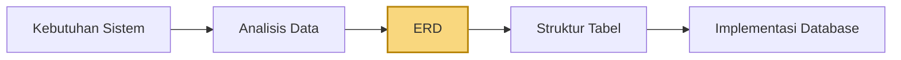
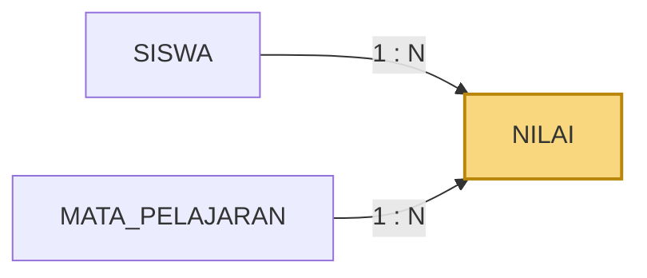
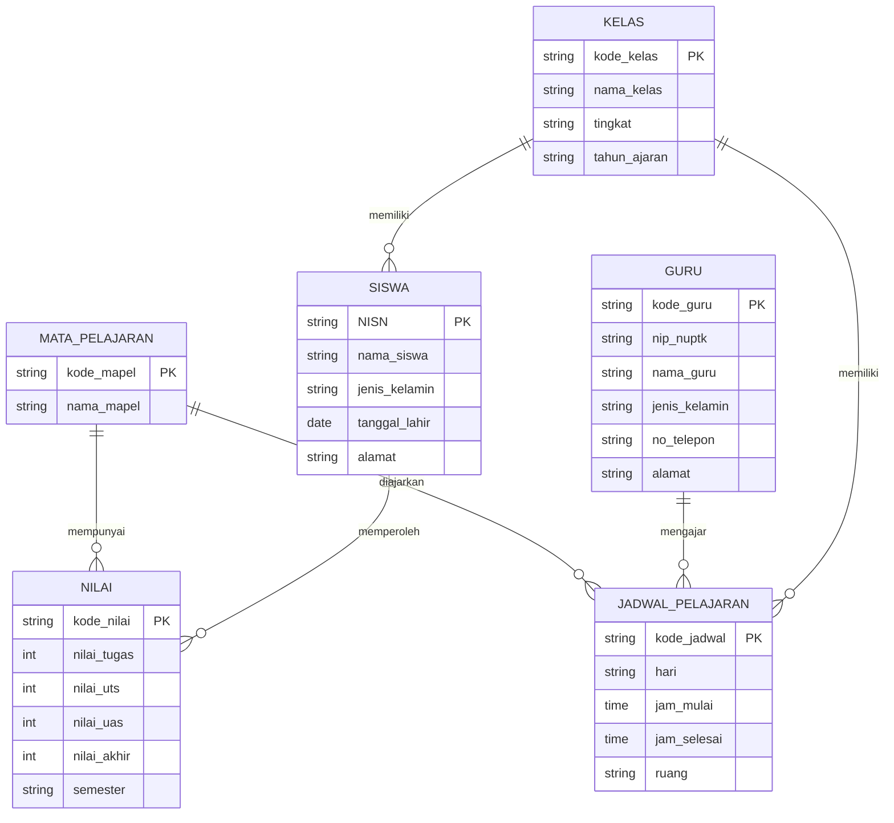

<div align="center">

# 🧩 Teknologi Basis Data
### Modul Praktikum 2 — Perancangan Basis Data Menggunakan Entity Relationship Diagram (ERD)


**Program Studi Teknologi Informasi · UIN Mataram · 2026**

</div>

---

## 📖 Tentang Modul Ini

Sebelum membuat tabel dengan SQL, sebuah database perlu **dirancang** terlebih dahulu: data apa yang disimpan, objek apa saja yang terlibat, dan bagaimana objek-objek itu saling berhubungan.

Di modul ini kita belajar membuat **ERD (Entity Relationship Diagram)**, yaitu model visual untuk menggambarkan struktur data. Berbeda dari Modul 1, **modul ini tidak berisi perintah SQL**. Hasil akhirnya berupa diagram, yang nantinya menjadi dasar pembuatan tabel di Modul 3.

| Bagian | Studi kasus | Bentuk |
|---|---|---|
| Praktikum terbimbing | Sistem Informasi Akademik **SMA** | Mengikuti contoh |
| Tugas lanjutan | Sistem Informasi Akademik **Kampus** | Dikerjakan mandiri |



> [!NOTE]
> Modul 2 berhenti di tahap **ERD** (kotak kuning). Struktur tabel dan implementasi SQL dikerjakan di Modul 3.

---

## 📑 Daftar Isi

- [1. Komponen ERD](#1-komponen-erd)
- [2. Jenis-jenis Atribut](#2-jenis-jenis-atribut)
- [3. Jenis Relationship](#3-jenis-relationship)
- [4. Kardinalitas](#4-kardinalitas)
- [5. Menyelesaikan Many-to-Many](#5-menyelesaikan-many-to-many)
- [6. Langkah Membuat ERD](#6-langkah-membuat-erd)
- [7. Studi Kasus: SIAKAD SMA](#7-studi-kasus-siakad-sma)
- [8. Praktik dengan draw.io](#8-praktik-dengan-drawio)
- [9. Tugas: SIAKAD Kampus](#9-tugas-siakad-kampus)
- [Catatan dan Koreksi Kecil](#catatan-dan-koreksi-kecil)
- [Referensi](#referensi)

---

## 1. Komponen ERD

ERD tersusun dari lima komponen utama:

| Komponen | Arti | Simbol (notasi Chen) | Contoh |
|---|---|:-:|---|
| **Entity** | Objek atau konsep yang datanya perlu disimpan | Persegi panjang ▭ | `SISWA`, `GURU` |
| **Attribute** | Karakteristik yang menjelaskan entitas | Oval ⬭ | `nama_siswa`, `alamat` |
| **Identifier / Key** | Atribut pembeda satu data dengan data lain | Oval dengan **garis bawah** | <ins>NISN</ins> |
| **Relationship** | Hubungan antar entitas | Belah ketupat ◇ | `memiliki`, `mengajar` |
| **Cardinality** | Jumlah keterlibatan entitas dalam hubungan | Angka `1` dan `N` pada garis | `1 : N` |

### Kapan sebuah benda layak jadi entitas?

Tidak semua kata benda otomatis menjadi entitas. Suatu objek layak menjadi entitas jika:

- ✅ informasinya **perlu disimpan**,
- ✅ **mempunyai atribut**,
- ✅ **dapat dibedakan** dari objek lain,
- ✅ **berperan** dalam proses sistem.

> [!TIP]
> Cara cepat mencari kandidat entitas: baca deskripsi kebutuhan sistem, lalu **tandai kata benda utamanya**. Setelah itu saring dengan empat syarat di atas.

### Entitas nyata vs konseptual

| Jenis | Contoh |
|---|---|
| Objek nyata | buku, mahasiswa, dosen, barang, kendaraan |
| Objek konseptual | mata kuliah, transaksi, nilai |

---

## 2. Jenis-jenis Atribut

| Jenis | Penjelasan | Contoh |
|---|---|---|
| **Simple** | Satu komponen, tidak bisa dibagi lagi | `jenis_kelamin`, `nama_siswa` |
| **Composite** | Bisa dibagi menjadi bagian yang lebih kecil | `alamat` → jalan, kota, kode pos |
| **Single-valued** | Hanya boleh berisi satu nilai | `nama` pelanggan |
| **Multi-valued** | Boleh berisi lebih dari satu nilai | `no_telepon` pelanggan |
| **Derived** (turunan) | Nilainya dihitung dari atribut lain | `masa_studi` = tanggal lulus − tanggal daftar |
| **Primary Key (PK)** | Mengidentifikasi entitas secara unik | `NIM`, `No. KTP`, `NPWP` |

> [!NOTE]
> Pada tahap ERD, **belum perlu menentukan tipe data** seperti `VARCHAR`, `INT`, atau `DATE`. Itu dibahas di Modul 3.

---

## 3. Jenis Relationship

Relationship umumnya diberi nama dengan **kata kerja**: memiliki, mengikuti, mengajar, menerima, terdaftar, dijadwalkan.

```
KELAS ──── memiliki ──── SISWA
GURU  ──── mengajar ──── JADWAL_PELAJARAN
```

| Jenis | Jumlah entitas | Keterangan |
|---|:-:|---|
| **Binary** (biner) | 2 | Paling umum dalam basis data |
| **Ternary** (ternier) | 3 | Jarang terjadi, tiga entitas ikut dalam satu relasi |
| **N-ary** | 3 atau lebih | Satu relasi menghubungkan banyak entitas sekaligus |

---

## 4. Kardinalitas

Kardinalitas menunjukkan **berapa banyak** data di satu entitas yang berhubungan dengan data di entitas lain.

| Jenis | Notasi | Arti | Contoh |
|---|:-:|---|---|
| **One-to-One** | 1 : 1 | Satu data A ↔ satu data B | Dosen mengepalai Jurusan |
| **One-to-Many** | 1 : N | Satu data A ↔ banyak data B | Dosen mengajar banyak Mata Kuliah |
| **Many-to-Many** | M : N | Banyak data A ↔ banyak data B | Mahasiswa mempelajari banyak Mata Kuliah |

### Simbol Crow's Foot

Untuk tugas, modul mewajibkan **Crow's Foot Notation**. Simbol di ujung garis menunjukkan jumlah minimum dan maksimum:

| Simbol Mermaid | Gambar ujung garis | Arti |
|:-:|:-:|---|
| `\|\|` | ┼┼ | Tepat satu |
| `o\|` | ○┼ | Nol atau satu |
| `}\|` | ┼< | Satu atau banyak |
| `}o` | ○< | Nol atau banyak |

---

## 5. Menyelesaikan Many-to-Many

Hubungan **M : N tidak dipakai langsung** pada rancangan relasional akhir. Hubungan ini diselesaikan dengan **entitas penghubung**.

**Contoh:** `SISWA M ──── N MATA_PELAJARAN`

Nilai seorang siswa tidak melekat pada `SISWA` saja, dan tidak melekat pada `MATA_PELAJARAN` saja. Nilai **muncul karena** seorang siswa mengikuti mata pelajaran tertentu. Karena itu dibuat entitas penghubung `NILAI`:



Entitas penghubung ini juga bisa menyimpan informasi tambahan: nilai tugas, nilai tengah semester, nilai akhir semester, dan nilai akhir.

---

## 6. Langkah Membuat ERD

Urutan kerja yang disarankan modul:

| Langkah | Kegiatan |
|:-:|---|
| 1️⃣ | Identifikasi dan tetapkan semua **entitas** |
| 2️⃣ | Tentukan **atribut** tiap entitas |
| 3️⃣ | Tentukan **key** (identifier) tiap entitas |
| 4️⃣ | Identifikasi dan tetapkan **relasi** antar entitas |
| 5️⃣ | Tentukan **kardinalitas** setiap relasi |
| 6️⃣ | Lengkapi entitas dan relasi dengan **atribut deskriptif** |

> [!IMPORTANT]
> **Jangan langsung menggambar.** Baca studi kasus dulu, analisis datanya di atas kertas atau catatan, baru gambar diagramnya.

---

## 7. Studi Kasus: SIAKAD SMA

> SMA Harapan Bangsa mempunyai sejumlah siswa dan guru. Setiap siswa ditempatkan pada sebuah kelas. Sekolah memiliki beberapa mata pelajaran. Proses pembelajaran diatur melalui jadwal pelajaran yang menentukan kelas, mata pelajaran, guru, hari, serta waktu pembelajaran. Seorang guru dapat mengajar beberapa jadwal pelajaran. Satu kelas memiliki beberapa jadwal pelajaran. Setelah mengikuti kegiatan pembelajaran, siswa memperoleh nilai untuk mata pelajaran yang diikutinya.

### 7.1 Entitas

Ada **6 entitas** utama:

| No | Entitas | Fungsi |
|:-:|---|---|
| 1 | `SISWA` | Menyimpan data siswa |
| 2 | `GURU` | Menyimpan data guru |
| 3 | `KELAS` | Menyimpan data kelas |
| 4 | `MATA_PELAJARAN` | Menyimpan data mata pelajaran |
| 5 | `JADWAL_PELAJARAN` | Menyimpan kegiatan pembelajaran |
| 6 | `NILAI` | Menyimpan hasil belajar siswa |

### 7.2 Atribut dan Identifier

| Entitas | Atribut | Primary Key |
|---|---|:-:|
| `SISWA` | **NISN**, nama_siswa, jenis_kelamin, tanggal_lahir, alamat | `NISN` |
| `GURU` | **kode_guru**, nip_nuptk, nama_guru, jenis_kelamin, no_telepon, alamat | `kode_guru` |
| `KELAS` | **kode_kelas**, nama_kelas, tingkat, tahun_ajaran | `kode_kelas` |
| `MATA_PELAJARAN` | **kode_mapel**, nama_mapel | `kode_mapel` |
| `JADWAL_PELAJARAN` | **kode_jadwal**, hari, jam_mulai, jam_selesai, ruang | `kode_jadwal` |
| `NILAI` | **kode_nilai**\*, nilai_tugas, nilai_uts, nilai_uas, nilai_akhir, semester | `kode_nilai`\* |

\* *Lihat [Catatan dan Koreksi Kecil](#catatan-dan-koreksi-kecil) mengenai identifier `NILAI`.*

### 7.3 Relationship dan Kardinalitas

| No | Relationship | Entitas | Kardinalitas | Penjelasan |
|:-:|---|---|:-:|---|
| 1 | **memiliki** | `KELAS` — `SISWA` | 1 : N | Satu kelas punya banyak siswa; seorang siswa berada di satu kelas pada periode tertentu |
| 2 | **memiliki** | `KELAS` — `JADWAL_PELAJARAN` | 1 : N | Satu kelas punya banyak jadwal; satu jadwal berlaku untuk satu kelas |
| 3 | **mengajar** | `GURU` — `JADWAL_PELAJARAN` | 1 : N | Satu guru bisa muncul di banyak jadwal; satu jadwal diampu satu guru |
| 4 | **diajarkan** | `MATA_PELAJARAN` — `JADWAL_PELAJARAN` | 1 : N | Satu mapel ada di banyak jadwal; satu jadwal mewakili satu mapel |
| 5 | **memperoleh** | `SISWA` — `NILAI` | 1 : N | Satu siswa punya banyak data nilai; satu data nilai milik satu siswa |
| 6 | **mempunyai** | `MATA_PELAJARAN` — `NILAI` | 1 : N | Satu mapel punya nilai dari banyak siswa |

### 7.4 Hasil ERD (Crow's Foot)

Diagram di bawah ini dirender langsung oleh GitHub dari kode Mermaid.



> [!NOTE]
> Sintaks Mermaid **mewajibkan** adanya tipe di setiap atribut (`string`, `int`, `date`, `time`). Tipe di atas hanyalah pengisi agar diagram bisa tampil, **bukan** keputusan tipe data. Tipe data yang sebenarnya dibahas di Modul 3.
>
> Simbol `||--o{` dibaca: satu di sisi kiri, nol atau banyak di sisi kanan.

---

## 8. Praktik dengan draw.io

### 8.1 Menyiapkan lembar kerja

| Langkah | Yang dilakukan |
|:-:|---|
| 1 | Buka browser (Chrome, Firefox, atau Edge) |
| 2 | Akses **https://app.diagrams.net** |
| 3 | Jika muncul pilihan lokasi simpan, pilih **Device** agar file tersimpan di komputer |
| 4 | Pilih **Create New Diagram** (atau **File → New** jika editor sudah terbuka) |
| 5 | Pilih template **Entity Relationship Diagram**, lalu klik **Create** |
| 6 | Klik **Save**, beri nama misalnya `ERD Siakad SMA.drawio`, lokasi **Device** |

### 8.2 Mengenal area kerja

| Area | Letak | Fungsi |
|---|---|---|
| **Canvas** | Tengah | Tempat menggambar ERD |
| **Shape tools** | Kiri | Kumpulan bentuk yang bisa dipakai |
| **Toolbar** | Atas | Mengatur font, garis, posisi, zoom, warna, dan lainnya |
| **Format panel** | Kanan | Mengatur style, text, arrange, connector, arrow |

### 8.3 Mengaktifkan library Entity Relation

Secara default bentuk ERD mungkin belum tampil di panel kiri:

1. Scroll panel kiri sampai bawah, klik **More Shapes...**
2. Cari kategori **Software**
3. Centang **Entity Relation**
4. Klik **Apply**

Kelompok baru bernama **Entity Relation** akan muncul di panel kiri.

### 8.4 Urutan menggambar

| Tahap | Bentuk yang dipakai | Cara |
|:-:|---|---|
| 1. Entitas | Bentuk tabel/entity | Drag ke canvas, klik dua kali pada nama untuk mengganti |
| 2. Tata letak | — | Atur posisi supaya rapi (lihat tips di bawah) |
| 3. Atribut | Bentuk attribute | Drag ke canvas, klik dua kali untuk mengganti nama |
| 4. Hubungkan atribut | Connector / untitled relation | Sambungkan tiap atribut ke entitasnya |
| 5. Relationship | Bentuk relationship | Drag, beri nama kata kerja, letakkan di antara dua entitas |
| 6. Kardinalitas | Label `1` dan `N` | Tambahkan pada garis setiap relationship |

**Usulan tata letak entitas SMA:**

```
                    ┌──────────┐
                    │   GURU   │
                    └──────────┘

┌─────────┐   ┌──────────────────┐   ┌────────────────┐
│  KELAS  │   │ JADWAL_PELAJARAN │   │ MATA_PELAJARAN │
└─────────┘   └──────────────────┘   └────────────────┘

┌─────────┐
│  SISWA  │
└─────────┘

┌─────────┐
│  NILAI  │
└─────────┘
```

**Tips agar ERD mudah dibaca:**

- ✅ Connector tidak terlalu banyak berpotongan
- ✅ Jarak antar entitas cukup
- ✅ Nama entitas mudah dibaca
- ✅ Hubungan antar entitas terlihat jelas

> [!TIP]
> Untuk tugas yang mewajibkan **Crow's Foot**, ujung garis connector bisa diganti lewat **Format panel → tab Arrow** (pilih gaya ujung garis bertipe ER).

---

## 9. Tugas: SIAKAD Kampus

Setelah praktikum terbimbing, kerjakan sendiri **ERD Sistem Informasi Akademik Kampus** menggunakan draw.io.

### 9.1 Ringkasan studi kasus

Sebuah perguruan tinggi memiliki beberapa program studi. Setiap prodi punya banyak mahasiswa dan dosen, sedangkan seorang mahasiswa terdaftar pada satu prodi. Setiap prodi menawarkan sejumlah mata kuliah (kode, nama, jumlah SKS). Dalam satu semester, sebuah mata kuliah dapat dibuka dalam satu atau beberapa kelas kuliah, dan setiap kelas kuliah diampu satu dosen. Mahasiswa mengambil mata kuliah lewat **KRS**: satu mahasiswa dapat mengambil banyak kelas kuliah, dan satu kelas kuliah diikuti banyak mahasiswa. Dosen kemudian memberi **nilai** (angka dan huruf) kepada mahasiswa pada kelas kuliah yang diikuti.

### 9.2 Yang harus ditentukan sendiri

1. Entitas yang diperlukan
2. Atribut tiap entitas
3. Identifier tiap entitas
4. Relationship antar entitas
5. Kardinalitas setiap relationship

Boleh menambah entitas atau atribut lain, **asalkan bisa dijelaskan alasannya** berdasarkan kebutuhan sistem.

### 9.3 Ketentuan pengerjaan

- [ ] Dibuat dengan **draw.io**
- [ ] Nama entitas ditulis **konsisten**
- [ ] Setiap entitas punya **atribut yang relevan**
- [ ] Setiap entitas punya **identifier yang jelas**
- [ ] Seluruh relationship **diberi kardinalitas**
- [ ] Hubungan **many-to-many dianalisis dan diselesaikan**
- [ ] Menggunakan **Crow's Foot Notation**
- [ ] Diagram **rapi** dan mudah dibaca
- [ ] Tidak ada connector yang **berpotongan berlebihan**

### 9.4 Hasil pengerjaan

<!--
Setelah ERD selesai, ekspor dari draw.io (File → Export as → PNG), simpan ke folder images/,
lalu hapus tanda komentar pada baris di bawah ini:


-->

*Tambahkan gambar ERD hasil pengerjaan di sini.*

---

## Catatan dan Koreksi Kecil

Beberapa hal pada modul asli yang perlu diperhatikan dan sudah disesuaikan di README ini:

| Bagian modul | Catatan |
|---|---|
| Tabel atribut `JADWAL_PELAJARAN` | Tertulis `jam_selesai_ruang`. Seharusnya dua atribut terpisah: `jam_selesai` dan `ruang`. |
| Primary key `NILAI` | Modul menulis `nilai_tugas` sebagai PK. Itu kurang tepat karena nilai tugas bisa sama antar baris. `NILAI` butuh identifier sendiri, maka di sini ditambahkan `kode_nilai` (usulan, tidak ada di modul). |
| Atribut `GURU` | Tabel modul memuat `nip_nuptk`, tetapi gambar ERD tidak. README ini mengikuti tabel. |
| `nilai_akhir` | Nilainya bisa dihitung dari nilai tugas, UTS, dan UAS, jadi sebenarnya termasuk **atribut turunan**. README tetap mengikuti modul dan menyimpannya sebagai atribut biasa. |
| Notasi gambar | Contoh terbimbing di modul memakai gaya Chen (belah ketupat, label `1` dan `N`), sedangkan tugas mewajibkan **Crow's Foot**. Diagram Mermaid di atas sudah memakai Crow's Foot. |

---

## Referensi

- Modul Praktikum 2 *Teknologi Basis Data* — Muti'ah, M.Pd, Program Studi Teknologi Informasi, UIN Mataram, 2026.
- [draw.io / diagrams.net](https://app.diagrams.net)
- [Mermaid: Entity Relationship Diagram](https://mermaid.js.org/syntax/entityRelationshipDiagram.html)

---

<div align="center">

[⬅️ Modul 1: Pengenalan Basis Data dan DBMS](../Modul-1/README.md)

Dibuat untuk keperluan belajar oleh [@akramjunaidi](https://github.com/akramjunaidi)

⭐ Kalau bermanfaat, jangan lupa beri bintang!

</div>
