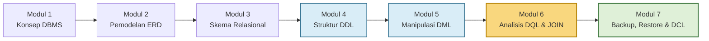
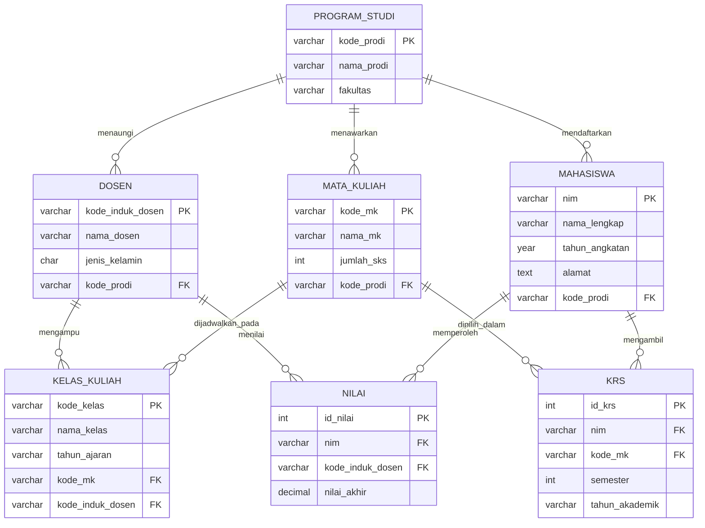

<div align="center">

# 🗄️ Praktikum Teknologi Basis Data
### Dokumentasi Lengkap Perancangan, Implementasi, Analisis, dan Administrasi Sistem Basis Data Akademik (`db_akademikkampus`)


-orange?style=for-the-badge)


**Akram Junaidi (`2503060033`)** · Program Studi Teknologi Informasi · Fakultas Dakwah dan Ilmu Komunikasi  
**Universitas Islam Negeri (UIN) Mataram** · Dosen Pengampu: **Muti'ah, M.Pd.** · Tahun Akademik 2026

</div>

---

## 📖 Tentang Repository

Repository ini memuat seluruh dokumentasi resmi, rancangan konseptual, skrip SQL, studi kasus, dan evaluasi praktikum mata kuliah **Teknologi Basis Data** dari **Modul 1 hingga Modul 7**. Seluruh rangkaian modul disusun secara berkesinambungan—dimulai dari pengenalan arsitektur DBMS, pemodelan *Entity Relationship Diagram* (ERD), transformasi ke skema relasional, implementasi fisik struktur tabel menggunakan DDL, pengisian dan manipulasi data menggunakan DML, analisis data multi-tabel menggunakan DQL & `JOIN`, hingga pencadangan (*backup*), pemulihan (*restore*), dan pengelolaan keamanan hak akses (*least privilege* DCL).



> [!TIP]
> Klik langsung judul masing-masing modul pada tabel navigasi di bawah untuk membuka dokumentasi lengkap beserta *cheat sheet* sintaks, diagram alur, kueri SQL siap pakai, dan catatan refleksi teknis.

---

## 📑 Daftar Isi

- [1. Peta & Navigasi Lengkap Modul Praktikum (Modul 1–7)](#1-peta--navigasi-lengkap-modul-praktikum-modul-17)
- [2. Arsitektur Basis Data Studi Kasus (`db_akademikkampus`)](#2-arsitektur-basis-data-studi-kasus-db_akademikkampus)
- [3. Struktur Direktori Repository](#3-struktur-direktori-repository)
- [4. Teknologi & Perangkat Lunak](#4-teknologi--perangkat-lunak)
- [5. Panduan Replikasi Database Secara Lokal](#5-panduan-replikasi-database-secara-lokal)

---

## 1. Peta & Navigasi Lengkap Modul Praktikum (Modul 1–7)

| Modul | Judul & Dokumentasi | Fokus Materi & Perintah Kunci | Keluaran / Studi Kasus Utama | Status |
| :---: | --- | --- | --- | :---: |
| **Modul 1** | [**Pengenalan Sistem Basis Data dan DBMS**](./Modul-1/README.md) | Arsitektur DBMS, hierarki data, lingkungan server lokal XAMPP & phpMyAdmin | Eksplorasi & pembuatan database awal pada MariaDB/MySQL | ✅ Selesai |
| **Modul 2** | [**Perancangan Basis Data Menggunakan ERD**](./Modul-2/README.md) | Entitas, atribut (kunci, komposit, multinilai), kardinalitas, dan notasi *Crow's Foot* | Rancangan ERD konseptual Sistem Informasi Akademik SMA & Kampus | ✅ Selesai |
| **Modul 3** | [**Transformasi ERD menjadi Skema Relasional**](./Modul-3/README.md) | Pemetaan entitas kuat/lemah, relasi `1:N` & `M:N`, *Primary Key* (`PK`) & *Foreign Key* (`FK`) | Rancangan 7 tabel relasional ternormalisasi untuk sistem akademik kampus | ✅ Selesai |
| **Modul 4** | [**Implementasi Struktur Basis Data Menggunakan DDL**](./Modul-4/README.md) | `CREATE DATABASE`, `CREATE TABLE`, tipe data, `PRIMARY KEY`, `FOREIGN KEY`, `UNIQUE`, `CHECK`, `ALTER`, `DROP` | Skema fisik **`db_akademikkampus`** (7 tabel berelasi dengan integritas referensial) | ✅ Selesai |
| **Modul 5** | [**Manipulasi Data Menggunakan DML**](./Modul-5/README.md) | `INSERT INTO` (urutan dependensi FK), `UPDATE ... WHERE`, `DELETE ... WHERE`, serta proteksi referensial | Pengisian lengkap **117 baris data valid** pada seluruh 7 tabel kampus | ✅ Selesai |
| **Modul 6** | [**Analisis Data Akademik Menggunakan DQL, Agregasi, dan JOIN**](./Modul-6/README.md) | `SELECT`, `WHERE`, `LIKE`, `IN`, `BETWEEN`, `ORDER BY`, `LIMIT`, `GROUP BY`, `HAVING`, `INNER JOIN` (2 & 3 tabel), `LEFT JOIN` | **16 skenario kueri analisis akademik** (peringkat nilai, rekap prodi, KRS, audit prodi kosong) | ✅ Selesai |
| **Modul 7** | [**Backup, Restore, dan Pengelolaan Hak Akses Basis Data (DCL)**](./Modul-7/README.md) | Ekspor/Impor SQL, database uji terisolasi, `CREATE USER`, `GRANT SELECT`, `SHOW GRANTS`, `REVOKE`, `DROP USER` | Berkas cadangan **`backup_kampus_2503060033.sql`**, uji restore **`db_akademikkampus_test`**, & akun **`'petugas_baca'@'localhost'`** | ✅ Selesai |

---

## 2. Arsitektur Basis Data Studi Kasus (`db_akademikkampus`)

Seluruh implementasi dari **Modul 4 hingga Modul 7** berpusat pada basis data relasional **`db_akademikkampus`** yang terdiri atas **7 tabel saling berelasi** dan **117 rekaman data terverifikasi**.

### Diagram Relasi Antar-Tabel



### Ringkasan Struktur & Jumlah Baris Tabel (`db_akademikkampus`)

| No. | Nama Tabel | Kategori | Kunci Utama (`PK`) | Kunci Tamu (`FK`) | Jumlah Data |
| :---: | --- | --- | --- | --- | :---: |
| 1 | `program_studi` | Master | `kode_prodi` | — | **3 baris** |
| 2 | `dosen` | Master | `kode_induk_dosen` | `kode_prodi` | **15 baris** |
| 3 | `mahasiswa` | Master | `nim` | `kode_prodi` | **24 baris** |
| 4 | `mata_kuliah` | Master | `kode_mk` | `kode_prodi` | **18 baris** |
| 5 | `kelas_kuliah` | Transaksi / Jadwal | `kode_kelas` | `kode_mk`, `kode_induk_dosen` | **15 baris** |
| 6 | `krs` | Transaksi Akademik | `id_krs` | `nim`, `kode_mk` | **24 baris** |
| 7 | `nilai` | Transaksi Evaluasi | `id_nilai` | `nim`, `kode_induk_dosen` | **18 baris** |
| **Total** | **7 Tabel Relasional** | **Master & Transaksi** | **7 Primary Key** | **8 Foreign Key** | **117 baris** |

---

## 3. Struktur Direktori Repository

```text
Teknologi-Basis-Data/
├── README.md                          # Halaman utama & navigasi pusat seluruh praktikum
├── Modul-1/
│   └── README.md                      # Modul 1: Pengenalan Sistem Basis Data dan DBMS
├── Modul-2/
│   └── README.md                      # Modul 2: Perancangan Basis Data Menggunakan ERD
├── Modul-3/
│   └── README.md                      # Modul 3: Transformasi ERD menjadi Skema Relasional
├── Modul-4/
│   └── README.md                      # Modul 4: Implementasi Struktur Basis Data Menggunakan DDL
├── Modul-5/
│   └── README.md                      # Modul 5: Manipulasi Data Menggunakan DML
├── Modul-6/
│   └── README.md                      # Modul 6: Analisis Data Menggunakan DQL, Agregasi & JOIN
└── Modul-7/
    ├── README.md                      # Modul 7: Backup, Restore, dan Pengelolaan Hak Akses (DCL)
    └── backup_kampus_2503060033.sql   # Berkas cadangan penuh struktur & data db_akademikkampus
```

---

## 4. Teknologi & Perangkat Lunak

| Komponen | Teknologi / Perangkat | Peran dalam Praktikum |
| --- | --- | --- |
| **DBMS Engine** | MySQL / MariaDB (via XAMPP) | Mesin pemrosesan basis data relasional dan eksekusi kueri SQL |
| **Administrasi Web** | phpMyAdmin | Antarmuka visual manajemen tabel, relasi, ekspor, dan impor SQL |
| **Pemodelan Diagram** | draw.io (diagrams.net) | Perancangan ERD notasi *Crow's Foot* dan diagram skema relasional |
| **Code & SQL Editor** | Visual Studio Code | Penyuntingan skrip SQL, inspeksi berkas cadangan `.sql`, dan Markdown |
| **Version Control** | Git & GitHub | Pengelolaan repositori, dokumentasi teknis, dan publikasi portofolio |

---

## 5. Panduan Replikasi Database Secara Lokal

Untuk memulihkan dan menguji basis data **`db_akademikkampus`** di komputer lokal Anda:

1. **Kloning Repository**
   ```bash
   git clone [https://github.com/akramjunaidi/Teknologi-Basis-Data.git](https://github.com/akramjunaidi/Teknologi-Basis-Data.git)
   cd Teknologi-Basis-Data
   ```
2. **Jalankan Layanan Server Lokal**
   Aktifkan modul **Apache** dan **MySQL** melalui **XAMPP Control Panel**, lalu buka `http://localhost/phpmyadmin`.
3. **Buat Database & Impor Cadangan**
   - Buat basis data baru bernama `db_akademikkampus` (atau `db_akademikkampus_test` untuk pengujian).
   - Buka tab **Import**, pilih berkas `Modul-7/backup_kampus_2503060033.sql`, lalu klik **Import** (40 kueri SQL akan dieksekusi untuk membangun seluruh 7 tabel beserta 117 baris data).
4. **Jalankan Kueri Analisis atau Pengujian Hak Akses**
   Gunakan kumpulan kueri pada [**Modul 6**](./Modul-6/README.md) untuk eksplorasi DQL & `JOIN`, atau ikuti langkah DCL pada [**Modul 7**](./Modul-7/README.md) untuk pengujian keamanan pengguna.

---

<div align="center">

### Navigasi Cepat Modul
[Modul 1](./Modul-1/README.md) · [Modul 2](./Modul-2/README.md) · [Modul 3](./Modul-3/README.md) · [Modul 4](./Modul-4/README.md) · [Modul 5](./Modul-5/README.md) · [Modul 6](./Modul-6/README.md) · [Modul 7](./Modul-7/README.md)

---

Disusun dan didokumentasikan oleh **Akram Junaidi** ([@akramjunaidi](https://github.com/akramjunaidi))  
Program Studi Teknologi Informasi · Fakultas Dakwah dan Ilmu Komunikasi · UIN Mataram · 2026

</div>
