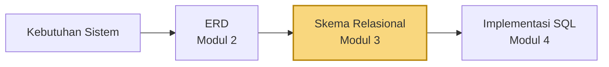
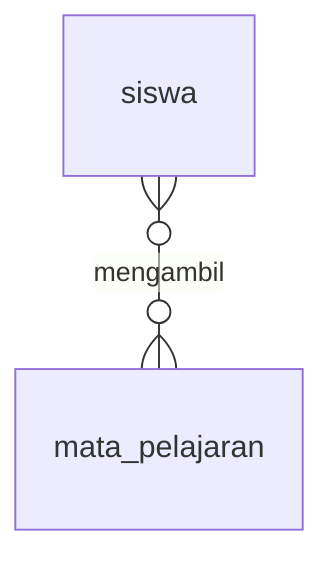
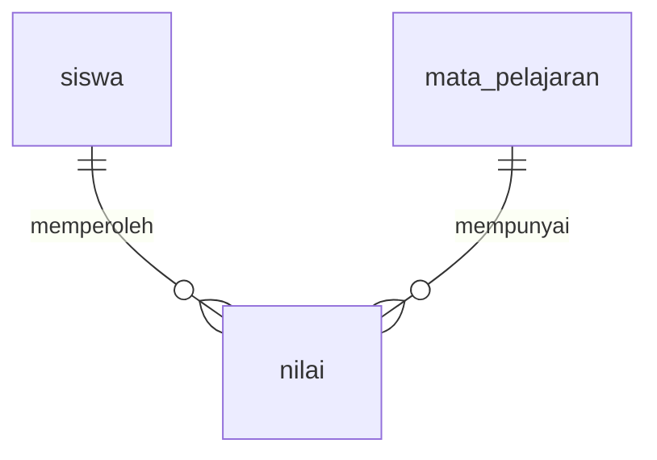
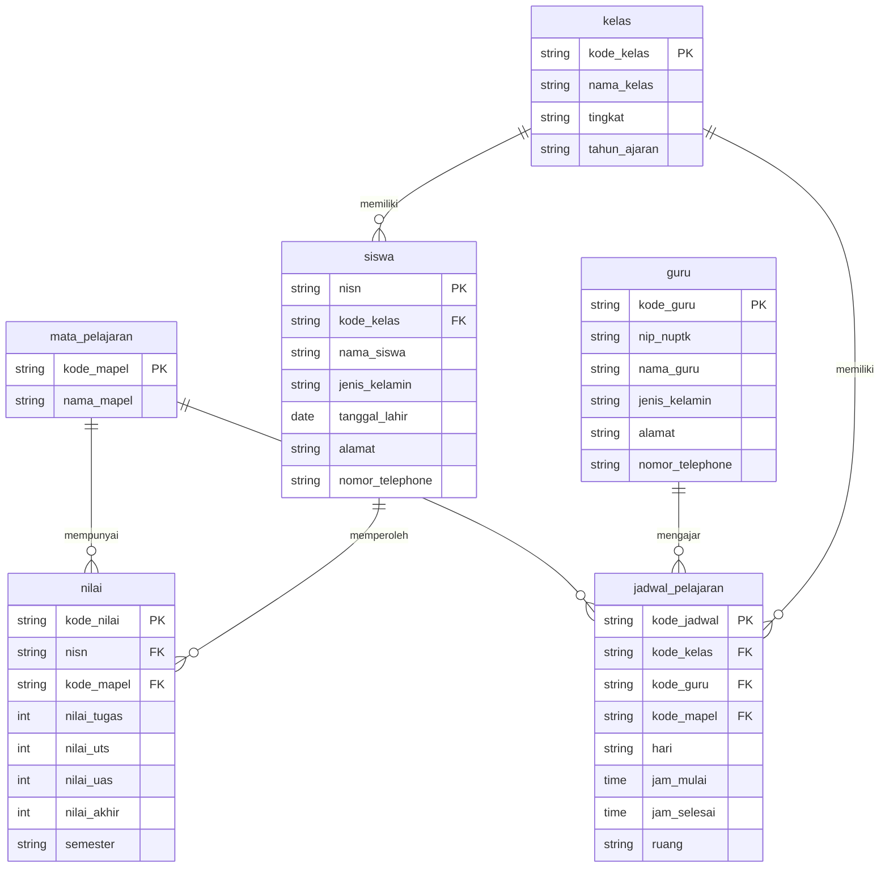

<div align="center">

# 🔗 Teknologi Basis Data
### Modul Praktikum 3 — Transformasi ERD menjadi Skema Relasional


**Program Studi Teknologi Informasi · UIN Mataram · 2026**

</div>

---

## 📖 Tentang Modul Ini

Di Modul 2 kita sudah punya ERD. Di modul ini ERD tersebut **diterjemahkan menjadi skema relasional**: entitas menjadi **tabel**, identifier menjadi **Primary Key (PK)**, dan relationship menjadi **Foreign Key (FK)**.

Hasil akhirnya berupa diagram skema relasional di draw.io yang menampilkan nama tabel, atribut, PK, FK, dan hubungan antar-tabel. **Belum ada SQL** di modul ini. Perintah seperti `CREATE TABLE` baru dipakai di Modul 4.



> [!NOTE]
> Studi kasusnya sama dengan Modul 2: **SIAKAD SMA Harapan Bangsa**. Kita tidak membuat ERD dari awal, tetapi memakai ERD Modul 2 untuk menentukan tabel, PK, FK, dan hubungan antar-tabel.

---

## 📑 Daftar Isi

- [1. Dari ERD ke Skema Relasional](#1-dari-erd-ke-skema-relasional)
- [2. Primary Key dan Foreign Key](#2-primary-key-dan-foreign-key)
- [3. Aturan Transformasi](#3-aturan-transformasi)
- [4. Notasi Crow's Foot](#4-notasi-crows-foot)
- [5. Studi Kasus: Transformasi SIAKAD SMA](#5-studi-kasus-transformasi-siakad-sma)
- [6. Praktik dengan draw.io](#6-praktik-dengan-drawio)
- [7. Tugas: Transformasi ERD SIAKAD Kampus](#7-tugas-transformasi-erd-siakad-kampus)
- [Catatan dan Koreksi Kecil](#catatan-dan-koreksi-kecil)
- [Referensi](#referensi)

---

## 1. Dari ERD ke Skema Relasional

Skema relasional adalah rancangan basis data berbentuk **tabel-tabel yang saling berhubungan**. Setiap konsep di ERD punya padanan di skema relasional:

| ERD (Modul 2) | | Skema Relasional (Modul 3) |
|---|:-:|---|
| Entitas | → | **Tabel** |
| Atribut | → | **Field / Kolom** |
| Identifier | → | **Primary Key** |
| Relationship | → | **Hubungan PK–FK** |
| Kardinalitas | → | **Penentu lokasi FK** |

### Contoh: entitas `SISWA` menjadi tabel `siswa`

| Key | Kolom pada tabel `siswa` |
|:-:|---|
| **PK** | `nisn` |
| | `nama_siswa` |
| | `jenis_kelamin` |
| | `tanggal_lahir` |
| | `alamat` |

Setiap atribut menjadi kolom, dan atribut yang tadinya identifier (bergaris bawah di ERD) menjadi PK.

---

## 2. Primary Key dan Foreign Key

**Primary Key (PK)** adalah atribut yang membedakan satu record dengan record lain secara unik. Pada contoh di atas, `nisn` adalah PK, jadi tidak ada dua siswa dengan NISN yang sama.

**Foreign Key (FK)** adalah atribut di suatu tabel yang **mengacu ke PK tabel lain**.

| Tabel `kelas` | | Tabel `siswa` | |
|:-:|---|:-:|---|
| **PK** | `kode_kelas` | **PK** | `nisn` |
| | `nama_kelas` | **FK** | `kode_kelas` |
| | | | `nama_siswa` |
| | | | `alamat` |

Kolom `kode_kelas` di `siswa` adalah FK yang mengacu ke PK `kode_kelas` di tabel `kelas`.

### Perbedaan PK dan FK

| Primary Key | Foreign Key |
|---|---|
| Menjadi identitas utama tabel | Menghubungkan dengan tabel lain |
| Nilainya **unik** | Nilainya **boleh berulang** |
| Berasal dari **identifier** | Berasal dari **relationship** |
| Menjadi sumber referensi | Mengacu ke PK tabel lain |

### Mengapa pakai FK, bukan menyalin data?

Informasi yang sama tidak perlu disimpan berulang kalau bisa diperoleh lewat hubungan antar-tabel.

| ❌ Disalin (redundan) | ✅ Pakai FK |
|---|---|
| Tabel `siswa` menyimpan `nama_kelas` di setiap baris siswa. Kalau nama kelas berubah, puluhan baris harus diubah. | Tabel `siswa` hanya menyimpan `kode_kelas`. Nama kelas cukup diubah di satu baris tabel `kelas`. |

---

## 3. Aturan Transformasi

### 3.1 Hubungan One-to-Many (1 : N)

> **Primary Key dari tabel di sisi 1 ditempatkan sebagai Foreign Key pada tabel di sisi N.**

Contoh `KELAS 1 ──── N SISWA`: satu kelas punya banyak siswa, seorang siswa berada pada satu kelas.

| Langkah | Hasil |
|:-:|---|
| 1 | Tentukan sisi 1 = `kelas`, sisi N = `siswa` |
| 2 | PK sisi 1 = `kode_kelas` |
| 3 | Tambahkan `kode_kelas` sebagai **FK** di tabel `siswa` |

> [!TIP]
> Cara cepat menentukan lokasi FK: **FK selalu ada di tabel yang berada di sisi "banyak"**.

### 3.2 Hubungan Many-to-Many (M : N)

Hubungan M : N **tidak bisa diselesaikan dengan satu FK saja**. Contoh: satu siswa mengikuti banyak mata pelajaran, dan satu mata pelajaran diikuti banyak siswa.

Solusinya adalah **tabel penghubung** yang menyimpan FK dari dua tabel yang dihubungkan. Pada kasus SMA, tabel penghubungnya adalah `nilai`:



berubah menjadi:



| Sebelum | Sesudah |
|---|---|
| `siswa` M ──── N `mata_pelajaran` | `siswa` 1 ──── N `nilai` N ──── 1 `mata_pelajaran` |

Tabel `nilai` memegang `nisn` (FK ke `siswa`) dan `kode_mapel` (FK ke `mata_pelajaran`).

---

## 4. Notasi Crow's Foot

Pada skema relasional, tabel digambar sebagai kotak berisi daftar kolom, dan hubungan digambar dengan garis yang ujungnya berbentuk **kaki gagak** (crow's foot). Simbol di ujung garis menggabungkan dua aturan: **kardinalitas** (jumlah maksimum data) dan **opsionalitas** (data wajib atau boleh tidak ada).

| Simbol ujung garis | Nama | Arti |
|:-:|---|---|
| `\|` atau `\|\|` | **One** | Satu |
| `<` (tiga cabang) | **Many** | Banyak data (nol, satu, atau lebih) |
| `o` | **Zero** | Opsional, boleh tidak ada |

Kombinasi hubungan yang dikenal: **one-to-many** (1 ke banyak), **one-to-one** (1 ke 1), dan **many-to-many** (banyak ke banyak).

| Simbol Mermaid | Arti |
|:-:|---|
| `\|\|` | Tepat satu |
| `o\|` | Nol atau satu |
| `}\|` | Satu atau banyak |
| `}o` | Nol atau banyak |

---

## 5. Studi Kasus: Transformasi SIAKAD SMA

> SMA Harapan Bangsa mempunyai sejumlah siswa dan guru. Setiap siswa ditempatkan pada sebuah kelas. Sekolah memiliki beberapa mata pelajaran. Proses pembelajaran diatur melalui jadwal pelajaran yang menentukan kelas, mata pelajaran, guru, hari, serta waktu pembelajaran. Seorang guru dapat mengajar beberapa jadwal pelajaran. Satu kelas memiliki beberapa jadwal pelajaran. Setelah mengikuti kegiatan pembelajaran, siswa memperoleh nilai untuk mata pelajaran yang diikutinya.

### 5.1 Entitas menjadi tabel

Enam entitas dari Modul 2 menjadi enam tabel: `siswa`, `guru`, `kelas`, `mata_pelajaran`, `jadwal_pelajaran`, `nilai`.

### 5.2 Menentukan lokasi Foreign Key

Untuk setiap relationship, tentukan sisi 1 dan sisi N, lalu pindahkan PK sisi 1 menjadi FK di sisi N.

| No | Relationship | Sisi 1 | Sisi N | Kolom FK | Ditempatkan di tabel |
|:-:|---|---|---|---|---|
| 1 | **memiliki** | `kelas` | `siswa` | `kode_kelas` | `siswa` |
| 2 | **memiliki** | `kelas` | `jadwal_pelajaran` | `kode_kelas` | `jadwal_pelajaran` |
| 3 | **mengajar** | `guru` | `jadwal_pelajaran` | `kode_guru` | `jadwal_pelajaran` |
| 4 | **diajarkan** | `mata_pelajaran` | `jadwal_pelajaran` | `kode_mapel` | `jadwal_pelajaran` |
| 5 | **memperoleh** | `siswa` | `nilai` | `nisn` | `nilai` |
| 6 | **mempunyai** | `mata_pelajaran` | `nilai` | `kode_mapel` | `nilai` |

### 5.3 Hasil: struktur seluruh tabel

| Tabel | Primary Key | Foreign Key | Kolom lainnya |
|---|:-:|---|---|
| `kelas` | `kode_kelas` | — | `nama_kelas`, `tingkat`, `tahun_ajaran` |
| `siswa` | `nisn` | `kode_kelas` → `kelas` | `nama_siswa`, `jenis_kelamin`, `tanggal_lahir`, `alamat`, `nomor_telephone` |
| `guru` | `kode_guru` | — | `nip_nuptk`, `nama_guru`, `jenis_kelamin`, `alamat`, `nomor_telephone` |
| `mata_pelajaran` | `kode_mapel` | — | `nama_mapel` |
| `jadwal_pelajaran` | `kode_jadwal` | `kode_kelas` → `kelas`<br>`kode_guru` → `guru`<br>`kode_mapel` → `mata_pelajaran` | `hari`, `jam_mulai`, `jam_selesai`, `ruang` |
| `nilai` | `kode_nilai`\* | `nisn` → `siswa`<br>`kode_mapel` → `mata_pelajaran` | `nilai_tugas`, `nilai_uts`, `nilai_uas`, `nilai_akhir`, `semester` |

\* *Lihat [Catatan dan Koreksi Kecil](#catatan-dan-koreksi-kecil) mengenai PK tabel `nilai`.*

### 5.4 Cara membaca hubungan antar-tabel

| Foreign Key | Mengacu ke | Dibaca sebagai |
|---|---|---|
| `siswa.kode_kelas` | `kelas.kode_kelas` | Setiap siswa berada di satu kelas |
| `jadwal_pelajaran.kode_kelas` | `kelas.kode_kelas` | Setiap jadwal berlaku untuk satu kelas |
| `jadwal_pelajaran.kode_guru` | `guru.kode_guru` | Setiap jadwal diampu oleh satu guru |
| `jadwal_pelajaran.kode_mapel` | `mata_pelajaran.kode_mapel` | Setiap jadwal membahas satu mata pelajaran |
| `nilai.nisn` | `siswa.nisn` | Setiap data nilai milik satu siswa |
| `nilai.kode_mapel` | `mata_pelajaran.kode_mapel` | Setiap data nilai berasal dari satu mata pelajaran |

### 5.5 Diagram skema relasional (Crow's Foot)

Dirender langsung oleh GitHub dari kode Mermaid.



> [!NOTE]
> Sintaks Mermaid mewajibkan tipe di setiap atribut. Tipe di atas (`string`, `int`, `date`, `time`) hanya pengisi agar diagram tampil, **bukan** keputusan tipe data. Tipe data yang sebenarnya ditentukan di Modul 4 bersama `CREATE TABLE`.

---

## 6. Praktik dengan draw.io

### 6.1 Persiapan file

| Langkah | Yang dilakukan |
|:-:|---|
| 1 | Buka **https://app.diagrams.net** |
| 2 | Pilih **Open Existing Diagram**, lalu buka file ERD dari Modul 2 (`ERD_SIAKAD_SMA_NIM.drawio`) |
| 3 | Periksa kembali ERD. Pastikan ada enam entitas: Siswa, Guru, Kelas, Mata_pelajaran, Jadwal_pelajaran, Nilai |
| 4 | Buat dokumen baru: **Blank Diagram**, beri nama `SKEMA_RELASIONAL_SMA_NIM`, simpan sebagai `.drawio` |

> [!IMPORTANT]
> **Jangan menghapus ERD asli.** Skema relasional dibuat di file baru agar ERD Modul 2 tetap tersimpan.

### 6.2 Urutan membuat skema

Kerjakan tabel satu per satu, mulai dari tabel yang tidak punya FK:

| Urutan | Tabel | Yang dikerjakan |
|:-:|---|---|
| 1 | `kelas` | Masukkan atribut sebagai field, ubah identifier `kode_kelas` menjadi **PK** |
| 2 | `siswa` | Masukkan atribut, `nisn` menjadi **PK**, lalu tambahkan `kode_kelas` sebagai **FK** |
| 3 | `guru` | Masukkan atribut, `kode_guru` menjadi **PK** |
| 4 | `mata_pelajaran` | Masukkan atribut, `kode_mapel` menjadi **PK** |
| 5 | `jadwal_pelajaran` | Masukkan atribut, `kode_jadwal` menjadi **PK**, lalu tambahkan FK `kode_kelas`, `kode_guru`, `kode_mapel` |
| 6 | `nilai` | Masukkan atribut, lalu tambahkan FK `nisn` dan `kode_mapel` |

Setelah semua tabel dan FK ada, **hubungkan tabel** dengan garis. Gunakan kardinalitas yang sama dengan ERD Modul 2, yaitu **one-to-many**: ujung "satu" di tabel PK, ujung "banyak" (kaki gagak) di tabel FK.

> [!TIP]
> Ujung garis Crow's Foot bisa diatur lewat **Format panel → tab Arrow**, dengan memilih gaya ujung garis bertipe ER.

### 6.3 Urutan tabel yang disarankan di canvas

```
                 ┌────────┐
                 │  guru  │
                 └────────┘

┌────────┐   ┌──────────────────┐   ┌────────────────┐
│ kelas  │   │ jadwal_pelajaran │   │ mata_pelajaran │
└────────┘   └──────────────────┘   └────────────────┘

┌────────┐
│ siswa  │
└────────┘
                    ┌────────┐
                    │ nilai  │
                    └────────┘
```

Susunan tidak harus persis sama. Usahakan garis tidak banyak berpotongan dan hubungan antar-tabel terlihat jelas.

---

## 7. Tugas: Transformasi ERD SIAKAD Kampus

Gunakan kembali ERD **SIAKAD Kampus** yang dibuat mandiri di Modul 2. Kamu **tidak membuat sistem baru**, tetapi mengubah ERD tersebut menjadi skema relasional dengan prinsip PK, FK, dan hubungan antar-tabel seperti pada praktikum SMA.

### 7.1 Indikator keberhasilan

- [ ] Menggunakan kembali ERD dari Modul 2
- [ ] Seluruh entitas diubah menjadi tabel
- [ ] Setiap tabel punya **Primary Key**
- [ ] **Foreign Key** ditentukan berdasarkan relationship
- [ ] Foreign Key ditempatkan di **tabel yang tepat**
- [ ] PK dan FK **dihubungkan** dengan garis
- [ ] Hubungan one-to-many dijelaskan pada skema relasional
- [ ] Hubungan antar-tabel yang dibuat dapat dijelaskan

### 7.2 Hasil pengerjaan

<!--
Setelah skema selesai, ekspor dari draw.io (File → Export as → PNG), simpan ke folder images/,
lalu hapus tanda komentar pada baris di bawah ini:


-->

*Tambahkan gambar skema relasional hasil pengerjaan di sini.*

---

## Catatan dan Koreksi Kecil

Beberapa hal pada modul asli yang perlu diperhatikan dan sudah disesuaikan di README ini:

| Bagian modul | Catatan |
|---|---|
| Relasi `mata_pelajaran` – `jadwal_pelajaran` | Teks langkah menulis "Sisi 1 = JADWAL_PELAJARAN, Sisi N = MATA_PELAJARAN". Itu terbalik. Menurut Modul 2, **satu mata pelajaran punya banyak jadwal**, jadi sisi 1 = `mata_pelajaran` dan sisi N = `jadwal_pelajaran`. Hasil akhirnya (FK `kode_mapel` di `jadwal_pelajaran`) sudah benar. |
| Tabel `nilai` tidak punya PK | Pada hasil langkah, `nilai` hanya berisi kolom nilai dan FK. Tabel ini perlu PK. README memakai `kode_nilai` (konsisten dengan usulan di Modul 2). Alternatifnya PK gabungan `nisn` + `kode_mapel` + `semester`. Kalau hanya `nisn` + `kode_mapel`, seorang siswa tidak bisa punya nilai untuk mapel yang sama di semester berbeda. |
| Kolom `semester` di `nilai` | Ada di ERD, tetapi terlewat pada langkah pembuatan tabel `nilai`. README menyertakannya. |
| `NIS` dan `NISN` | Contoh teori memakai `NIS`, studi kasus memakai `NISN`, dan satu langkah menulis "masukkan NIS sebagai Foreign Key". README memakai `nisn` secara konsisten, huruf kecil seperti kolom lain. |
| `nomor_telephone` | Modul 2 memakai `no_telepon`, sedangkan skema di sini memakai `nomor_telephone`. Selain itu `siswa` mendapat kolom telepon yang tidak ada di ERD Modul 2. README mengikuti skema modul ini, tetapi sebaiknya pilih satu nama yang konsisten (misalnya `no_telepon`) sebelum masuk Modul 4. |
| Rujukan modul berikutnya | Modul 2 menyebut implementasi tabel di Modul 3, sedangkan Modul 3 menyebut `CREATE TABLE`, tipe data, PK, dan FK baru dibahas di **Modul 4**. |
| Kesimpulan modul | Menyebut "analisis redundansi", padahal isi modul tidak punya bagian khusus itu. README menambahkan penjelasan singkatnya di bagian 2. |

---

## Referensi

- Modul Praktikum 3 *Teknologi Basis Data* — Muti'ah, M.Pd, Program Studi Teknologi Informasi, UIN Mataram, 2026.
- Elmasri, R., & Navathe, S. B. *Fundamentals of Database Systems*. Pearson.
- Connolly, T., & Begg, C. *Database Systems: A Practical Approach to Design, Implementation, and Management*. Pearson.
- [draw.io / diagrams.net](https://app.diagrams.net)
- [Mermaid: Entity Relationship Diagram](https://mermaid.js.org/syntax/entityRelationshipDiagram.html)

---

<div align="center">

[⬅️ Modul 2: Perancangan Basis Data dengan ERD](../Modul-2/README.md)

Dibuat untuk keperluan belajar oleh [@akramjunaidi](https://github.com/akramjunaidi)

⭐ Kalau bermanfaat, jangan lupa beri bintang!

</div>
